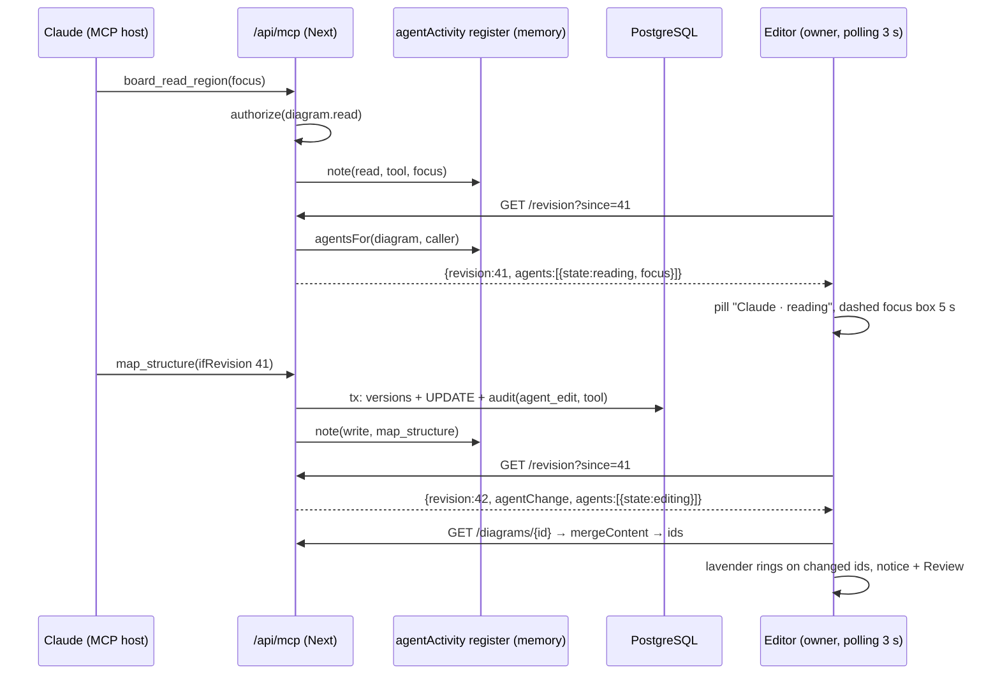
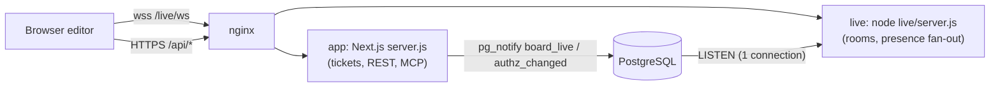

# ADR-0006 — Live activity and presence (Step 1: activity + agent indicator; Step 2: presence + live cursors)

- Status: **Accepted** (2026-10-21). Step 1 is built slice by slice (see §17 As built); Step 2 is not started.
- Builds on: [ADR-0004](0004-realtime-collaboration.md) (Group D direction: Yjs + Hocuspocus sidecar, collab ticket, `authz_changed`), AI-2 live pickup ([ai-canvas-via-mcp.md](../investigations/ai-canvas-via-mcp.md) "AI-2 as built"), slice 8 Compare, audit (`0008`), MCP `agentWrite`. It changes no accepted decision; Step 2 is the transport half of ADR-0004, built before the CRDT half.
- Owner request (2026-10-21): "can one user see the activity live from another user, or can I see on a board the live Claude activity directly in the tool?"
- Personas: **CX/UX** running live mapping sessions; **Solution Architect** and **PM** co-working on a board; **AI/MCP agent** made visible as a participant.
- Primitives exposed: **activity timeline** (a generic who/what/when feed over any board), **agent activity signal**, **change highlight**, **presence** (who is here, cursor, selection, viewport) and **follow**. No role-specific workflow ("facilitator mode", "review cycle") is baked in.

## 1. Context (as built today)

- Editors poll `GET /api/diagrams/{id}/revision?since=N` every 3 s (30 s hidden). A probe with nothing new runs **zero extra queries** beyond the authz metadata row; behind the head it resolves `updatedBy` and `agentChange`. `pickupRemote` fetches the head and three-way merges by id (`lib/merge/threeWay.js`, summary = counts only). `RemoteUpdateNotice` shows "Updated by <name | an agent>" and "Review agent change" (Compare overlay).
- Agents write only through `agentWrite` → `applyContentChange`: one transaction, a `system` pre-change version, an `agent` version and one `audit_events` row `diagram.agent_edit` (target: tokenId, credential, revision, versionId, counts; **no tool name**). Agent **reads** leave no trace.
- Human saves: `PUT` with `If-Match` (1 s debounce); `auto` versions at most every 10 min plus a session-end checkpoint. There is **no per-save record of who edited**; `diagrams.updated_by` keeps only the last writer.
- `NOTIFY authz_changed` is emitted by `memberRepository` on grant/role/revoke. Rate limiters are in-memory per process. One Next.js standalone `server.js` in one container (prod `127.0.0.1:3040`) behind nginx (config lives on the host, not in this repo). No WebSocket code, no `ws` dependency.

## 2. Real-world analogy

**A project room with a glass wall and a logbook.**

- _Step 1 is the logbook and the door light._ The logbook at the door says who worked on the wall and what they did (activity timeline). When the research analyst (Claude) is at the wall, a small light above the door is on: "analyst at the wall" (agent indicator). When you look up from your desk, the cards that moved since you last looked are briefly marked with chalk (change highlight). None of this needs a radio: you glance at the wall every few seconds anyway (the 3 s poll).
- _Step 2 is seeing people through the glass._ You see who is in the room, where each person is pointing and which cards they hold (presence, cursors, selection), and you can walk behind someone to see what they see (follow). That needs a live line, not glances (a socket).
- _Not in scope: two people writing on the same card at once_ (CRDT co-editing). The room still has one rule: if two people grab the same card, the last hand wins for that property (AI-2 merge).

What the analogy drives: the logbook is **durable and coarse** (stored, grouped by person and session); presence is **ephemeral and fine-grained** (never stored); the analyst's door light is **ephemeral** too and says only what can honestly be known (Claude _called a tool_ on this board N seconds ago — we cannot see Claude "thinking").

## 3. Research (accessed 2026-10-21)

| Source                                                                                                                                                       | Finding                                                                                                                                                    | Take-away                                                                                      |
| ------------------------------------------------------------------------------------------------------------------------------------------------------------ | ---------------------------------------------------------------------------------------------------------------------------------------------------------- | ---------------------------------------------------------------------------------------------- |
| Miro, [Board history: activity](https://help.miro.com/hc/en-us/articles/360017730913-Board-history-activity) (search snippet; page 403 to fetch)             | Activity tab: changes in date order **grouped by user**, categories add/edit/delete; toggle "highlight recent changes made by others while you were away". | Group by actor + session; offer highlight of what changed.                                     |
| Miro, [Attention management](https://help.miro.com/hc/en-us/articles/360013358479-Attention-management) (search snippet)                                     | Follow a collaborator by clicking their avatar; "Bring everyone to me" auto-follows all until they move, zoom or click.                                    | Follow ends on the follower's own input. "Bring everyone" is a later, facilitator-ish add-on.  |
| Figma, [Spotlight / observation mode](https://help.figma.com/hc/en-us/articles/360040322673-Follow-along-with-observation-mode) (undated)                    | Click an avatar to follow; "Spotlight me"; at most **200 multiplayer cursors**, editors prioritized; users can hide others' cursors (motion sensitivity).  | Cap cursors; per-user "hide cursors"; reduced motion.                                          |
| tldraw, [Cursors](https://tldraw.dev/sdk-features/cursors) and [presence examples](https://tldraw.dev/examples/sync-custom-presence) (undated)               | Presence = per-user cursor, camera, selection; customizable `getUserPresence`; off-screen collaborators as an edge arrow.                                  | Our presence record = cursor + selection + viewport; edge hints for off-screen.                |
| Yjs, [Awareness](https://docs.yjs.dev/api/about-awareness) (undated)                                                                                         | Peer marked offline after **30 s** without an update; clients re-broadcast periodically.                                                                   | Same liveness rule, so presence maps 1:1 onto awareness later.                                 |
| Next.js, [Custom server](https://nextjs.org/docs/pages/guides/custom-server) (updated 2025-04-24)                                                            | "Standalone output mode … does not trace custom server files … These cannot be used together."                                                             | A custom server would end `output: 'standalone'`; prefer a separate process.                   |
| Next.js [RFC: WebSocket upgrades in route handlers](https://github.com/vercel/next.js/discussions/95514) (open discussion, undated)                          | No native upgrade support in Next 16; community `next-ws` patches internals.                                                                               | Do not run sockets inside Next.                                                                |
| Hocuspocus v4 ([usage](https://tiptap.dev/docs/hocuspocus/server/usage), [v4 notes](https://github.com/ueberdosis/hocuspocus/blob/main/RELEASE_NOTES_V4.md)) | Without `listen()`, you call `hocuspocus.handleConnection()` from your own upgrade handler (crossws); `connection.readOnly` per role.                      | Group D can be **mounted inside the Step 2 sidecar** on its own path: no second socket server. |
| nginx, [WebSocket proxying](https://nginx.org/en/docs/http/websocket.html)                                                                                   | Pass `Upgrade`/`Connection` explicitly, HTTP/1.1, idle timeout 60 s by default (raise `proxy_read_timeout` or ping).                                       | 25 s pings + 75 s timeout.                                                                     |
| SSE behind nginx ([OneUptime, 2025-12-16](https://oneuptime.com/blog/post/2025-12-16-server-sent-events-nginx/view))                                         | Needs `proxy_buffering off`, long `proxy_read_timeout`.                                                                                                    | SSE is also a config change; it saves nothing over WS on the proxy side.                       |

## 4. Decision summary

| Step  | Decision                                                                                                                                                                                                                                                                                                                                                                                                                                                                   |
| ----- | -------------------------------------------------------------------------------------------------------------------------------------------------------------------------------------------------------------------------------------------------------------------------------------------------------------------------------------------------------------------------------------------------------------------------------------------------------------------------- |
| 1     | **No new realtime infrastructure.** (a) Activity panel = merged feed over a new coalesced `diagram_edit_sessions` table (human saves), `audit_events` (agent edits, restores, sharing) and `diagram_versions` (named versions). (b) Agent indicator = an **in-process agent-activity register** filled by MCP tool handlers after `authorize()`, surfaced as `agents[]` on the existing revision probe (zero queries). (c) Change highlight = client-only, from merge ids. |
| 2     | **WebSocket sidecar `live`** (Node + `ws`, ~500 lines) as a **separate compose service from the same image**, at `wss://lab.ontographia.com/live/ws`, authenticated by a **60 s HMAC ticket** from Next (`authorize()` stays the only decision point), fanned out from **PostgreSQL `LISTEN/NOTIFY`**. It carries presence, cursors, selections, follow, agent presence and **revision push** (the 3 s poll drops to a 30 s safety net while the socket is healthy).       |
| Later | Group D mounts Hocuspocus inside the same sidecar (`/live/collab`); presence fields map onto Yjs awareness.                                                                                                                                                                                                                                                                                                                                                                |

## 5. Step 1 — Activity panel, agent indicator, change highlight

### 5.1 Agent activity signal (how the editor learns "Claude is here" cheaply)

- **Register** `lib/live/agentActivity.js` (process-local, `globalThis` singleton so dev HMR does not duplicate it, same precedent as the in-memory rate limiters). Key `diagramId:tokenId`; value `{kind: 'read'|'write', tool, at, userId (on behalf of), clientLabel, credential, focus?}`; TTL 120 s; LRU cap 10,000 keys; sweep on access. Never persisted; nothing about reads reaches the database.
- **Who writes it:** the single-board MCP tools, _after_ `authorize()` succeeds: reads `diagram_get`, `board_read_region` (with `focus` = the region's bbox, at most 1 rectangle), `diagram_show`, thumbnail/resource reads; writes `agentWrite` callers (`diagram_apply_ops`, `map_structure`, `layout_apply`, later table/doc tools) on success. `diagram_list`/`diagram_search` touch many boards and are **not** recorded. One helper `noteAgent(principal, diagramId, kind, tool, focus)` in `lib/mcp/server.js` wraps this so a new tool cannot forget it (test: every registered single-board tool calls it).
- **Audit gains the tool name:** `agentWrite` adds `tool` to the `diagram.agent_edit` target JSON (no migration).
- **Probe contract** (additive): `GET /revision?since=N` adds `agents: AgentActivity[]` (below). States are derived honestly from the last call: `editing` if the last write is < 20 s old, `reading` if the last read is < 20 s old, else `recent` until 120 s, then dropped. ETag becomes `"r<revision>-a<maxAgentAt>"`.
- **Privacy rule (Q-LA1 default):** an agent's **writes** are visible to everyone who can read the board (they already see "Updated by an agent" and the result). Its **reads** and read focus are visible **only to the user the agent acts for** (`userId === caller`). Rationale: a read reveals what a person is working on, like a browsing history; a write is a visible act on shared material. Step 2 lets a user opt in to showing their agents' reads (§6.5).
- **Label:** to the acting user, the OAuth `client_label` (e.g. "Claude") or "Personal token"; to others "Agent for <display name>". Labels are sanitized (text only, ≤ 40 chars) because DCR client names are client-controlled.

### 5.2 Change highlight on pickup

- `mergeContent` additionally returns `summary.remote.ids = {added[], changed[], removed[]}` (pure change; capped at 500 ids each, `truncated` flag). `pickupRemote` passes them with `who`/`agent` to a `remoteHighlight` state in `DiagramContext`.
- Canvas: changed/added elements and connections get a 2 px ring that fades over 1.6 s (Deep Cyan `#4FB3CE` for humans, Deep Lavender `#9A8AC8` for agents, the only place lavender is used); removed ones show a dashed ghost outline that fades over 1.2 s. `prefers-reduced-motion`: a static ring for 3 s, no fade. More than 150 ids → one ring around the union bbox. Changes outside the viewport → an edge chip "4 changes ↗" that pans there. A user setting "Highlight others' changes" (default on, `user_settings`).
- Agent read focus (5.1, acting user only): a dashed lavender rectangle labeled "Claude is reading" over the region for 5 s.

### 5.3 Activity timeline

- **Sources**
  - `diagram_edit_sessions` (migration 0011, §7): one row per _(diagram, human user, burst)_; a save extends the open session if its `last_at` is < 10 min old, else opens a new one. Written in the same transaction as the content `UPDATE` (one extra `UPDATE … RETURNING`, `INSERT` when 0 rows; the diagram row lock already serializes per board).
  - `audit_events`: `diagram.agent_edit` (counts, tool, versionId), `version.restore`, and sharing events (owner only, `audit.read`).
  - `diagram_versions`: named versions. Comment threads are out of v1 (the Comments panel exists; Q-LA5).
- **Grouping in the UI:** by day, then consecutive items by the same actor; consecutive agent edits by the same token within 10 min collapse ("Claude for Peter · 4 changes · map_structure, table_create").
- **Links:** agent edit → **Review** = Compare `previousVersionNumber` → that edit's version (the diff endpoint already accepts `against=<n>`). Human session → **Compare** between the nearest versions bounding `[revision_from − 1, revision_to]` by `diagram_revision`; labeled "approximate" when the bounds are checkpoints rather than exact revisions; "Compare with now" when no later version exists. Restore → link to the restored version.
- **Freshness:** the panel refetches its first page when the probe reports a new revision (Step 1) or on a `rev` push (Step 2).
- **UX sketch** (a tab next to History in the existing right slide-in panel):

```
┌ History │ Activity ───────────────────── ✕ ┐
│ ● Claude for Peter is reading  (you)       │  ← live row from probe agents[]
│ Today                                      │
│ ◆ Claude for Peter        14:31            │
│   map_structure · +12 ~3 −0     [Review]   │
│ ○ Anna Berg   14:02–14:20 · 37 saves       │
│                                 [Compare]  │
│ ○ Peter H.    09:10 · named "Workshop end" │
│ Yesterday                                  │
│ ↺ Peter H.    restored version 14          │
│                              [Load more]   │
└────────────────────────────────────────────┘
Indicator pill (top bar, next to Share):  [◆ Claude · reading]  → popover: last tool, time, Review, Open activity
```



## 6. Step 2 — Presence, live cursors, follow

### 6.1 Transport evaluation

| Option                                             | Fit                                                                                                                                                                                                                                           | Verdict                                               |
| -------------------------------------------------- | --------------------------------------------------------------------------------------------------------------------------------------------------------------------------------------------------------------------------------------------- | ----------------------------------------------------- |
| Keep polling (presence heartbeat on the 3 s probe) | Avatars at 3 s granularity work; cursors/follow do not (needs 10–20 Hz). Every probe already costs a next-auth session read (the session callback re-reads `users`).                                                                          | Rejected for cursors; kept as fallback for revisions. |
| SSE from a Next API route + POST for client→server | Server push fine; but cursors become 10–20 authenticated POSTs/s per user through Next on a 2-core box; Next response compression and nginx buffering must be disabled for the stream; one-way.                                               | Rejected.                                             |
| WebSocket inside Next (custom server or `next-ws`) | Custom server and `output: 'standalone'` "cannot be used together"; `next-ws` patches internals; a socket bug or CPU burst would stall SSR and the MCP endpoint.                                                                              | Rejected.                                             |
| **WebSocket sidecar `live` (Node + `ws`)**         | Isolated process (can use the second core), restarts independently, tiny dependency surface, per-recipient filtering (privacy), and later hosts Hocuspocus via `handleConnection`. Cost: one compose service, one nginx location, one secret. | **Chosen.**                                           |
| Hocuspocus now, awareness only                     | Proven reconnect/awareness, but pulls Yjs into the bundle before content uses it, and awareness is broadcast to all peers (no per-recipient filtering for viewers/guests).                                                                    | Deferred to Group D (mounted in the same sidecar).    |
| Hosted (Liveblocks, Ably, PartyKit)                | Rejected in ADR-0004 (data leaves our infra, recurring cost).                                                                                                                                                                                 | Rejected.                                             |

### 6.2 Architecture



- **Process:** `live/server.js` (plain Node ESM, deps `ws` + `pg` only; it imports **no** app code and runs **no** SQL besides `LISTEN`). Compose service `live` from the same image with `command: node live/server.js`, `127.0.0.1:3041`, own healthcheck (`GET /live/health`), `restart: unless-stopped`.
- **Auth:** `POST /api/live/ticket {diagramId}` (`withDiagramAuth`, `diagram.read`, 30/min/user) returns `{ticket, expiresIn: 60, url: '/live/ws'}`. Ticket = `base64url(payload).HMAC-SHA256(LIVE_TICKET_SECRET)`, payload `{v:1, jti, sub: userId, did, role, name, img, color, showMe, showAgentReads, exp}`. The client sends it as the **first message** (never in the URL, so it is not in access logs) within 5 s. The sidecar checks signature, `exp`, `jti` single use (60 s cache), and `Origin == APP_ORIGIN`. **Lease:** every 10 min the client sends `reauth` with a fresh ticket or is closed `4401`; this re-runs `authorize()` (suspension, deletion, revoked links) even if a NOTIFY was missed.
- **Fan-out channels** (payloads ≤ 1 KB, emitted inside the writing transaction so they fire only on commit):
  - `authz_changed` (exists): `role` → sidecar sends `{t:'role'}` and stops relaying that user's cursor if they drop to none; `revoke` → close `4403`.
  - `board_live` (new): `{t:'rev', d, r, via, by}` from `updateDiagram`, `applyContentChange`, restore; `{t:'agent', d, ...}` from the agent register (throttled ≤ 1 per 2 s per key); `{t:'gone', d}` on diagram delete; `{t:'user', u, status}` on suspension (admin user update).
- **Agents as presence:** the sidecar keeps the latest `agent` entry per board for 120 s and shows it as a participant (lavender sparkle avatar "Claude for Peter"), with the same read/write privacy rule as §5.1. Agents have no cursor; their _focus_ (region read, or changed bbox on write) is drawn as a labeled lasso for 5 s.
- **Revision push:** on `rev` the client calls the existing `pickupRemote` immediately (it still fetches attribution from the probe). While the socket is open the poll runs every **30 s** as a safety net; on socket loss it returns to **3 s**. Missed NOTIFYs (sidecar's pg connection dropped) are covered by `{t:'resync'}` to all clients on reconnect plus the 30 s poll.

### 6.3 Protocol `ogl-live.v1` (JSON text frames; all coordinates in canvas space)

| Direction | Message                                                                        | Rate / size                                                              |
| --------- | ------------------------------------------------------------------------------ | ------------------------------------------------------------------------ |
| C→S       | `hello {ticket}`, `reauth {ticket}`                                            | once; every 10 min                                                       |
| C→S       | `cursor {x, y}` / `cursor null` (left canvas)                                  | ≤ 20 Hz, only on move                                                    |
| C→S       | `sel {ids[≤200]}`; `busy {id}`/`busy null` (typing a label, dragging)          | on change, ≤ 4 Hz                                                        |
| C→S       | `view {x, y, w, h, z}`                                                         | ≤ 4 Hz, **only while someone follows you** (server sends `followed {n}`) |
| C→S       | `follow {sessionId}` / `follow null`                                           | on click                                                                 |
| S→C       | `welcome {sessionId, you, peers[], revision}`, `join`, `leave`                 | on change                                                                |
| S→C       | `frame {peers: {sid: {c?, s?, b?, v?}}}` — coalesced deltas for the whole room | ≤ 15 Hz per room, only when something changed                            |
| S→C       | `rev`, `agent`, `role`, `followed`, `resync`, `error {code}`                   | as needed                                                                |
| both      | `ping`/`pong`                                                                  | every 25 s                                                               |

Server limits: ≤ 40 inbound msgs/s and ≤ 4 KB per message per connection (excess dropped; sustained abuse → close `1008`); ≤ 50 sockets per board (beyond: presence shows a count only), ≤ 5 per user, ≤ 400 per process; `bufferedAmount` > 256 KB → skip frames for that client, > 1 MB → close `1013`. Viewers (role `viewer`) may send `cursor`/`view`/`follow` but their `sel`/`busy` are dropped.

### 6.4 UX

```
Top bar:  [AB][PH][◆][+2]  ← avatar stack (colors from the Ethereal Sky set, ◆ = agent)
  click avatar → menu: Follow · Go to cursor · (self) Show me to others ☑ · Hide others' cursors ☐
Canvas:   ➤ Anna        name-tagged cursor; idle > 10 s → fades to a dot; off-screen → edge arrow
          ┌ ─ ─ ┐ Anna   peer selection outline (1.5 px, peer color)
          "Anna is editing" tag on an element a peer is typing in (a hint, not a lock)
Follow:   banner "Following Anna · Stop (Esc)"; ends on your own pan, zoom or click (Miro rule)
          followed user sees "2 following you" next to their avatar
```

Colors: deterministic `hash(userId) → 8` colors from the palette (lavender reserved for agents). Keyboard: avatar menu reachable by Tab; cursors are `aria-hidden`; the avatar list is a labeled list; screen readers get a polite "Anna joined" only when the setting "Announce collaborators" is on.

### 6.5 Privacy

- Presence is shown to everyone who can read the board, and every reader is shown (Q-LP1). **Opt-out** "Show me to others" (per user, `user_settings.live.showMe`, default on): when off you appear as "+1 other viewer" without name, you send no cursor/selection, and you cannot follow or be followed. Edits stay attributed regardless (the logbook is not optional).
- Agent reads: hidden from others unless the acting user enables "Show my agents' reading to others" (default off; ticket field `showAgentReads`).
- Future link guests (slice 6): appear as "Guest n"; they receive peers' names only if `ALLOW_LINK_PRESENCE_NAMES` is set (default off: "Collaborator").
- Nothing about presence, cursors or agent reads is persisted or logged; metrics are aggregate counts only.

```mermaid
sequenceDiagram
  participant E as Editor (Anna)
  participant A as Next /api/live/ticket
  participant L as live sidecar
  participant P as PostgreSQL
  participant F as Editor (Peter)
  E->>A: POST ticket {diagramId}
  A->>A: authorize(diagram.read) → role
  A-->>E: ticket (60 s, HMAC)
  E->>L: WS /live/ws, hello{ticket}
  L->>L: verify sig, exp, jti, Origin
  L-->>E: welcome{peers:[Peter]}
  L-->>F: join{Anna}
  E->>L: cursor{x,y} ×20/s
  L-->>F: frame{Anna:{c}} ≤15/s
  F->>A: PUT /diagrams/{id} (save)
  A->>P: tx UPDATE … ; pg_notify(board_live, rev)
  P-->>L: NOTIFY rev 43
  L-->>E: rev{43, by Peter}
  E->>A: GET /diagrams/{id} → merge → highlight
  Note over P,L: revoke → authz_changed → L closes Anna's socket 4403
```

## 7. Data model

**Migration `0011_diagram_edit_sessions`** (Step 1, additive, idempotent):

```sql
CREATE TABLE IF NOT EXISTS diagram_edit_sessions (
  id             BIGSERIAL PRIMARY KEY,
  diagram_id     UUID NOT NULL REFERENCES diagrams(id) ON DELETE CASCADE,
  actor_user_id  UUID REFERENCES users(id) ON DELETE SET NULL,
  first_at       TIMESTAMPTZ NOT NULL DEFAULT NOW(),
  last_at        TIMESTAMPTZ NOT NULL DEFAULT NOW(),
  save_count     INTEGER NOT NULL DEFAULT 1,
  revision_from  BIGINT NOT NULL,
  revision_to    BIGINT NOT NULL
);
CREATE INDEX IF NOT EXISTS idx_edit_sessions_diagram ON diagram_edit_sessions (diagram_id, last_at DESC, id DESC);
CREATE INDEX IF NOT EXISTS idx_edit_sessions_open ON diagram_edit_sessions (diagram_id, actor_user_id, last_at DESC);
```

- Human web saves only (agent edits are already one audit row per call). No content, no counts (Compare computes them on demand).
- Retention: 365 days, pruned by the existing audit retention job (Q-LA3).
- Step 2 needs **no migration**: presence is in memory; preferences live in `user_settings` JSON (`live.showMe`, `live.showAgentReads`, `live.hideCursors`, `live.highlightChanges`). Migration numbers 0012+ stay free.
- Policy (`lib/authz/policy.js`): new action `activity.read` → `viewer`.

## 8. API contracts (additive)

| Endpoint                                           | Auth                     | Contract                                                                                                                                                                                                                                                                                                                                                                                                                                                                                                                                                                                                                                                                                                                                     |
| -------------------------------------------------- | ------------------------ | -------------------------------------------------------------------------------------------------------------------------------------------------------------------------------------------------------------------------------------------------------------------------------------------------------------------------------------------------------------------------------------------------------------------------------------------------------------------------------------------------------------------------------------------------------------------------------------------------------------------------------------------------------------------------------------------------------------------------------------------- |
| `GET /api/diagrams/{id}/revision?since=N` | `diagram.read` | adds `agents: [{key, label, forUser: {id, name}, mine, state, tool, lastAt, focus?: {x,y,w,h}}]`; `state` is one of `reading`, `editing`, `recent`. `focus` and read states only when `mine` or the acting user allows it |
| `GET /api/diagrams/{id}/activity?limit=30&cursor=` | `activity.read` | `{items: [{id, kind, at, endAt?, actor: {type, id, name, image}, onBehalfOf?, agent?: {label, tool}, counts?, saves?, revision: {from, to}, compare?: {from, to, approximate}, version?: {number, name}}], nextCursor}`. `id` is source-prefixed (`s:12`, `a:345`, `v:9`); `kind` is one of `edit_session`, `agent_edit`, `restore`, `named_version`, `share`; `compare.to` is a version number or `head`. Cursor = opaque `(at, id)`; each source is read with `LIMIT limit+1` and merged. `share` items only with `audit.read`. Display names, never e-mails (Q-S5c). `limit` ≤ 100 |
| `POST /api/live/ticket`                            | session + `diagram.read` | body `{diagramId}` → `{ticket, expiresIn, url}`; 429 after 30/min/user; 404 if `LIVE_ENABLED` is off                                                                                                                                                                                                                                                                                                                                                                                                                                                                                                                                                                                                                                         |
| `wss /live/ws`                                     | ticket                   | protocol §6.3; close codes `4400` bad message, `4401` ticket/lease, `4403` access revoked, `4404` board gone, `4429` limits, `1013` slow consumer                                                                                                                                                                                                                                                                                                                                                                                                                                                                                                                                                                                            |

## 9. Delivery slices (vertical, each shippable alone)

| #        | Slice                                                                                                                                       | Done when                                                                                                                                                                                                                                                                                       |
| -------- | ------------------------------------------------------------------------------------------------------------------------------------------- | ----------------------------------------------------------------------------------------------------------------------------------------------------------------------------------------------------------------------------------------------------------------------------------------------- |
| **LA-1** | Change highlight: merge returns ids; rings/ghosts/edge chip; reduced motion; setting                                                        | Agent adds 3 and moves 2 elements → exactly those 5 ring in lavender within one poll; a human change rings cyan; with reduced motion no animation runs; 600 changed ids → one bbox ring; off-screen change → chip pans to it. Unit tests on ids from `mergeContent`; e2e in two contexts.       |
| **LA-2** | Agent indicator: register, `noteAgent` in every single-board tool, `tool` in audit target, probe `agents[]`, pill + popover, read-focus box | Claude reads → owner sees "reading" ≤ 3 s later and the focus box; a second user with access sees nothing for the read but sees "editing" for a write; entry gone after 120 s; idle probe still runs zero extra queries (query-count test); every single-board tool is covered (registry test). |
| **LA-3** | Activity panel: migration 0011, session upsert in save tx, `GET /activity`, `activity.read`, panel tab, Review/Compare links                | 37 saves in 18 min → one session row; a 12-min pause → two; agent edit row has Review that opens the right diff; viewer sees content items but no share items; owner sees both; role × endpoint matrix; p95 < 50 ms on a board with 10k audit rows.                                             |
| **LP-1** | `live` sidecar + ticket + nginx/compose + revision push + avatar stack (no cursors) + agent participant                                     | Two browsers: avatars appear ≤ 1 s; a save shows on the other side ≤ 1 s with highlight; poll is 30 s with socket up, 3 s after killing `live`; revoke closes the socket ≤ 2 s; expired/replayed ticket and foreign Origin rejected; ticket never in nginx access log.                          |
| **LP-2** | Cursors, selections, `busy` tags, idle fade, edge arrows, "Hide others' cursors", "Show me to others"                                       | 20 Hz input → ≤ 15 frames/s delivered, smooth (interpolated); hidden user appears as "+1" with no cursor; viewer's `sel` dropped server-side; limits tests (flood → dropped, then 1008).                                                                                                        |
| **LP-3** | Follow (+ "n following you", `view` only while followed)                                                                                    | Following tracks pan/zoom ≤ 300 ms behind; own input stops it; following a user who opts out ends it.                                                                                                                                                                                           |

Step 1 (LA-1..3) needs no infra approval. Each slice follows repo rules (TDD, IMPLEMENTATION-LOG entry, `data-model.md`/`api-contracts.md` updated when built).

## 10. Security

- **Authorization stays single-source:** only Next decides roles (ticket issue, lease renewal); the sidecar trusts signed claims plus `authz_changed`. No per-recipient leak: the sidecar filters agent-read and `showMe` fields per recipient before sending.
- **CSWSH / replay:** ticket in the first message (not cookies, not URL), `Origin` check, `jti` single use, 60 s expiry, 10-min lease. `LIVE_TICKET_SECRET` ≥ 32 bytes, distinct from `NEXTAUTH_SECRET`, rotated by redeploying both services (old tickets expire in 60 s).
- **Untrusted input:** every message parsed with size cap and schema (zod-like hand validation, finite numbers, ids `^[A-Za-z0-9_.:@+~-]{1,200}$`); names and labels come only from the ticket (server-authored), never from client messages, so no peer can spoof another's name. Display names are rendered as text.
- **DoS:** per-connection rate and size caps, per-user and per-board socket caps, slow-consumer cutoff; the ticket endpoint is rate-limited.
- **Privacy:** nothing ephemeral is stored; agent reads are private by default; opt-out honored server-side; no IP addresses logged (as for audit).

## 11. Performance budget (2-core host)

| Item                         | Budget                                                                                                                    |
| ---------------------------- | ------------------------------------------------------------------------------------------------------------------------- |
| Idle revision probe (Step 1) | unchanged: 0 extra queries; register lookup O(agents on board)                                                            |
| Save path                    | +1 indexed `UPDATE`/`INSERT` (< 1 ms)                                                                                     |
| `GET /activity`              | ≤ 3 indexed queries, p95 < 50 ms, only while the panel is open                                                            |
| Highlight                    | ≤ 2 ms per pickup for 500 ids; CSS animation only (no React re-render per frame)                                          |
| `live` sidecar               | < 60 MB RSS, < 5 % of one core at 50 sockets / 20 moving cursors; outbound ≤ 15 frames/s per room, ~40 B per changed peer |
| Poll load                    | 10 open tabs: 3.3 → 0.33 probe req/s once revision push is on (each probe costs a session read)                           |

## 12. Failure modes

| Failure                                | Behavior                                                                                                                                                                                                                                                                     |
| -------------------------------------- | ---------------------------------------------------------------------------------------------------------------------------------------------------------------------------------------------------------------------------------------------------------------------------- |
| `live` down or nginx refuses upgrade   | Editor falls back to 3 s polling and Step 1 features; avatars area shows "Live presence unavailable" (muted); reconnect with jittered backoff 1→30 s and a fresh ticket                                                                                                      |
| Sidecar's pg `LISTEN` connection drops | Reconnect; on success broadcast `resync` (clients probe once); the 30 s poll covers the gap                                                                                                                                                                                  |
| Next restarts                          | Sockets unaffected (tickets are stateless); the in-memory agent register empties (indicator gone until the next tool call)                                                                                                                                                   |
| Deploy of `live`                       | All clients reconnect with jitter; presence rebuilds from `hello` within seconds; no data at stake                                                                                                                                                                           |
| Multi-process later                    | The agent register and rate limiters become per process; the `board_live` NOTIFY already carries agent activity, so the probe can read it from the sidecar or a small shared table. Horizontal scaling of `live` works per board via NOTIFY fan-out (every instance LISTENs) |

## 13. Observability

- `live` logs one JSON line per minute: sockets, rooms, msgs in/out, dropped, closes by code, NOTIFY lag (emit time in payload vs receive). `GET /live/health` (internal) for compose and nginx-side checks.
- Next: counters for tickets issued/refused, activity endpoint latency, probe `agents[]` hits; existing `AUDIT_FAILED` handling unchanged.
- No per-user presence logs.

## 14. Later: real-time co-editing (out of scope, prepared)

What it would take (ADR-0004 D1): a Y.Doc per board (`elements`/`connections`/... as `Y.Map<id, Y.Map>`, fractional z-order), Hocuspocus mounted **in the `live` sidecar** via `handleConnection` on `/live/collab` (same ticket, same nginx path, same compose service, `connection.readOnly` for viewers/commenters), `diagram_yupdates` + compaction, debounced materialization into `diagrams.content` through the existing write path (versions, revision, `board_live` rev), agent ops applied as Y transactions, `Y.UndoManager` replacing local undo, live drag streaming. How Steps 1–2 prepare: board rooms, ticket/lease auth, LISTEN fan-out, nginx/compose plumbing, presence fields named and timed like awareness (cursor, selection, view, user; 30 s liveness), `busy` hints, highlight of remote changes, and an activity log that reads versions and audit (unchanged by CRDT). The client's `usePresence` hook gets a second provider (awareness); the UI does not change.

## 15. Open questions (recommended defaults)

> **Decision (2026-10-21):** the product owner approved this ADR with all recommended defaults, including the Step 2 infrastructure changes (nginx `/live/` location with upgrade headers, the `live` compose service on 127.0.0.1:3041, Dockerfile copying `live/`, the `ws` dependency, env vars `LIVE_ENABLED`, `LIVE_TICKET_SECRET`, `APP_ORIGIN`). Build order: Step 1 (LA-1..LA-3), then Step 2 (LP-1..LP-3).

| ID    | Question                                                                   | Default                                                                                                                              |
| ----- | -------------------------------------------------------------------------- | ------------------------------------------------------------------------------------------------------------------------------------ |
| Q-LA1 | Show Claude's **reads** to other viewers?                                  | **No.** Reads are visible to the person the agent acts for; writes to everyone. Opt-in "Show my agents' reading to others" in Step 2 |
| Q-LA2 | Who sees the activity panel?                                               | **Everyone with read access** sees content activity; sharing events **owner only** (`audit.read`)                                    |
| Q-LA3 | Retention of edit sessions                                                 | **365 days**, same job as audit (Q-A2)                                                                                               |
| Q-LA4 | Highlight remote changes by default?                                       | **On**, per-user toggle, reduced motion respected                                                                                    |
| Q-LA5 | Comments in the activity feed?                                             | **Not in v1** (Comments panel covers it); add with slice 9 unread                                                                    |
| Q-LP1 | Presence visible to viewers/commenters, and are they shown?                | **Yes both ways** for members; future link guests appear as "Guest" and see names only if enabled                                    |
| Q-LP2 | Opt-out of being shown?                                                    | **Yes**, per user; hidden users count as "+1 other viewer"; edits stay attributed                                                    |
| Q-LP3 | Cursor rate and idle                                                       | Client ≤ 20 Hz, server frames ≤ 15 Hz, fade after 10 s idle, hide outside canvas; "Hide others' cursors" per user                    |
| Q-LP4 | "Bring everyone to me" / spotlight?                                        | **Follow only** in v1; spotlight later if workshops need it                                                                          |
| Q-LP5 | Max participants per board                                                 | 50 sockets with full presence; beyond, count only                                                                                    |
| Q-LP6 | `live` as separate compose service or second process in the app container? | **Separate service, same image** (own health, restarts, logs)                                                                        |

## 16. Config and infrastructure changes needing owner approval (Step 2 only)

1. **nginx** (host file `/etc/nginx/sites-available/lab.ontographia.com`): `map $http_upgrade $connection_upgrade {default upgrade; '' close;}` and `location /live/ { proxy_pass http://127.0.0.1:3041; proxy_http_version 1.1; proxy_set_header Upgrade $http_upgrade; proxy_set_header Connection $connection_upgrade; proxy_set_header Host $host; proxy_set_header X-Forwarded-For $proxy_add_x_forwarded_for; proxy_read_timeout 75s; proxy_buffering off; }` (the `http` map goes in the server-wide config). Tickets travel in the first WebSocket message, so access logs never contain them.
2. **docker-compose.yml:** new `live` service (same build, `command: node live/server.js`, `127.0.0.1:${LIVE_PORT:-3041}:3041`, `DATABASE_URL`, `LIVE_TICKET_SECRET`, `APP_ORIGIN`, healthcheck, `depends_on: db`).
3. **Dockerfile:** copy `live/` and its traced deps (`ws`; `pg` is already present) into the runner stage.
4. **package.json:** add `ws` (MIT, no transitive deps). **.env:** `LIVE_ENABLED`, `LIVE_TICKET_SECRET`, `APP_ORIGIN`.
5. **next.config.js:** no change (same origin; no CSP today). If a CSP is added later, `connect-src 'self' wss://lab.ontographia.com`.

## Consequences

- - Step 1 answers the owner's question (see Claude's activity on the board, see who changed what) with one small migration and no new runtime.
- - Step 2 adds presence with an isolated, cheap process that Group D reuses; the 3 s poll load drops by about 10×.
- − A second service to deploy and monitor; nginx config lives outside the repo and must be changed by hand.
- − The agent indicator is per process and best-effort (empty after a restart); it reports tool calls, not Claude's intent.

## 17. As built

### LA-1 change highlight (built)

- `mergeContent` returns `summary.remote.ids = {added, changed, removed, truncated}` (elements and connections only, 500 per list). A remote delete that a local edit kept alive is not listed as removed.
- `pickupRemote` builds `remoteHighlight` (`live/remoteHighlight.js`, pure) and exposes it with `clearRemoteHighlight` from `DiagramContext`. Ghosts come from the local elements before the merge. More than 150 items (or a truncated list) collapse into one ring around the union bbox.
- `ui/RemoteHighlight.js`: `RemoteHighlightLayer` (rings inside the scaled canvas layer, constant 2 px on screen, `aria-hidden`, no pointer events), `RemoteHighlightChip` ("N changes ↗" at the nearest edge, click pans there and replays the rings), `useHighlightLifecycle` (rings 1.7 s, or a static 3 s hold under `prefers-reduced-motion`; the chip and state live 10 s). CSS animation only (`styles/diagram-studio.css`).
- Setting: flat `user_settings` key `highlightRemoteChanges` (default on), toggled in the canvas context menu. The ADR sketched `live.highlightChanges`; the existing settings are flat, so no nesting was introduced.
- Not built (by design): the dashed "Claude is reading" focus box belongs to LA-2.

### LA-2 agent indicator (built)

- `lib/live/agentActivity.js`: process-local register (`globalThis` singleton), key `diagramId:tokenId`, one `read` and one `write` event per key, TTL 120 s, LRU cap 10,000, per-board index so a probe is O(agents on the board). `agentsFor(diagramId, viewerId)` applies the privacy rule: writes to everyone, reads and read focus only to the acting user. States: `editing`/`reading` under 20 s, `recent` until 120 s. Items carry `key` (hash, never the token id), `label`, `forUser`, `mine`, `state`, `tool`, `lastAt`, `ageMs`, optional `focus`.
- `createMcpServer` has one `noteAgent` helper, called after `authorize()` by `diagram_get`, `diagram_thumbnail`, `board_read_region` (focus = bbox of the region), `diagram_show`, `doc_get`, `table_get`, the diagram resources and, on success only, `agentWrite` (`diagram_apply_ops`, `map_structure`, `layout_apply`, `doc_create`, `doc_update`, `table_create`, `table_update`). The acting user's display name is resolved once per entry in the background. A registry test classifies every registered tool as single-board or non-board, so a new tool cannot forget it.
- `agentWrite` passes `tool` to `applyContentChange`; the `diagram.agent_edit` audit target gains `tool`. OAuth principals carry `clientLabel` (from the grant); personal tokens show as "Personal token".
- Probe: `agents[]` from memory (no query; a caught-up probe still runs none). The context applies it on every probe and keeps the same array identity when nothing changed.
- UI: `AgentIndicator` pill in the top bar before Share ("Claude . reading", "editing", muted "45 s ago"), popover with the last action, Review (when an agent change can be reviewed) and "Open activity" (wired in LA-3); `AgentFocusLayer` draws the dashed lavender "Claude is reading" box for 5 s, only for the acting user.

### LA-3 activity panel (built)

- Migration `0011_diagram_edit_sessions` exactly as in section 7. `diagramRepository.updateDiagram` calls `recordEditSession` inside the save transaction (content saves by a signed-in person only): select the person's newest session, `planSession` decides extend (< 10 minutes since `last_at`) or open, one `UPDATE` or `INSERT`. A failure rolls the save back.
- `GET /api/diagrams/{id}/activity` (`activity.read` = viewer): three indexed queries (sessions with LATERAL lookups of the bounding versions, audit events with joins for names, versions and the OAuth client label, named versions), merged newest first by `(timestamp, source, id)` with an opaque cursor. Sharing events only when the caller also holds `audit.read`. Items: `edit_session` (`at`, `endAt`, `saves`, `revision {from,to}`, `compare`), `agent_edit` (`agent {label, tool}`, `onBehalfOf`, `counts`, `version`, `compare` from the pre-change version to the edit), `restore`, `named_version`, `share`. p95 under 50 ms on a board with 10,000 audit rows is a db test.
- UI: History | Activity tabs in the right-hand panel. The Activity tab shows a live row from the probe's `agents[]`, then the feed grouped by day, then consecutive rows by the same actor; runs of agent edits by the same agent for the same person within 10 minutes collapse ("Claude for Peter . 4 changes . tool, tool"). Review and Compare run the slice-8 diff inline; the board's newest state compares against the live board and offers the canvas overlay. Opened from the agent pill ("Open activity") or the title-bar menu; "Open version N" jumps to History.
- Retention: no audit retention job exists in this codebase yet, so `pruneEditSessions` (365 days) runs opportunistically from the activity endpoint. Audit rows keep growing until that job exists (Q-A2).
