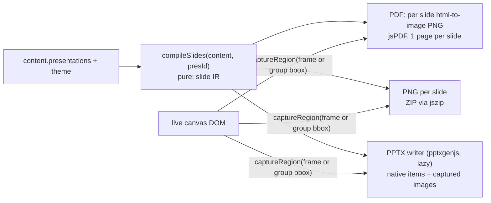
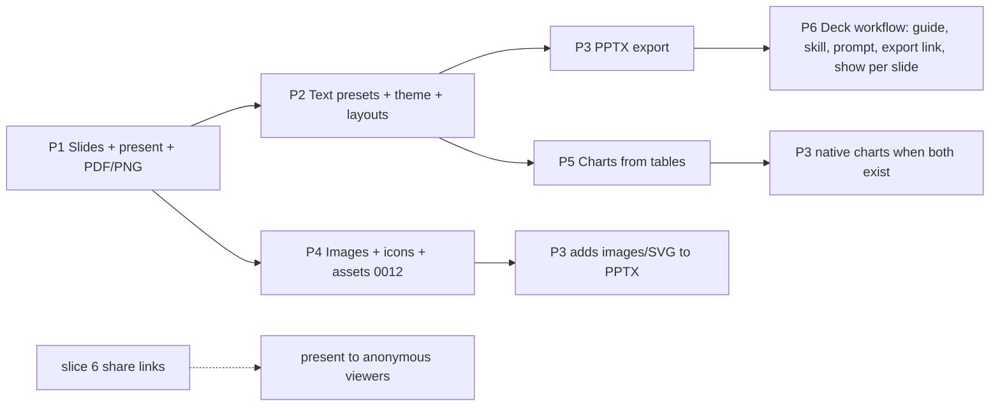

# ADR-0007 — Presentations and visual primitives (slides, present mode, PPTX/PDF export, deck tools for Claude)

- Status: **Accepted** (2026-10-22, owner approved all recommended defaults). **P1, P2 and P3 are built** (sections 14, 15 and 16); P4 to P6 are not.
- Builds on: frames with explicit membership (`utils/frameMembership.js`), the live-canvas export pipeline (`export/captureCanvas.js`, `exportRenderer.js`), Table (AI-4) and Doc (AI-5) elements, the server SVG renderer (`lib/render/diagramSvg.js`, AI-9a), the MCP write path `agentWrite` → `applyContentChange`, and sharing (ADR-0003, slice 5). It changes no accepted decision.
- Owner request (2026-10-22): "a create presentation option would also be good through Claude … more options to add things on the visuals; more like a Canva/Figma style … or like Claude natively already does [its visual artifacts], but then putting it there together visually next to each other so that it could also be exported to a PPT."
- Personas: **AI/MCP agent** (builds the deck), **Solution Architect** (architecture review decks from maps and ADR docs), **CX/UX** (research readouts: findings doc, affinity map, evidence table side by side), **PM** (roadmap and KPI updates from tables).
- Primitives exposed: **presentation** (an ordered list of slide frames with notes), **slide frame** (a frame with an aspect ratio), **text box with typography presets**, **board theme** (palette and font tokens), **image asset**, **icon**, **chart bound to a table**, and **deterministic slide layouts** (placement grids, not content templates). There are no "architecture review deck" or "research readout" templates. Claude composes those from the primitives.

## 1. Real-world analogy

**A studio wall and a guided tour.**

- The **board** is the studio wall. Work happens there: maps, tables, memos, stickies.
- A **presentation** is a guided tour of that wall. The curator chooses which **framed panels** to stop at and in what order, and carries **cue cards** (speaker notes). The panels stay on the wall: touring them does not move or copy them, so a panel is always current (**frame-as-slide is live**).
- To put a table and a memo **"next to each other"** for one tour stop, the curator pins **photocopies** onto a new display board, labelled with where they came from (**composed slides copy a snapshot with provenance**). The originals stay put and stay editable.
- A **chart** is a gauge wired to a table: it redraws when the numbers change (**live by reference**, because it is a projection of data, not a copy).
- **Export to PowerPoint** is like making a handout set. Text and simple shapes are retyped so they stay editable. Complex drawings are photographed (images), because retyping them would distort them.
- **Present mode** is dimming the room lights: everything except the current panel disappears.

The analogy drives four decisions:

1. A slide is a place on the board, not a separate document.
2. A deck is a list that references places.
3. Copying is explicit and labelled.
4. The PPTX export is honest about what stays editable and what does not.

## 2. Research (accessed 2026-10-22)

| Source                                                                                                                                                                                                                                                                                      | Finding                                                                                                                                                                                                                                                                                                                                                                                                                              | Take-away                                                                                                                                                                                                                               |
| ------------------------------------------------------------------------------------------------------------------------------------------------------------------------------------------------------------------------------------------------------------------------------------------- | ------------------------------------------------------------------------------------------------------------------------------------------------------------------------------------------------------------------------------------------------------------------------------------------------------------------------------------------------------------------------------------------------------------------------------------ | --------------------------------------------------------------------------------------------------------------------------------------------------------------------------------------------------------------------------------------- |
| Miro, [Frames](https://help.miro.com/hc/en-us/articles/360018261813-Frames), [Miro Slides](https://help.miro.com/hc/en-us/articles/25542531289234-Miro-Slides), [Export](https://help.miro.com/hc/en-us/articles/360017572754-How-to-export-your-board) (search snippets; pages return 403) | Frames are the slides, Present walks them in order, and presenter notes open in a separate window. PDF export makes one page per frame. **No native PPTX export**: there is a long-standing [community request](https://community.miro.com/ideas/export-miro-frames-to-powerpoint-4020) and a third-party Marketplace exporter. A 16:9 frame preset exists.                                                                          | Slides as frames is the proven board-native model. PPTX would be a differentiator, not table stakes.                                                                                                                                    |
| Miro, [Create Miro Slides with AI](https://help.miro.com/hc/en-us/articles/30040238341906-Create-Miro-Slides-with-AI) (snippet)                                                                                                                                                             | Select board objects, choose "Slides", and the AI generates a deck from the selection.                                                                                                                                                                                                                                                                                                                                               | Our analogue is Claude reading a region and composing slides with deterministic tools (§6).                                                                                                                                             |
| Figma, [Export from Figma Slides](https://help.figma.com/hc/en-us/articles/24848334599447-Export-from-Figma-Slides) (fetched)                                                                                                                                                               | PPTX as **editable objects or flattened bitmap**. Missing fonts fall back to the default font. Interactive elements and code become images. **Gradients become solid colours in PPTX.**                                                                                                                                                                                                                                              | Offer editable output where we can and images elsewhere, and state the limits. No gradients in v1.                                                                                                                                      |
| Figma, [FigJam board to slides with AI](https://help.figma.com/hc/en-us/articles/25968453273495-Generate-a-slide-deck-from-a-FigJam-board-using-Figma-AI) (snippet)                                                                                                                         | Summarizes the board into a new deck outline; the board layout is not preserved.                                                                                                                                                                                                                                                                                                                                                     | Two needs: summary slides (text) and the board itself on slides (frames). We need both.                                                                                                                                                 |
| Canva and Gamma PPTX reviews ([presentations.ai](https://www.presentations.ai/blog/canva-vs-powerpoint), [slidegmm](https://www.slidegmm.ai/en/blog/gamma-export-powerpoint-quality-guide), third-party, undated)                                                                           | Text stays editable, but fonts are substituted, spacing shifts and some elements are flattened.                                                                                                                                                                                                                                                                                                                                      | Even the market leaders lose fidelity in PPTX, so set expectations in the UI.                                                                                                                                                           |
| tldraw, [slideshow](https://tldraw.dev/examples/slideshow) and [slides](https://tldraw.dev/examples/slides) examples                                                                                                                                                                        | Slides are built from frames plus camera constraints; there is no special document type.                                                                                                                                                                                                                                                                                                                                             | Present mode = camera locked to a frame.                                                                                                                                                                                                |
| Excalidraw+ [presentations](https://plus.excalidraw.com/use-cases/presentations) (2024)                                                                                                                                                                                                     | Presentation built on frames, with PDF and PPTX export. A [discussion](https://github.com/excalidraw/excalidraw/discussions/8090) asking for "export as objects" suggests the PPTX contains images.                                                                                                                                                                                                                                  | Image-per-slide PPTX is the floor; we can do better for text, tables and charts.                                                                                                                                                        |
| Anthropic, [Claude creates files](https://claude.com/blog/create-files) (2025-09-09) and [pptx skill](https://github.com/anthropics/skills/blob/main/skills/pptx/SKILL.md) (fetched)                                                                                                        | Claude already writes PPTX in its sandbox, and the skill **recommends pptxgenjs** for new decks. Gotchas: no gradient fills, colours without `#`, a default 16:9 layout of 10 × 5.625 in, chart XML that PowerPoint may refuse unless the output is validated, icons rasterized to PNG.                                                                                                                                              | Use the same library Claude itself trusts. Test chart output in real PowerPoint. The lab's value over Claude's sandbox: the deck **lives** next to the board, is versioned, shared and editable by people, and stays bound to the data. |
| pptxgenjs ([npm](https://www.npmjs.com/package/pptxgenjs), [docs](https://gitbrent.github.io/PptxGenJS/docs/api-images/))                                                                                                                                                                   | **MIT**, 4.0.1 (2025-06-26), last push 2025-11-28, about 300 open issues and PRs: slow but alive. About **123 KB gzip**, depends on jszip. Native shapes, text, tables, charts, notes and SVG images (SVG only shows in PowerPoint 2016+ and Microsoft 365). Autofit "shrink" is only an XML flag that PowerPoint applies when the text is edited. **No font embedding** ([#176](https://github.com/gitbrent/PptxGenJS/issues/176)). | The only maintained, permissive option. officegen was last published in 2021, and docxtemplater's useful modules are paid. Lazy-load it; never put it in the canvas bundle.                                                             |
| [PowerPoint and SVG](https://thepowerpointblog.com/powerpoint-svg/) (2026-05, secondary)                                                                                                                                                                                                    | Microsoft 365 and PowerPoint 2016+ render SVG; older versions and non-Microsoft viewers may show a blank image without a PNG fallback.                                                                                                                                                                                                                                                                                               | Ship a PNG fallback (rasterized in the browser) for every SVG we embed.                                                                                                                                                                 |
| sharp ([npm](https://www.npmjs.com/package/sharp), 0.35.5, 2026-09-27), DOMPurify 3.4.17, file-type 22.2.0, [SVG XSS guide](https://www.svggenie.com/blog/svg-xss-sanitize-guide)                                                                                                           | sharp is Apache-2.0 with LGPL libvips binaries, which is fine for a hosted service. DOMPurify has an SVG profile but needs a DOM on the server. file-type sniffs magic bytes but cannot detect SVG. Treat SVG as hostile: sanitize it **and** never render it inline.                                                                                                                                                                | Magic bytes for raster images; an allow-list re-serializer for SVG; `` only; a sandbox CSP on the asset route.                                                                                                                     |
| Icon sets on npm (2026-10)                                                                                                                                                                                                                                                                  | lucide ISC 1.61.0, @tabler/icons MIT 3.49.0, Phosphor MIT (core 2.1.1, 2024-03-29, quiet).                                                                                                                                                                                                                                                                                                                                           | Lucide: permissive, active, and the stroke style matches the Ethereal Sky look. Vendor a curated subset.                                                                                                                                |

## 3. What exists today (as-built facts this design relies on)

- **Frames**: `core/frame` (default 600 × 400; `frameTitle`, `backgroundColor`, `showTitle`), explicit `parentFrameId` membership, and nesting. `FrameNavigator` lists frames sorted by `createdAt`, then y, and zooms to one. There is no order field and no aspect ratio.
- **Export**: PNG, JPEG, SVG and PDF are **client-side** captures of the live DOM through html-to-image. The **PDF is a raster image** on one page, with scope `canvas`, `viewport`, `frame` or `selection`. The server cannot export PDF; it has only the reduced-fidelity `diagramSvg` renderer, which draws no pack decorations. Q-MCP6 (headless browser) stays "no".
- **Visual editing**:
  - **Existing**: alignment snap guides (`useAlignmentGuides`), align and distribute (`ContextualToolbar`), z-order through `zIndex` (Bring to Front, Send to Back), lock (element and layer, enforced by the applier), groups (`content.groups`), and a per-element `fontFamily` and `fontSize`. Font families load from **Google Fonts** at runtime.
  - **Missing**: a text style system (`core/text-block` only offers 12 to 24 px), themes, an image element (only a hot-linked `imageUrl` on sticky notes and mind-map nodes), icons, charts and gradients.
- **Content model**: the keys are `elements`, `connections`, `layers`, `groups` and `viewport` (`CONTENT_KEYS`, frozen). The cap is 5 MB, 5,000 elements and 10,000 connections. Versions, Compare, three-way merge and MCP all work on this blob.
- **Sharing**: members only (slice 5). Share links (slice 6, `diagram_links`) are **not built**, so presenting to someone without an account is not possible yet.
- **Migrations** end at `0011`.

## 4. Decision summary

| #   | Decision                                                                                                                                                                                                                                                                                                                                                                                                                                                  |
| --- | --------------------------------------------------------------------------------------------------------------------------------------------------------------------------------------------------------------------------------------------------------------------------------------------------------------------------------------------------------------------------------------------------------------------------------------------------------- |
| D1  | **A slide is a frame.** A presentation is an **ordered list of frame references** stored in `content.presentations[]`, so it is versioned, restorable, comparable and mergeable like everything else. A board can hold **many presentations**, and a frame can appear in several.                                                                                                                                                                         |
| D2  | **Slide frames have an aspect ratio** (`16:9` by default, also `4:3`, `1:1`, `free`) at a canonical **1920 × 1080 board units** for 16:9. Resizing keeps the ratio. Any existing frame can become a slide; a non-matching one is letterboxed.                                                                                                                                                                                                             |
| D3  | **Content on slides**: (a) **frame-as-slide is live**, with zero copy, and is the default for maps built in a frame. (b) **Composition copies a snapshot**, scaled to fit a slot, stamped `origin.copiedFrom = {elementId, revision}`. (c) **Data-bound visuals reference by id**: a chart reads its table live. A live "mirror" of a table or doc is **Later**.                                                                                          |
| D4  | **One theme per board** (`content.theme`): palette tokens and a heading/body font pair, with Ethereal Sky as the default. Elements may store **token references** (`"@accent"`) instead of hex, so applying a theme restyles every slide. Existing elements keep their concrete colours.                                                                                                                                                                  |
| D5  | **Text presets**: `title`, `subtitle`, `heading`, `body`, `caption`, `quote`, `number` (big KPI figure). The text-block gains `data.text = {preset, markdown}`, using the AI-5 Markdown **inline subset** (bold, italic, lists, links) through the same safe parser and renderer. There is no HTML and no new rich-text engine.                                                                                                                           |
| D6  | **Present mode** is a read-only render state of the existing editor page (`?present=<presentationId>&slide=<n>`): full screen, camera locked to the slide frame, everything outside the frame masked, keyboard navigation. Viewer role or above. Anonymous presenting waits for share links (slice 6).                                                                                                                                                    |
| D7  | **Export runs in the browser** (the only place with full-fidelity rendering): **PDF** (one page per slide, raster as today), **PNG per slide** (ZIP), and **PPTX** through **pptxgenjs** (lazy-loaded). PPTX is a hybrid: **native editable** text, basic shapes, stickies, tables, charts, images and notes; **images** (PNG, with SVG where safe) for pack stencils and connected diagrams. Fidelity limits are listed in §8.3 and shown in the dialog. |
| D8  | **Images are uploaded assets**, never hot-linked: PNG, JPEG and WebP (magic bytes checked), plus SVG only through an allow-list re-serializer. Stored in PostgreSQL (migration `0012`), served through `authorize()` with a sandbox CSP and rendered only as ``. **No server-side URL fetch** (SSRF and licensing).                                                                                                                                  |
| D9  | **Claude's visuals come in as SVG.** Claude's native visuals are HTML/SVG artifacts. Script and HTML cannot run on a board, but a self-contained SVG can: `image_add {svg}` stores a sanitized SVG asset. Claude can also draw natively with text, shapes, charts and icons, which stay editable and theme-aware.                                                                                                                                         |
| D10 | **MCP deck tools compile to ops through `agentWrite`** (one version and one audit row per call), with deterministic slide layouts. `presentation_export` returns a **deep link** that opens the lab's export dialog. There is no server-side file generation, no new file storage and no signed URL in v1.                                                                                                                                                |

## 5. Presentation model

### 5.1 Data (inside `content`)

```jsonc
// content.presentations: at most 20 per board
{
  "id": "pres-<uuid>",
  "title": "Checkout review - Oct",          // plain text, at most 200 characters
  "aspect": "16:9",                           // default for new slides: 16:9 | 4:3 | 1:1
  "slides": [                                 // at most 200
    { "id": "slide-<uuid>", "frameId": "frame-…", "notes": "plain text, at most 10 KB", "hidden": false }
  ]
}
// slide frame (an ordinary core/frame), additive properties:
{ "type": "frame", "size": {"width": 1920, "height": 1080},
  "data": { "frameTitle": "Findings", "aspect": "16:9", "background": "@surface" } }
// content.theme (optional; absent = Ethereal Sky)
{ "preset": "ethereal-sky", "palette": { "bg": "#FFFFFF", "surface": "#F6FAFC", "text": "#1E2A33", "muted": "#5B6B78",
  "accent": "#4FB3CE", "accent2": "#6A9FC9", "accent3": "#E8A99A", "accent4": "#F0D98A", "accent5": "#9A8AC8", "accent6": "#C490B0" },
  "fonts": { "heading": "inter", "body": "inter" }, "scale": 1 }
```

- **Why inside `content`** (same reasoning as AI-4/5, §3.3 of ai-canvas-via-mcp): restoring a version restores the deck order with its slides; Compare can show "slide 3 moved"; MCP and the merge code use one path. The cost is that `CONTENT_KEYS` gains `presentations` and `theme`, so `validateDiagramContent`, `normalizeContent`, `diffContent`, `threeWay` and `diagramSvg` all need updating (tested in P1 and P2).
- **Referential rules**:
  - A slide whose frame is deleted is **kept as "missing"**: the panel shows a placeholder, present mode skips it, and export reports it. This is the same detach rule as comments and table row links, so an autosave never fails.
  - Deleting a frame from the Presentation panel asks "Remove slide only / delete frame too".
- **Merge**: presentations merge by id. Within a deck, slides merge by id; if both sides changed the order, local wins and the conflict is reported. Notes are a field.
- **Font ids** come from a closed list of self-hosted fonts (§7.6). Font names are never free text, because they feed CSS and PPTX.

### 5.2 Slide geometry and presets

- Canonical sizes: 16:9 = 1920 × 1080, 4:3 = 1440 × 1080, 1:1 = 1080 × 1080. Preset font sizes are defined at this scale (title 72, subtitle 40, heading 48, body 28, caption 20, quote 40 italic, number 120 semibold). They are **materialized** at insert time as `fontSize × (frame.height / 1080)`, so a scaled slide keeps its proportions. The element keeps `preset` so that theme or scale changes can re-apply it.
- **Slide layouts** are deterministic **placement grids** (named slots with 96-unit margins and 48-unit gutters). They decide only where things go, never what the content is:

| Layout           | Slots                      |
| ---------------- | -------------------------- |
| `title`          | title, subtitle            |
| `title-body`     | title, body                |
| `two-column`     | title, left, right         |
| `three-column`   | title, c1, c2, c3          |
| `title-visual`   | title, visual (full width) |
| `visual-caption` | visual, caption            |
| `big-number`     | number, label, body        |
| `blank`          | full                       |

- **Fit rule for composed content**: copied elements are scaled uniformly (positions, sizes, font sizes, stroke widths, and table column widths and row metrics through a new table `scale` field) to fit the slot. The block is centred in the slot and is **never upscaled above 1.5×**. If it would fall below 0.35× (unreadable), the tool refuses and suggests "put the whole frame on its own slide" (D3a).

### 5.3 Present mode (UX)

```
┌────────────────────────────────────────────────────────────┐
│                                                            │  full screen (Fullscreen API), black letterbox
│        [ slide frame rendered by the normal canvas,        │  camera = frame bounds, outside masked
│          read-only, chrome hidden, no handles ]            │
│                                                            │
│                                          3 / 12  ◀ ▶  ✕    │  auto-hides after 2 s without pointer movement
└────────────────────────────────────────────────────────────┘
```

- **Keys**:
  - Next: → ↓ Space PageDown Enter.
  - Previous: ← ↑ PageUp Backspace.
  - Home and End jump to the first and last slide.
  - A number then Enter goes to that slide.
  - `B` blacks out the screen.
  - `F` toggles full screen.
  - `N` shows the notes overlay (presenter only).
  - Esc leaves present mode and returns to the slide's frame on the board.
  - A click or tap on the right or left third of the screen goes next or back; swipe works on touch.
- **Rendering** reuses `DiagramCanvas` with a `presenting` flag: no handles, ports, comments, AI badges or remote highlights, and no editing. The slide's notes are announced through `aria-live` with "Slide 3 of 12: <frame title>". There are no transitions (out of scope), and `prefers-reduced-motion` is irrelevant.
- **What is shown**: everything whose box intersects the frame, clipped to it. This is what you see on the board, and the same rule applies to export, so present and export agree. The current `frame` export scope ("fully inside only") stays as it is for single-frame export.
- **Who can present**: anyone whose role allows `diagram.read`. The link `…/diagram/LAB-12?present=pres-…&slide=3` is shareable to members. Without access it gives the normal 404. Anonymous audiences need slice 6 (share links, viewer only, `ALLOW_ANONYMOUS_LINKS`).
- **Later**:
  - **Presenter view**: a second window over BroadcastChannel with notes, the next slide and a timer.
  - **"Follow the presenter"**: built on ADR-0006 Step 2 follow, where the presenter's slide index is part of presence.
  - A Talktrack-style recording is out of scope.
- **Presentation panel** (right slide-in, a tab next to History and Activity):
  - Thumbnails come from the client capture, cached per frame revision.
  - Drag to reorder.
  - Actions: "Add slide" (a new 16:9 frame placed right of the deck's last slide in free space), "Add selected frame", hide or show a slide, and notes per slide.
  - Buttons: Present, Export.
- A frame's toolbar also gets "Add to presentation".

## 6. Visual primitives: the smallest set that makes Claude-built decks look good

Prioritization rule: Claude must be able to make a **clean, on-brand, readable** deck from board content with no manual fixing. That needs hierarchy (type presets), consistency (theme), arrangement (layouts, alignment) and data (tables, charts). Images and icons add polish but do not create the first readable deck.

| Primitive                                                 | Status today                         | Priority          | Slice                                                  | Notes                                                                                                            |
| --------------------------------------------------------- | ------------------------------------ | ----------------- | ------------------------------------------------------ | ---------------------------------------------------------------------------------------------------------------- |
| Slide frame (aspect, order, notes)                        | frames exist; no order or aspect     | **Must**          | P1                                                     | §5                                                                                                               |
| Present mode                                              | none                                 | **Must**          | P1                                                     | §5.3                                                                                                             |
| Text box with typography presets and inline Markdown      | text-block 12 to 24 px               | **Must**          | P2                                                     | D5; reuses the AI-5 parser and renderer                                                                          |
| Board theme (palette and fonts, token references)         | none                                 | **Must**          | P2                                                     | D4; Ethereal Sky default plus 3 neutral presets (Paper, Slate dark, Contrast)                                    |
| Slide layouts (placement grids)                           | none                                 | **Must**          | P2                                                     | used by the tools and by "Add slide ▸ layout" in the UI                                                          |
| Align, distribute, snap guides                            | exist                                | **Must** (exists) | P2 adds "align to slide" and "centre in slide"         |                                                                                                                  |
| Z-order, lock, group                                      | exist (`zIndex`, `locked`, `groups`) | **Must** (exists) | n/a                                                    | the MCP ops gain `zIndex` (P2)                                                                                   |
| Shapes: solid fill, stroke, corner radius, opacity        | partly (fill, stroke)                | **Must**          | P2                                                     | adds a `radius` and an `opacity` property on core shapes                                                         |
| Table on a slide                                          | exists (AI-4)                        | **Must** (exists) | P2 adds `scale` for fit and theme-aware header colours |                                                                                                                  |
| Doc on a slide                                            | exists (AI-5)                        | **Should**        | P2                                                     | new `display: 'full'` mode (text without the card chrome) so a doc reads as slide prose; overflow fades as today |
| KPI / callout card                                        | none                                 | **Should**        | P2                                                     | composition only: `number` and `caption` presets in a rounded shape; a layout does it, no new element type       |
| Chart bound to a table (bar, column, line, pie or donut)  | none                                 | **Should**        | P5                                                     | §6.2                                                                                                             |
| Image (upload, Claude SVG/PNG)                            | none (hot-linked URLs only)          | **Should**        | P4                                                     | §7                                                                                                               |
| Icons (curated licensed set)                              | none                                 | **Should**        | P4                                                     | Lucide (ISC), a vendored subset of about 300 icons as path data, theme-coloured                                  |
| Gradients, shadows, image crop and masks                  | none                                 | **Later**         | n/a                                                    | gradients become solid colours in PPTX anyway (Figma docs)                                                       |
| Live mirror of a table or doc                             | none                                 | **Later**         | n/a                                                    | D3; needs a "source changed" UX                                                                                  |
| Transitions and animations, presenter view, video, embeds | none                                 | **Later or out**  | n/a                                                    |                                                                                                                  |

### 6.1 Text box

- **Element**: `core/text-block` gains `data.text = {preset, markdown}`, plus optional overrides: `color` (hex or `@token`), `align`, `verticalAlign`, `fontWeight`.
- **Migration**: legacy text-blocks without `data.text` keep rendering from `label` and the old properties. No migration is needed.
- **Box sizing**:
  - The width is fixed by the user or the slot.
  - The height grows with the text, measured in the browser.
  - The server tools estimate the height with the same character-width table as tables. The editor corrects it on the next render; that correction is a client-only layout fix, not an autosave on its own.

### 6.2 Chart (P5)

- **Element**: `core/chart` with `data.chart = {tableId, kind: bar|column|line|pie|donut, x: colId, series: [colId…] (≤ 6), stacked?, sort?, legend?, labels?}`.
- **Live data**: it reads the table's rows on every render, so editing a cell redraws the chart. The cap is 200 data points (the first 200 rows, then a footer note).
- **Missing data**: a missing table or column renders a placeholder "Source table removed". It is stored validly, like dangling row links.
- **Renderer**: a **small in-house pure SVG renderer** (`lib/chart/chartSvg.js`, about 400 lines, no dependency). The same code draws the editor DOM, the export capture, `diagram_show` and PPTX fallback images.
- **Colours** follow the palette tokens in order. Accessibility: direct labels where they fit, and an `aria-label` summary.
- **Why no chart library**: the four chart kinds above need about 400 lines. A library would have to be made deterministic and safe for both server and client rendering. The `dataviz` guidance (palette validation, direct labels) applies.

## 7. Images, assets and fonts: security and limits

### 7.1 Storage (migration `0012_assets.sql`)

```sql
CREATE TABLE asset_blobs (                 -- content-addressed, immutable
  sha256      bytea PRIMARY KEY,           -- 32 bytes
  mime        text NOT NULL CHECK (mime IN ('image/png','image/jpeg','image/webp','image/svg+xml')),
  bytes       bytea NOT NULL,
  byte_size   integer NOT NULL CHECK (byte_size <= 5242880),
  width       integer NOT NULL, height integer NOT NULL,
  created_at  timestamptz NOT NULL DEFAULT now()
);
CREATE TABLE diagram_assets (              -- a board's right to use a blob
  id          text PRIMARY KEY,            -- 'asset-<uuid>'
  diagram_id  uuid NOT NULL REFERENCES diagrams(id) ON DELETE CASCADE,
  sha256      bytea NOT NULL REFERENCES asset_blobs(sha256),
  alt         text,                        -- at most 300 characters, plain text
  created_by  uuid REFERENCES users(id), created_via text NOT NULL CHECK (created_via IN ('user','agent','duplicate')),
  created_at  timestamptz NOT NULL DEFAULT now(),
  UNIQUE (diagram_id, sha256)
);
CREATE INDEX diagram_assets_sha ON diagram_assets(sha256);
```

- **PostgreSQL `bytea`** (Q-P6): one consistent backup, transactional with the board, and no new volume or service. Bounded by quotas: **100 MB per board** and **1 GB per owner**. Revisit object storage when the total passes about 5 GB.
- **Immutable and never edited.** A blob is removed only by a GC job once no `diagram_assets` row references it. `diagram_assets` rows live as long as the board, so old versions that reference an asset always restore. Duplicating a board copies the rows (`created_via='duplicate'`), not the bytes.
- **Cross-board paste**: `POST /assets/import {fromDiagramId, assetId}` with `diagram.read` on the source and `diagram.write` on the target.

### 7.2 Upload and serving (API contracts)

| Endpoint                                  | Role                   | Contract                                                                                                                                                                                                                                                                                                                                                                                                                                                                                                                                                      |
| ----------------------------------------- | ---------------------- | ------------------------------------------------------------------------------------------------------------------------------------------------------------------------------------------------------------------------------------------------------------------------------------------------------------------------------------------------------------------------------------------------------------------------------------------------------------------------------------------------------------------------------------------------------------- |
| `POST /api/diagrams/{id}/assets`          | editor (`asset.write`) | Raw body; `Content-Type` is one of the four types, `X-Alt` is optional. The body is at most 5 MB (413). **Magic bytes must match** the declared type (400 `MIME_MISMATCH`). The image header is parsed in pure JS for width and height: at most 8,000 px per side and **25 MP** (decompression-bomb guard). SVG goes through §7.3. Upload rate limit: 30 per minute per user. The quotas give 413 `QUOTA_EXCEEDED`. Response 201: `{assetId, mime, width, height, bytes, sha256}`; a duplicate returns the existing id with 200. Writes audit `asset.create`. |
| `GET /api/diagrams/{id}/assets/{assetId}` | viewer (`asset.read`)  | Stored bytes. Headers: the stored `Content-Type`, `X-Content-Type-Options: nosniff`, `Content-Security-Policy: default-src 'none'; style-src 'unsafe-inline'; sandbox`, `Cross-Origin-Resource-Policy: same-origin`, `Content-Disposition: inline; filename="asset.<ext>"`, `Cache-Control: private, max-age=31536000, immutable`, and `ETag` = sha256. A wrong board returns 404.                                                                                                                                                                            |
| `GET /api/diagrams/{id}/assets`           | editor                 | Lists `{assetId, mime, width, height, bytes, alt, createdAt}` for the image picker.                                                                                                                                                                                                                                                                                                                                                                                                                                                                           |
| `POST /api/diagrams/{id}/assets/import`   | editor on the target   | Cross-board copy (above).                                                                                                                                                                                                                                                                                                                                                                                                                                                                                                                                     |

- **Client side**: before upload, the browser re-encodes raster images through `<canvas>`. This strips EXIF and GPS data, normalizes orientation and downsizes to at most 3,840 px on the long side. Without a canvas the original is sent as is.
- **Server re-encoding** with sharp is defense in depth; it is **not in v1** (Q-P10), because it is a native dependency.
- **The image element**: `core/image` with `data.image = {assetId, alt, fit: contain|cover, radius?}`. The validator checks the `asset-` id format. The applier checks that the asset belongs to **this** board, so a board cannot reference another board's asset.
- **Export capture**: html-to-image fetches the asset same-origin (with the cookie), so the canvas is never tainted.
- **Hot links**: existing `imageUrl` hot links on stickies and mind-map nodes stay, but a "Convert to uploaded image" action is offered. They leak the viewer's IP to third parties and can taint exports.

### 7.3 SVG (from users and from Claude)

- The SVG is parsed with a strict SAX parser (`saxes`, ISC: **new dependency**) and **re-serialized from an allow-list**:
  - **Elements**: `svg g path rect circle ellipse line polyline polygon text tspan defs linearGradient radialGradient stop clipPath title desc`.
  - **Attributes**: geometry, `fill`, `stroke*`, `opacity`, `transform` (number and command alphabet), `font-*`, `text-anchor`, `id` (pattern), and local `url(#id)` references only.
- **Dropped**: `script`, `foreignObject`, `style` elements, `on*` attributes, `href` and `xlink:href` (no external or `data:` references, no `use`), `image`, `animate*`, `filter` and `feImage`, entities and DOCTYPE, and CSS in attributes beyond the allowed properties.
- **Limits**: at most 512 KB in and 20,000 nodes. A missing `viewBox` is computed from `width` and `height`.
- **Three walls**:
  1. Sanitized storage.
  2. Rendering only as ``, where browsers run no script and load no subresources.
  3. A sandbox CSP on the asset route, in case someone opens the URL directly.

  This is the same layered approach as `diagram_show`.

- **PPTX**: SVGs are embedded together with a **PNG fallback** rasterized in the browser at export time (§8.3).

### 7.4 No URL fetch (Q-P3)

The server never fetches an image URL. Doing so would need SSRF defences: resolve and pin the IP, block private and link-local ranges including 169.254.169.254, re-check redirects, and cap size and time. It would also make the lab the party that copies third-party images, which creates licensing exposure. Users upload files they have rights to (Terms), and Claude passes bytes or SVG it generated. This can be revisited as an allow-listed proxy later.

### 7.5 MCP size reality

The MCP request body cap is 256 KB. `image_add` therefore takes **SVG of at most 200 KB** or **base64 PNG/JPEG/WebP of at most 180 KB decoded**: enough for diagrams, illustrations and icons Claude draws, not for photos. Larger images are uploaded by the user in the lab.

### 7.6 Fonts

- Themes use a **closed list of self-hosted OFL fonts**: Inter, Source Serif 4, IBM Plex Sans, Plex Mono, Work Sans (replaced Lato in P2: its OFL Reserved Font Name forbids reusing the name on modified subsets) and Montserrat. They are served from `/fonts/` and carry the OFL notices.
- **Motivation**: the editor currently loads Google Fonts from the CDN, which leaks viewer IPs (a known EU GDPR concern) and complicates export font embedding (`fontEmbed.js`). Q-P11 asks whether to move all fonts off the CDN.
- **PPTX** cannot embed fonts (pptxgenjs #176). See §8.3.

## 8. Export



### 8.1 The slide IR (pure, `lib/present/compileSlides.js`)

For each visible slide, the IR holds: `{frame, scale, background, items[]}`. Each item is one of:

- `text` (runs from the inline Markdown AST)
- `shape` (rect, ellipse or rounded rect, with fill and stroke)
- `sticky`
- `table`
- `chart` (with resolved data)
- `image` (assetId)
- `picture` (a region the writer must capture)
- `notes`

**Classification rule**:

- Core basic shapes, text-blocks, stickies, tables, charts, images, icons and docs become **native** items.
- Every element of another pack, every connection, and every element connected to one become a **picture** cluster: the union bbox of each connected component. One image per cluster keeps diagrams exact and connector routing intact.

The IR is pure and tested without a browser. The same IR could later drive server-side generation (Q-P8).

### 8.2 PDF and PNG

- **PDF**: one page per visible slide. The page size equals the slide aspect (16:9 → 960 × 540 pt). Each page is a high-resolution raster of the slide region captured by the existing `captureCanvas` with a `region` scope, at a 2× pixel ratio, clamped as today. Optional: speaker notes as a page under each slide (Later).
- **Vector PDF stays Later**: html-in-SVG cannot be vectorized client-side, as `exportRenderer.js` already notes.
- **PNG**: one 1920 × 1080 image per slide (2× optional), zipped (jszip comes with pptxgenjs).
- **Progress and cost**: progress is shown per slide, and the export can be cancelled. Slides are captured one after another, yielding between them so the UI stays responsive (about 0.3 to 1 s per slide).

### 8.3 PPTX: approach and honest fidelity

The PPTX layout is LAYOUT_WIDE, 13.333 × 7.5 in for 16:9 (4:3 and 1:1 get custom layouts). Positions are converted with `inch = unit × 13.333 / frame.width`, and font sizes with `pt = px × 0.75 × (1920 / frame.width) × (13.333 × 96 / 1920)`.

| Board content                                                     | In PPTX                                                                                                               | Editable?                               | Limits (shown in the export dialog)                                                                                                                                                                                                                                                                                                             |
| ----------------------------------------------------------------- | --------------------------------------------------------------------------------------------------------------------- | --------------------------------------- | ----------------------------------------------------------------------------------------------------------------------------------------------------------------------------------------------------------------------------------------------------------------------------------------------------------------------------------------------- |
| Text box (presets, bold, italic, lists, links)                    | native text box, runs, bullets, hyperlinks (http(s) only)                                                             | yes                                     | **Fonts are not embedded.** The viewer must have the theme font, or PowerPoint substitutes one. The option "Office-safe fonts" (default **on**, Q-P7) maps headings and body to Aptos/Calibri/Arial. **Line wraps can differ** because the text metrics differ. Boxes get 8% extra height and `fit: none`; overflow is possible, not truncated. |
| Core shapes, stickies                                             | native shapes with text                                                                                               | yes                                     | Solid fills only (no gradients); a corner radius maps to `roundRect` with an approximate radius.                                                                                                                                                                                                                                                |
| Table                                                             | native table (header styling from the theme)                                                                          | yes                                     | Rows are capped at those that fit the slide (estimated); above 25 rows the dialog warns. Wrapping differs from the canvas.                                                                                                                                                                                                                      |
| Chart                                                             | **native chart** (`addChart`) from the table data, theme colours                                                      | yes (data sheet editable in PowerPoint) | Validated with real PowerPoint and LibreOffice in CI fixtures (the Anthropic skill warns that some chart XML is refused). Per-point label styling is approximate.                                                                                                                                                                               |
| Doc (`display: full` or card)                                     | native text box: headings bold and larger, lists, quotes indented, code in a monospace run, GFM tables as plain lines | yes                                     | Only the text visible on the slide is exported (the excerpt or the full text that fits); the rest is cut with "…" and the doc link is added to the notes.                                                                                                                                                                                       |
| Image (raster)                                                    | embedded picture                                                                                                      | as a picture                            | none                                                                                                                                                                                                                                                                                                                                            |
| Image (SVG), icon                                                 | SVG picture plus a **PNG fallback**                                                                                   | as a picture                            | Old PowerPoint and non-Microsoft viewers show the PNG.                                                                                                                                                                                                                                                                                          |
| Pack stencils (UML, ERD, TOGAF…), connections, connected diagrams | **one PNG per connected cluster** (2×)                                                                                | no (an image)                           | The "Editable diagrams (experimental)" option later maps nodes to shapes and straight connectors to lines; curved and step connectors would become freeforms, not glued. **Not in v1.**                                                                                                                                                         |
| Frame background, slide title                                     | slide background colour; the title becomes the slide's title placeholder text (outline view and accessibility)        | yes                                     | Background images Later.                                                                                                                                                                                                                                                                                                                        |
| Speaker notes                                                     | slide notes                                                                                                           | yes                                     | plain text                                                                                                                                                                                                                                                                                                                                      |
| Comments, AI badges, highlights, hidden slides                    | omitted                                                                                                               | n/a                                     | n/a                                                                                                                                                                                                                                                                                                                                             |

Expected result: a deck that **looks right in PowerPoint and Keynote** with editable headings, bullets, tables and charts. Diagrams are crisp images. Without the fonts installed, expect small reflow. This is above the Miro baseline (no PPTX), on par with Figma's "editable" mode for our element set, and honest about diagrams.

## 9. MCP surface for Claude

All writes compile to `Op[]` and run through **`agentWrite`**: rate limit, editor token plus allowlist, `baseRevision` compare-and-set, locks, `validateDiagramContent`, one `created_via='agent'` version with the pre-agent version, one `diagram.agent_edit` audit row with `tool`, and `noteAgent` for the activity indicator.

**New ops**:

- `presentation_patch {presentationId, create?|title?|aspect?|insertSlides?|removeSlideIds?|order?|notes?}`
- `theme_set`
- `add_element` gains `text`, `chart` and `image` payloads (the same pattern as `table` and `doc`)
- `update_element` gains `zIndex`

Naming follows AI-3/4/5 (`baseRevision`, `anchor`).

| Tool                             | Input (sketch)                                                                                                                                                                                                        | Output                                                                                                                                                             | Role / slice                                  |
| -------------------------------- | --------------------------------------------------------------------------------------------------------------------------------------------------------------------------------------------------------------------- | ------------------------------------------------------------------------------------------------------------------------------------------------------------------ | --------------------------------------------- |
| `presentation_create`            | `{id, baseRevision, title, aspect?}`                                                                                                                                                                                  | `{revision, versionId, presentationId}`                                                                                                                            | editor / P1                                   |
| `slide_add`                      | `{id, baseRevision, presentationId, position?, frameId? (an existing frame becomes a slide; `fitAspect?` grows it to the ratio without moving content) \| new: {title?, layout?, anchor?}, blocks?: Block[], notes?}` | `{revision, slideId, frameId, created: {key: id}, warnings}`                                                                                                       | editor / P1 (frames), P2 (layouts and blocks) |
| `slide_update`                   | `{id, baseRevision, presentationId, slideId, notes?, hidden?, title?, layout?, blocks? (re-compose: replaces only the elements the tool placed, tracked by `origin.slot`)}`                                           | `{revision, …}`                                                                                                                                                    | editor / P1 and P2                            |
| `slide_reorder` / `slide_remove` | `{…, slideIds[]}` / `{…, slideId, deleteFrame?: false}`                                                                                                                                                               | `{revision}`                                                                                                                                                       | editor / P1                                   |
| `presentation_get`               | `{id, presentationId?}`                                                                                                                                                                                               | decks → slides `{n, slideId, frameId, title, notes, hidden, missing, outline}` (the outline uses the region projection, so text stays bounded and flagged as data) | viewer / P1                                   |
| `text_add`                       | `{id, baseRevision, markdown, preset, anchor \| inSlide: {slideId, slot}, width?}`                                                                                                                                    | `{revision, elementId}`                                                                                                                                            | editor / P2                                   |
| `theme_apply`                    | `{id, baseRevision, preset? \| palette? \| fonts?}`                                                                                                                                                                   | `{revision, theme}`                                                                                                                                                | editor / P2                                   |
| `chart_create` / `chart_update`  | `{id, baseRevision, tableId, kind, x, series[], anchor \| inSlide}`                                                                                                                                                   | `{revision, elementId, points, warnings}`                                                                                                                          | editor / P5                                   |
| `image_add`                      | `{id, baseRevision, svg? \| base64?+mime?, alt (required), anchor \| inSlide, width?}`                                                                                                                                | `{revision, elementId, assetId, sanitized: {removed: [...]}}`                                                                                                      | editor / P4                                   |
| `icon_search`                    | `{query, limit?}`                                                                                                                                                                                                     | `[{name, tags}]` from the vendored set                                                                                                                             | viewer / P4                                   |
| `presentation_export`            | `{id, presentationId, format: pptx\|pdf\|png}`                                                                                                                                                                        | `{url: "…/diagram/LAB-n?present=pres-…&export=pptx", note}`: opens the lab's export dialog pre-filled. The user clicks Download (browsers need the gesture).       | viewer / P6                                   |
| `diagram_show`                   | existing, plus `focus: {slide: {presentationId, n}}` sugar (frame focus)                                                                                                                                              | the slide picture in the Claude card                                                                                                                               | viewer / P6                                   |

**Block** (used by `slide_add`, `slide_update` and the `inSlide` anchors), each with a `slot` from the layout:

- `{text: {markdown, preset}}`
- `{copy: {elementIds[] | frameId}}`: a snapshot, scaled to fit, with `origin.copiedFrom`
- `{chart: {...}}`
- `{image: {assetId | svg}}`
- `{table: {columns, rows}}` (inline new table)
- `{icon: {name, color?}}`

Caps:

- 12 blocks per slide
- 40 slides per call
- 200 compiled ops (`MAX_STRUCTURE_OPS` applies)
- copy at most 300 elements per block

**How Claude composes a deck from existing content** (taught in the guide and the skill):

1. `board_read_region` or `presentation_get`.
2. Plan the storyline (Claude thinks).
3. `presentation_create`.
4. Per stop, choose:
   - an existing map frame → `slide_add {frameId, fitAspect:true}` (live);
   - a "side by side" stop → `slide_add {layout:'two-column', blocks:[{slot:'left', copy:{elementIds:[tableId]}}, {slot:'right', text:{…}}]}` (snapshot);
   - numbers → `chart_create` bound to the board's table;
   - a summary → `text` blocks, with `#el=` links in notes for traceability.
5. `theme_apply` once.
6. `diagram_show` on two or three slides to self-check.
7. `presentation_export` link to the user.

The guide also states:

- **Copy, don't move**, the owner's working material.
- Keep at most **6 bullets per slide**.
- Use the `number` preset for KPIs.
- Never put board text in tool descriptions.
- Board content remains data, not instructions.

A new verb prompt, **`present_region {link, slides?}`**, is persona-neutral like `summarize_region`.

## 10. Limits, performance and security summary

- **Content caps** (`lib/diagramLimits.js`):
  - 20 presentations per board, 200 slides each.
  - Notes up to 10 KB of plain text (control and bidi characters stripped, as for doc titles).
  - Text-box markdown up to 20 KB.
  - 6 series and 200 points per chart.
  - 500 image elements per board.
  - Assets per §7.
  - All of it still sits under the 5 MB content cap; images are references, not inline bytes.
- **Validation**: `presentations` and `theme` have closed schemas (unknown keys are rejected). Colours are `#rrggbb` or a known `@token`. Font ids come from a closed list. `frameId` and `assetId` have pattern checks. Inline Markdown goes through the existing `sanitizeDocMarkdown` and `docHref` allow-list.
- **Performance**:
  - Present mode renders the existing canvas with culling to the frame, so large boards stay smooth.
  - Thumbnails are captured lazily and cached by `frameId + revision`.
  - The export runs one slide at a time and can be cancelled.
  - pptxgenjs (about 123 KB gzip) and jszip are loaded only on export.
  - The chart renderer is pure, memoized by table revision.
- **OWASP**:
  - A01 Broken access control: assets are authorized through `authorize()`, and an asset must belong to the referencing board.
  - A03 Injection: SVG and Markdown are sanitized, and there is no HTML.
  - A05 Security misconfiguration: asset response headers per §7.2.
  - A08 Software and data integrity: content-addressed immutable blobs.
  - A10 SSRF: there is no URL fetch at all.
  - CSV-style injection does not apply to PPTX. Hyperlinks in PPTX are limited to http(s) and `mailto:`.

## 11. Delivery slices (vertical; each has an editor, validation, export, MCP part, tests and docs)



| #      | Scope                                                                                                                                                                                                                                                                                                                                                                                                                                   | Done when (acceptance)                                                                                                                                                                                                                                                                                                                         | New deps / infra                                                                                                        |
| ------ | --------------------------------------------------------------------------------------------------------------------------------------------------------------------------------------------------------------------------------------------------------------------------------------------------------------------------------------------------------------------------------------------------------------------------------------- | ---------------------------------------------------------------------------------------------------------------------------------------------------------------------------------------------------------------------------------------------------------------------------------------------------------------------------------------------- | ----------------------------------------------------------------------------------------------------------------------- |
| **P1** | `content.presentations` (schema, normalize, diff, merge, SVG ignore); frame `aspect` with ratio-locked resize and "16:9 / 4:3 / 1:1" presets; Presentation panel (add, reorder, notes, hide, missing slides); present mode (§5.3); PDF (page per slide) and PNG (current slide; ZIP lands in P3); MCP `presentation_create`, `slide_add {frameId}`, `slide_reorder`, `slide_remove`, `slide_update {notes, hidden}`, `presentation_get` | Restoring a version restores the deck order. A deleted frame becomes a "missing" slide and the autosave still succeeds. The keyboard contract passes an e2e test. A viewer can present but cannot edit. A 12-slide PDF has 12 pages in 16:9. An MCP call makes one version and one audit row. Three-way merge of reorder plus notes is tested. | none                                                                                                                    |
| **P2** | Text presets, inline Markdown text box, `content.theme` with token references and 4 presets, slide layouts, shapes `radius` and `opacity`, "align to slide", table `scale`, doc `display: full`; MCP `slide_add` with layouts and blocks (`text`, `copy`, `table`), `text_add`, `theme_apply`, `zIndex`                                                                                                                                 | Applying a theme restyles token-coloured elements on all slides and leaves hex-coloured ones alone. A copy block fits its slot, is deterministic, keeps provenance and refuses below 0.35×. Hostile Markdown is neutralized (reuses the AI-5 fuzz test). Self-hosted theme fonts work in export.                                               | self-hosted OFL font files (Q-P11)                                                                                      |
| **P3** | `compileSlides` IR; PPTX writer (native text, shapes, stickies, tables, docs, notes; cluster pictures); ZIP of PNGs; export dialog with fidelity notes and the "Office-safe fonts" option                                                                                                                                                                                                                                               | Fixture decks open without a repair prompt in PowerPoint (Microsoft 365, macOS and Windows), Keynote, LibreOffice and Google Slides (a manual checklist plus OOXML schema validation in CI). Text, tables and notes are editable. Diagrams are images at 2×. The bundle size of the editor route does not change (lazy import test).           | **pptxgenjs** (MIT) and its jszip                                                                                       |
| **P4** | Migration `0012`; asset endpoints; `core/image` (upload, drag-drop, paste, alt text required to publish, fit, radius); SVG sanitizer; Lucide subset as `core/icon`; "convert hot-linked image"; MCP `image_add`, `icon_search`; PPTX pictures with PNG fallback                                                                                                                                                                         | A wrong-board asset gives 404. The MIME mismatch, oversize, 25 MP bomb and quota cases are rejected. The SVG corpus (XSS cheat sheet, external refs, `foreignObject`, entities) re-serializes clean. Direct navigation to an SVG runs no script (CSP sandbox e2e). Duplicating a board copies asset rows.                                      | **saxes** (ISC); vendored Lucide paths (ISC notice); nginx `client_max_body_size ≥ 6m` on the asset route (host config) |
| **P5** | `core/chart` and `chartSvg`; chart inspector (pick table, kind, columns); live redraw; `diagram_show` draws charts; native PPTX charts; MCP `chart_create`, `chart_update`                                                                                                                                                                                                                                                              | Editing a table cell redraws the chart. A removed table shows a placeholder and stays valid. Native charts open without repair in PowerPoint and LibreOffice. Palette contrast is checked by the validator.                                                                                                                                    | none                                                                                                                    |
| **P6** | Guide (`GUIDE_VERSION` 3) "Decks" section; skill `skills/ontographia-lab` deck workflow and examples per persona; prompt `present_region`; `presentation_export` deep link (opens the dialog); `diagram_show` slide focus; how-to                                                                                                                                                                                                       | From claude.ai: "make a 6-slide readout of this frame" produces a themed deck with one live map slide, one composed side-by-side slide, one chart, notes and a working export link. Verified in Claude Code and the reference host; claude.ai once the connector is deployed.                                                                  | none                                                                                                                    |

P1 alone already answers "Miro-style present and PDF". P1 to P3 together answer "export to PPT". Each slice appends to `docs/release/IMPLEMENTATION-LOG.md` and an "As built" section here.

## 12. Open questions for the owner (each with a recommended default)

> **Decision (2026-10-22):** the product owner approved this ADR with all recommended defaults, including the new dependencies (pptxgenjs MIT, saxes ISC, Lucide icon paths ISC copied into the repo, self-hosted OFL fonts), migration `0012_assets` (image storage in Postgres, 100 MB per board / 1 GB per owner) and raising nginx `client_max_body_size` to at least 6 MB on the asset route. Build order P1 → P6.

| #     | Question                                                    | Recommended default                                                                                                                                                                                                          |
| ----- | ----------------------------------------------------------- | ---------------------------------------------------------------------------------------------------------------------------------------------------------------------------------------------------------------------------- |
| Q-P1  | One or many presentations per board?                        | **Many in the model**; the panel shows a deck picker and creates "Presentation 1" on the first "Add slide".                                                                                                                  |
| Q-P2  | Content on composed slides: snapshot or live?               | **Frame-as-slide is live; composition copies a snapshot with provenance; charts are live.** A live table or doc "mirror" comes later, if decks go stale in practice.                                                         |
| Q-P3  | Images: upload only, or also fetch from a URL?              | **Upload, plus Claude-provided bytes or SVG. No server fetch** (SSRF, licensing).                                                                                                                                            |
| Q-P4  | Icon set?                                                   | **Lucide (ISC)**, a curated subset of about 300 vendored as path data.                                                                                                                                                       |
| Q-P5  | Chart library?                                              | **In-house pure SVG** for bar, column, line, pie and donut; native PPTX charts on export.                                                                                                                                    |
| Q-P6  | Asset storage?                                              | **PostgreSQL `bytea`** with quotas (100 MB per board, 1 GB per owner); object storage when the total exceeds about 5 GB.                                                                                                     |
| Q-P7  | PPTX fonts: theme fonts or Office-safe?                     | **Office-safe on by default** (predictable for recipients); theme fonts are an opt-in with a "recipients need these fonts installed" note.                                                                                   |
| Q-P8  | Should `presentation_export` return a file to Claude?       | **No: a deep link to the lab's export dialog.** Later: server-side PPTX from the same IR, with diagrams through `diagramSvg`, delivered by a single-use 10-minute download token. That needs a migration and its own review. |
| Q-P9  | Presenting to people without an account?                    | **Wait for slice 6** share links (viewer only, behind `ALLOW_ANONYMOUS_LINKS`).                                                                                                                                              |
| Q-P10 | Server-side image re-encoding (sharp, a native dependency)? | **Not in v1**: client re-encode, server magic bytes and header checks, `nosniff` and a sandbox CSP. Add sharp if user uploads become common.                                                                                 |
| Q-P11 | Self-host fonts instead of Google Fonts CDN?                | **Yes for theme fonts in P2**; move the whole font picker off the CDN at the same time (privacy, export embedding).                                                                                                          |
| Q-P12 | Diagrams in PPTX: images or native shapes?                  | **Images in v1** (exact); "editable diagrams" as a later experiment.                                                                                                                                                         |
| Q-P13 | Canonical slide size 1920 × 1080 board units?               | **Yes.** It is readable next to the default 600 × 400 frames and sticky-note scale, and the presets are defined at this size.                                                                                                |

## 13. New dependencies and infrastructure the owner must approve

- **pptxgenjs** 4.x (MIT, about 123 KB gzip, lazy-loaded; brings jszip) for P3.
- **saxes** (ISC, small, pure JS) for SVG re-serialization in P4.
- **Lucide** icon path data, vendored with its ISC notice (no runtime package), for P4.
- **Self-hosted OFL fonts** under `public/fonts/` for P2.
- **Migration `0012_assets`**: PostgreSQL storage grows with images, so backups grow too.
- **nginx** `client_max_body_size` raised to at least 6 MB for `/api/diagrams/*/assets` (host config, not in this repo).
- No new service, no headless browser, no server-side LLM and no external fetch.
## 14. As built: slice P1 (2026-10-22)

Status of the ADR: **Accepted** (the owner approved it with all recommended defaults on 2026-10-22). **P1 is built; P2 to P6 are not.** No new dependency, no migration and no infrastructure change in P1 (jsPDF and html-to-image were already in the editor).

**What P1 contains**

- **Data**: `content.presentations[]` with a closed schema (`lib/present/presentationSchema.js`): at most 20 decks, 200 slides each, ids of 1 to 128 characters, unique per list, unknown keys rejected, notes plain text up to 10 KB (control and bidi characters stripped, 413 over the cap). A slide may reference a frame that does not exist: it is a "missing slide" and never fails a save. `validateDiagramContent`, `normalizeDiagramContent`, `contentFromDiagram`, the JSON import and export, `dedupeContentIds`, `diffContent` and `mergeContent` all know the new key. Boards without decks keep their exact stored shape (no empty `presentations` key appears).
- **Frame shape**: a frame gets `data.aspect` (`16:9`, `4:3`, `1:1`, `free`). Resizing a frame with a fixed aspect keeps the ratio, anchored on the edge opposite the handle (`resizeWithAspect`). The frame toolbar has "Slide shape" (the presets grow the frame to the ratio and never shrink it or move its content) and "Add to presentation". A frame with a fixed aspect draws as a square-cornered slide instead of the dashed outline. "Add slide" in the panel makes a canonical 1920 x 1080 frame to the right of the deck's last slide.
- **Merge and diff rules** (tested in `presentationDiffMerge.test.js`): a deck merges by id; `title` and `aspect` merge as fields; slides merge by slide id. Only one side reordered: that order is adopted. Both reordered differently: the local order wins and `slides.order` is reported. `notes`, `hidden` and `frameId` merge per slide as fields (both changed: local wins, reported as `slides.<id>.<field>`). A slide added on one side is kept (a remote one goes after its predecessor). A slide removed remotely and untouched locally is removed; removed remotely but edited locally it is kept; removed locally it stays removed. Compare reports `title`, `aspect`, `slides` (added, removed, another frame), `order`, `notes` and `hidden`, under a "Presentations" heading.
- **Panel** (`present/PresentationPanel.js`): deck picker, new, rename, default shape, delete deck, slides with thumbnails, drag and the Move up / Move down buttons, hide or show, per-slide notes (saved on blur), per-slide PNG, Remove with "Remove slide only / Delete frame too", missing slides marked, Add slide, Add selected frame, Present, Export PDF with progress and cancel. A viewer sees the same list with Present and Export but no editing control.
- **Present mode** (`present/PresentMode.js`): full screen (best effort), `role="dialog"` with a focus trap, the keys of 5.3 (`presentKeys.js`), click thirds and swipe, a visible counter and a polite live announcement "Slide n of N: title", notes (N), black screen (B), controls that hide after 2 s and reappear on focus, no animation. The editor's own shortcuts are blocked while presenting. Esc leaves and zooms back to the slide's frame; so does leaving browser full screen with Esc. Deep link `?present=<presentationId>&slide=<n>`; hidden and missing slides are skipped; viewer role and up.
- **Export** (`present/exportDeck.js`): PDF with one page per visible slide at 540 pt tall (16:9 gives 960 x 540), raster at 2x; PNG of one slide from the panel (the ZIP is still P3). The panel reports how many slides were skipped (hidden or missing).
- **MCP** (`lib/mcp/deckTools.js`, all writes through `agentWrite`, `noteAgent` on every tool, listed in the registry test): `presentation_create`, `slide_add`, `slide_reorder`, `slide_remove`, `slide_update`, `presentation_get`. They compile to the new `presentation_patch` op and to `update_element` (which gained `aspect` for frames). Guide version 3 has a "Decks" section; the skill has the workflow, the tool reference and an example, and the skill zip was rebuilt.

**Deviations from the design**

1. The panel is its own right slide-in opened from the title-bar menu ("Presentation...") and the frame toolbar, not a tab next to History and Activity (those two share one panel and tab state; a third tab would have touched its wiring).
2. Present mode shows a static clone of the live canvas, clipped to the frame (the same clone the exports use, with elements that do not touch the frame removed), instead of reusing `DiagramCanvas` with a `presenting` flag. It is read-only by construction and agrees with the export. Connections that cross the frame edge are clipped, not removed.
3. Thumbnails are the reduced-fidelity SVG from `lib/render/diagramSvg.js` (cheap, pure), not html-to-image captures cached by frame revision. They show shapes and labels, not pack decorations.
4. `slide_add` also takes `frameIds` (up to 40, in order) so a whole deck is one saved version; the sketch only had `frameId`. `presentation_patch` also has `updateSlides` and `removeDeck`.
5. Deck edits are not part of the undo stack (they are saved, versioned and restorable, like layers and groups).
6. The shape presets grow a frame to the ratio (they do not rescale it to 1920 x 1080). `fitAspect` in `slide_add` does the same.
7. `diagram_get` does not summarize decks; `presentation_get` does. `diagram_show` per-slide focus, the `present_region` prompt and the export link stay in P6.

**Review follow-ups (2026-10-22)**

- `presentation_get` respects the 120 KB response budget: pages of at most 50 slides and about 56 KB (`truncated`, `next` is the next `offset`), notes cut to 500 characters (`notesTruncated`, `notesChars`), `slideId` reads one slide with its full notes. A 200-slide deck with 10 KB notes pages cleanly and every page stays under 120 KB (tested).
- PDF export memory: the pixel ratio now follows the deck size (2x up to 20 slides, 1.5x up to 60, 1x above), each slide's clone and image are released before the next one is rendered with a full task break between slides, the panel shows progress with Cancel, and it asks for confirmation above 100 slides. Measured in headless Chrome against a dev server (3 to 6 rects per slide, 16:9, one run each, so treat as indicative): 20 slides at 2x 21 s, 50 slides at 1.5x 34 s (JS heap peak 96 MB), 100 slides at 1x 34 s (JS heap peak 160 MB, PDF 3.3 MB). The review measured 49 s and a 450 MB peak for 50 slides at 2x before the change.
- `pruneToFrame` only gives rotated nodes slack when the angle is not zero (`rotate(0deg)` is not a rotation), so neighbouring slides no longer stay in the DOM. What remains in the clone touches the slide.
- A locked frame can be added as a slide (a read-only reference); `fitAspect` and `slide_remove {deleteFrame}` are refused on it (guide, skill and tests say so).

**Not verified**: a real claude.ai session building a deck (needs the deployed connector); the full-screen API in Safari and Firefox; touch swipe on a real device; boards with several hundred slides.

**Tests**: `presentationSchema`, `presentationPatch`, `presentationDiffMerge`, `mcpDeckTools`, the updated `mcpServer` and `mcpAgentActivity` (every deck tool records the board), `diagramRepositoryAgentEdit` (db: one agent version and one audit row per call, restore brings back the deck order), `components/diagram-studio/{presentation,presentKeys,presentExport,presentationState}`, and the browser test `__tests__/e2e/slides.test.js` (build a deck from frames, reorder, notes, hide, present with the keyboard, deep link, a viewer, PDF with one 16:9 page per slide, PNG, and a real MCP agent building a 3-slide deck that the open editor picks up live).

## 15. As built: slice P2 (2026-10-22)

Status: **P1 and P2 are built; P3 to P6 are not.** No new npm dependency and no migration. Self-hosted OFL fonts were added (approved), and the Google Fonts CDN link is gone.

**What P2 contains**

- **Theme** (`lib/present/themes.js`, `content.theme`): closed schema, stored expanded `{preset, palette, fonts}`. Four presets (Ethereal Sky default, Paper, Slate dark, Contrast). Colours are `#rrggbb` or a `@token` (`bg, surface, text, muted, accent, accent2..6, accentText, onAccent`). Fonts come from the closed list Inter, Source Serif 4, IBM Plex Sans, IBM Plex Mono, Work Sans, Montserrat (a stored `lato` is migrated to `work-sans`). Token references work in `color`, `backgroundColor`, `borderColor`, `textColor`, `fillColor`, `strokeColor` and a frame's `data.backgroundColor`: the canvas node, present mode, the exports and `diagram_show` resolve them through the theme, so a theme switch restyles token-coloured elements and every text preset and leaves hex-coloured ones alone. `validateDiagramContent`, normalize, JSON import/export, live pickup, `diffContent` (one `theme` entry, shown in Compare) and `mergeContent` (per token, local wins) all know the key. A custom palette below WCAG AA 4.5:1 is accepted with a warning; all four presets are tested for AA (text, muted, accentText on bg and surface, onAccent on accent).
- **Text presets** (`lib/present/textPreset.js`, `elements/text/`): `core/text-block` with `data.text = {preset, markdown, color?, align?, verticalAlign?, fontWeight?}`, the AI-5 sanitizer and parser (no HTML, no images, links through `docHref`), 20 KB cap, `label` mirrors the plain text. Font size is materialized at insert time as `size x frame height / 1080`; colour and font are resolved at render time. The box grows to fit its text for people who can edit it (never shrinks) and is never clipped (`overflow: visible`, `data-overflow` for viewers). All measurement and wrapping live behind one function, `lib/present/textLayout.js` (`layoutText`), so the shared engine of ADR-0008 can replace it without touching callers.
- **Layouts** (`lib/present/layouts.js`, `slideBuild.js`): the eight placement grids of section 5.2 with 96 / 48 unit margins and gutters scaled by `frame.height / 1080`, accent bar decor (a full-height strip on the cover, which sits on `@surface`). `slide_add {slides}`, the panel's "Add slide with layout" and "Apply to selected slide" use them; applying a layout moves what an earlier layout placed (`origin.slot`), maps content from slots the new layout lacks into empty ones in reading order, adds placeholders for empty slots and never touches the person's own or locked elements.
- **Composition** (`lib/present/compose.js`, `lib/mcp/slideCompose.js`): `text`, `copy` and `table` blocks. A copy block clones elements with new ids, scales them uniformly (positions, sizes, font sizes, stroke widths, connection waypoints, table `scale`), centres them in the slot, scales up to fill the cell (cap 3x, raised from 1.5x after the first visual check), top-aligns, refuses below 0.35x with the "own slide" advice, copies at most 300 elements, and stamps `origin = {copiedFrom: {elementId, revision}, slot}`. Deterministic for the same input and id sequence. `origin`, `showLabel` and frame `data.layout` are validated (closed, invalid values stripped with a warning).
- **Shapes, table, doc**: `borderRadius` (0 to 999) and `opacity` (0 to 1) are validated; opacity now keeps the fill colour (it used to wash every fill to white). Table `data.table.scale` (0.2 to 3) draws the natural layout with a CSS scale (`element.size` is the natural size times the scale); the SVG renderer and `table_patch` sizes honour it. Doc `display: 'card' | 'full'` shows the text alone (slide prose). "Align to slide" and "Centre in slide" are in the overflow menu of the contextual toolbar for any selection inside a slide frame (`lib/present/alignToSlide.js`).
- **MCP** (all through `agentWrite`, `noteAgent`, in the registry test): `slide_add {slides: [{title?, layout?, blocks?, notes?}]}` (up to 40 slides in one version), `slide_update {layout?, blocks?}` (re-compose), `text_add`, `theme_apply`; ops `theme_set`, internal `paste_clones` (rejected for callers), `add_element` / `update_element` gained `text`, `style {fill, stroke, textColor, radius, opacity}`, `zIndex` (and `aspect` for frames); `doc_create` / `doc_update` gained `display`. Guide version 4 and the skill (rebuilt zip) describe the workflow.
- **Fonts** (`public/fonts`, `styles/fonts.css`): 26 Latin-subset woff2 files of the six theme fonts plus TASA Explorer (the logo font) from the Fontsource packages, with each `*-LICENSE.txt` (SIL OFL 1.1). The Google Fonts `<link>` in `_document.js` is removed; the font picker in the contextual toolbar now offers the six self-hosted fonts and system stacks (the old 40 CDN fonts are gone; elements that stored another family keep their CSS stack and fall back to the generic family). `fontEmbed.js` embeds the `@font-face` rules for PNG and PDF export as before.
- **Present mode and export** draw `data.backgroundColor` through the theme (`frameBackground`) and clone the live canvas, so presets, themes and fonts are identical in the editor, present mode and the PDF/PNG.

**Deviations from the design**

1. `content.theme` has no `scale` key (the ADR sketch listed one): preset sizes follow the frame, so a second scale would be a no-op. Two extra palette tokens, `accentText` and `onAccent`, make AA contrast checkable (the brand accent #4FB3CE is only 2.3:1 on white).
2. Body is 32 and caption 22 (the sketch said 28 and 20), raised after looking at 1379 x 985 present mode. Both numbers are in `PRESET_SPECS` and `textLayout.js`.
3. `slide_add` takes `slides: [...]` for new slides (up to 40 in one version) instead of the single `new: {...}` plus top-level `blocks` of the sketch; `frameId` / `frameIds` are unchanged.
4. The `copy` block also accepts `frameId` (the frame's members, scaled against the frame's box), and a `table` block builds a new table in the slot.
5. The panel gets a "Design" section (theme picker, layout picker, text presets) instead of a separate theme dialog. There is no undo for theme changes (like deck edits); they are saved and versioned.
6. The editor does not correct text-box heights on its own beyond the grow-to-fit above, and presets have no inline toolbar yet (the preset of an existing text is changed through `text_add` / the MCP `update_element text {preset}`).
7. The font picker no longer lists the 40 CDN fonts (Q-P11 asked to move it off the CDN).

**Not verified**: a real claude.ai session building the deck (needs the deployed connector); Safari and Firefox rendering of the fonts and the table CSS scale; boards with hundreds of slides. The visual check ran in headless Chrome at 1379 x 985 against a throwaway database.

**Tests**: `presentTheme`, `presentFrameBackground`, `presentTextPreset`, `presentTextLayout`, `presentContentValidation`, `presentLayouts`, `presentCompose`, `presentOps`, `presentSvg`, `presentThemeIntegration`, `presentSlideBuild`, `presentAlignToSlide`, `mcpSlideCompose`, the updated `mcpServer`, `mcpAgentActivity` and `claudeSkill`, components `textPresetNode`, `designControls`, `deckActionsP2`, `tableScale`, `docDisplayFull`, `shapeStyle`, db (`diagramRepositoryAgentEdit`: one version and one audit row per P2 call, refused calls write nothing, restore brings back the old theme) and `__tests__/e2e/presets-themes.test.js` (layout, apply layout, title / body / number presets, theme switch, present, PDF; and a real MCP agent building a 5-slide themed deck presented slide by slide).

## 16. As built: slice P3 (2026-10-23)

Status: **P1 to P3 are built; P4 to P6 are not.** New dependency (approved): **pptxgenjs 4.0.1** (MIT; brings jszip and, for Node-only paths, image-size and https). No migration.

**What P3 contains**

- **Export** (browser only, no server file): "Export PPTX" in the Presentation panel opens a dialog (`present/PptxExportDialog.js`) with the slide count, skipped slides, the **Office-safe fonts** option (on by default), the fidelity limits and per-deck warnings; then `present/exportPptx.js` compiles, captures and writes. `presentation_export` (the deep link) stays in P6, as section 11 says.
- **Pure core** under `lib/present/pptx/`: `compile.js` (the slide IR, section 8.1), `textRuns.js` (markdown to paragraphs and runs, with the engine's line breaks), `write.js` (IR to .pptx; pptxgenjs is injected), `mapping.js` (units, colours, fonts, link allow-list, notes, file name), `package.js` (post-processing). Unit-tested in Node by writing real files and reading the XML back.
- **Native and editable**: text presets (explicit soft line breaks from `lib/text` through the same wrap call as the canvas, `fit: none`, box 4% wider and at least the canvas height plus 8%), core rectangle / circle / diamond with fill, border, radius and opacity, sticky notes, nested frames and sections as boxes with a title, tables (header row, select-chip fills, number alignment, boolean marks), docs (card as one rounded shape with title and text, or `display: full` as a text box; cut at the box height with an ellipsis and the doc link in the notes), dividers, speaker notes, the first title (else heading) text as the slide's **title placeholder**.
- **Pictures**: every other pack, every connector, and every element a connector touches: one **2x transparent PNG per connected component**, captured from the live canvas clone (the PDF/PNG export path) with only that cluster kept, placed at its box (alt text lists the labels).
- **Theme**: slide background and every token colour resolve through the board theme. Fonts: Office-safe maps all sans families to **Arial**, Source Serif 4 to **Georgia**, IBM Plex Mono to **Courier New**; off keeps the theme family names.
- **Slide size**: 16:9 is 13.333 x 7.5 in, 4:3 is 10 x 7.5, 1:1 is 7.5 x 7.5; other ratios fit inside 13.333 x 7.5. PowerPoint has one slide size per file, so slides of another shape are scaled to fit and centred (a warning says so).
- **Security**: all text goes in as text (pptxgenjs escapes it; XML-invalid control characters are stripped), links pass the doc allow-list plus absolute lab URLs (`/diagram/...` and `#el=` become `https://<lab>/diagram/<id>...`), notes strip control and bidi characters and are capped at 10 KB, the file name is sanitized, table cells are never formulas.

**Deviations from the design**

1. Office-safe sans is **Arial** only (the sketch said Aptos/Calibri/Arial): Arial exists on Windows, macOS, Keynote and Google Slides and is the closest width to the Inter-class faces. Aptos is not on older Office.
2. pptxgenjs 4.0.1 writes `<a:pPr>` in front of every run; `package.js` keeps the first per paragraph so PowerPoint does not ask to repair the file (fflate, already a dependency, reads and rewrites the zip).
3. `next.config.js` gained a client-only `IgnorePlugin` for `node:fs` and `node:https`: pptxgenjs names them behind a runtime "is this Node" check and webpack cannot read the `node:` scheme.
4. Tables drop rows that do not fit the slide and end with "... N more rows on the board"; above 25 rows the dialog warns. Quote indentation is not exported (italic only). Charts and images are not in the deck yet (P4 and P5).
5. A doc card is one rounded shape with text, not a card plus separate text.

**Bundle**: pptxgenjs sits in its own async chunks, 273 KB raw / 95.6 KB gzip plus jszip 96 KB / 28.0 KB gzip (about 123.6 KB gzip, as estimated); compile and writer are a third async chunk (26 KB raw, 10.6 KB gzip). No page lists them in the build manifest. `scripts/check-pptx-bundle.js` and `__tests__/scripts/pptxBundle.test.js` check this after a production build.

**Verification**: Quick Look (Apple's Office renderer) showed the slides; LibreOffice is not installed here and driving Keynote timed out, so **PowerPoint, Keynote import, LibreOffice and Google Slides are still the manual checklist of section 11**. Quick Look places list bullets left of the text box (the same for plain pptxgenjs output), PowerPoint's rules put them at the box edge.

**Not verified**: opening in real PowerPoint (repair prompt), Keynote, Google Slides; boards with hundreds of slides; fonts missing on the recipient's machine.

**Tests**: `pptxMapping`, `pptxTextRuns` (line parity with `textLayout`), `pptxExport` (IR and a real package, hostile input), `pptxPackage`, component `pptxExportDialog`, `pptxBundle` (source and build), and the browser test `__tests__/e2e/pptx-export.test.js` (dialog, download, native table and text, real 2x UML picture, five-slide deck, fonts option, a viewer).
