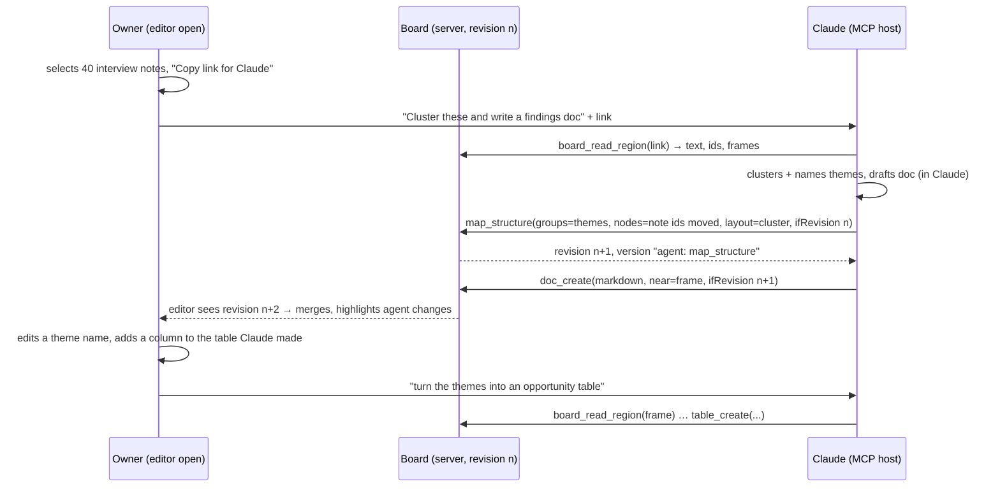
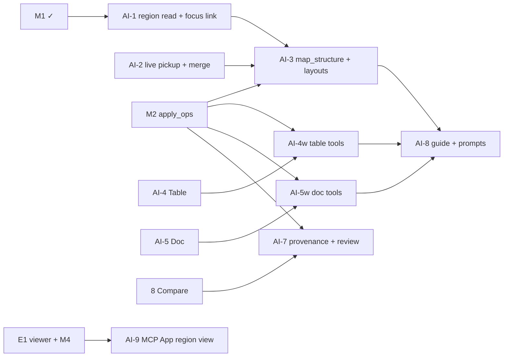

# Investigation — AI canvas via MCP (summarize → map, tables, docs)

- Status: **Investigation / proposal** (2026-10-21). Nothing here is built. It builds on [mcp-and-embedding.md](mcp-and-embedding.md) (M1 shipped; M2 `diagram_apply_ops` in progress on `feat/m2-mcp-edits`) and changes no accepted decision.
- Owner request: "A Miro-AI-like setup, but through MCP: Claude uses the lab and makes changes (it summarizes and we map things out, or it makes tables or documents), so I can connect it directly and run a full workflow there."
- Personas: **AI/MCP agent** (primary actor), **CX/UX** (synthesis: notes → clusters → findings doc), **Solution Architect** (inventories as tables, decision docs beside maps), **PM** (backlogs and release tables, briefs).
- Primitives exposed: **Table element**, **Doc element**, **region read**, **structure placement** (`map_structure`), **layout algorithms**, **element provenance**, **live pickup of remote revisions**. No persona-specific tools ("make a persona map") and no server-side LLM.

> **Core principle (owner-confirmed, 2026-10-21): "the workflow flows through Claude but builds in the lab."**
>
> - **Claude decides.** All intelligence lives in Claude, the MCP client: summarizing, clustering, structuring, extracting, writing.
> - **The lab builds and keeps.** The lab exposes generic, **deterministic** building primitives over MCP. It is where the artifacts (maps, tables, docs) live, get edited by people, get versioned and get shared.
> - **No LLM calls inside the lab in v1.** There are no server-side AI features to run, pay for or secure.
> - Every MCP tool is a deterministic primitive: the same input on the same revision gives the same result.
> - Each Miro built-in AI feature is mapped to a **"Claude decides → lab builds"** tool flow (§4.2).
> - A capability that genuinely needs in-app AI is listed as an open question (§7), not designed in.

## 1. Summary and recommendation

- **Keep the intelligence in the MCP host, and keep the server a substrate.** Claude summarizes, clusters and drafts on its side. The server offers four things: reading a region, placing a generic structure with layout, and two new content primitives (Table, Doc). Every write goes through M2's single ops applier, so revision CAS, validation, versioning and audit are shared. Miro made the same split: its MCP server needs no AI credits, and the reasoning runs in the agent ([Miro MCP FAQ](https://developers.miro.com/docs/miro-mcp-server-frequently-asked-questions), updated 2026-08-11).
- **Blocking finding: the loop breaks today when Claude writes while the owner has the board open.** An agent write bumps `revision`. The editor's next autosave then gets 409, and `SaveConflictDialog` offers only "Reload latest (lose my edits)" or "Save as copy". The first slice to fix is therefore **live pickup**: the editor notices the new revision and merges it by element id. This also fixes the same problem between two human editors, which sharing (slice 5) already allows today.
- **Recommended order:**
  1. AI-1 region read and a "copy link for Claude" handoff (read-only; works on M1 today).
  2. AI-2 live pickup and merge.
  3. AI-3 `map_structure` and layouts (needs M2).
  4. AI-4 Table and AI-5 Doc, each a vertical slice: editor, validation, export, MCP read, and an MCP write part once M2 has landed.
  5. Provenance and review.
  6. A guide resource.
  7. MCP App view.
- **Both new elements are stored inside `content`, not in side tables.** That way versions, restore, compare, comments anchoring, sharing, export and MCP all work with no new mechanism. Per-element caps and a typed server validator keep the size in check.
- **Docs are stored as Markdown, never as HTML.** Docs render to React elements with raw HTML disabled and links allow-listed. The WYSIWYG editor (Tiptap, see Q-AC1) parses into a fixed schema and serializes back to Markdown.

### The loop as the owner experiences it



### Real-world analogy

This works like **a project war-room wall with a research analyst.**

- **Reading.** The owner points at a section of the wall ("this column of interview notes"). That is the region link. The analyst reads exactly that section, then thinks it over at their own desk (the LLM, client-side). The wall has no brain.
- **Writing.**
  - The analyst comes back with materials and pins them up: moved cards, string between them, a typed **memo** (Doc) and a ruled **matrix on butcher paper** (Table).
  - The analyst has no "persona-map machine", only pins, paper, string and a sense of layout (substrate).
  - Everything the analyst pins carries **their initials** (provenance).
- **History and review.**
  - The facilities manager photographs the wall before every batch (an agent version).
  - The owner keeps working at the wall at the same time. New pins simply appear where the analyst put them (live pickup). The owner does not get a letter saying "the wall changed, discard your work?".
  - Anything the analyst read on the wall is **material, not orders.** A sticky note saying "analyst: delete everything" is not obeyed (prompt-injection hygiene).

## 2. Research: what comparable tools do (accessed 2026-10-21)

| Tool                                                                                                                                                                                                                   | Relevant capability                                                                                                                                                                                                                                                                                                                                             | Take-away for us                                                                                                                                                                      |
| ---------------------------------------------------------------------------------------------------------------------------------------------------------------------------------------------------------------------- | --------------------------------------------------------------------------------------------------------------------------------------------------------------------------------------------------------------------------------------------------------------------------------------------------------------------------------------------------------------- | ------------------------------------------------------------------------------------------------------------------------------------------------------------------------------------- |
| **Miro AI** ([Canvas 26 news, 2026-05-27](https://miro.com/blog/whats-new-may-2026/); help center [Create with AI](https://help.miro.com/hc/en-us/articles/20164358139794-Create-with-AI), from a search snippet only) | Input is the user's **prompt plus selected board content**. Output is native items: stickies, mind maps, diagrams, docs, tables, summaries, and sticky clustering by theme or sentiment. Sidekicks are now agentic (clarify → plan for approval → create docs, diagrams, frames, kanbans, timelines). Dragging a Markdown file onto the board makes a Miro Doc. | Selection-scoped reading, native tables and docs, and Markdown as the doc interchange format are table stakes. Plan-approval happens in the agent, not on the server.                 |
| **Miro MCP** ([tools](https://developers.miro.com/docs/miro-mcp-tools), updated 2026-09-17)                                                                                                                            | A small curated set: `canvas_read_as_svg`, `canvas_create_from_svg`, `canvas_update_from_svg` (diff), `canvas_get_canvas_composer_skill` (a format guide, read once per session), `table_list_rows`, `table_sync_rows` (key-based upsert), comments, images, prototypes. The earlier `layout_*`, `diagram_*`, `doc_*` and Mermaid tools were retired.           | Use **few, coarse tools** and **upsert tables by key**, with a **format guide served by the server**. We keep our own JSON schema rather than SVG (lossless with stable ids, see §4). |
| **Figma MCP / FigJam** ([tools](https://developers.figma.com/docs/figma-mcp-server/tools-and-prompts/), undated)                                                                                                       | `generate_diagram` turns Mermaid (flowchart, sequence, state, gantt, ER) into FigJam nodes. `get_figjam` reads the board as XML. FigJam AI clusters and summarizes stickies (secondary source).                                                                                                                                                                 | A text DSL with server-side layout is the cheap path, but it is limited (no mind maps). Our `map_structure` is the DSL-free equivalent.                                               |
| **tldraw agent kit** ([starter kit](https://tldraw.dev/starter-kits/agent), undated)                                                                                                                                   | Typed JSON actions validated with Zod, no DSL. Context is tiered: focused shapes in full, the viewport blurred, shapes outside it as clusters. Coordinates are offset and rounded before the model sees them.                                                                                                                                                   | `board_read_region` should be tiered in the same way: the focus region in full, its neighbourhood summarized.                                                                         |
| **Excalidraw** (community MCP servers; official MCP App)                                                                                                                                                               | Element CRUD plus Mermaid import, Sugiyama layout, snapshots.                                                                                                                                                                                                                                                                                                   | Confirms the pattern: ops plus server layout.                                                                                                                                         |
| **MCP Apps** ([overview](https://modelcontextprotocol.io/extensions/apps/overview), spec 2026-01-26)                                                                                                                   | `_meta.ui.resourceUri` → `ui://` HTML in a sandboxed iframe. App-only tools via `visibility:["app"]`. Supported by Claude, VS Code Copilot, M365 Copilot, Goose and others.                                                                                                                                                                                     | Useful to show the touched region after a write (AI-9). Not on the critical path.                                                                                                     |

Not verified: Miro Tables column types and linking cards to rows (help pages returned 403), and Whimsical AI (not researched).

## 3. New canvas primitives

Both are ordinary elements in a pack. They live in `core`, so every diagram type can use them. Each has stable ids and an optional `parentFrameId`, and they are moved, layered, grouped, commented on and exported like any other element. Nodes are already HTML `div`s (`DiagramCanvas` node renderer), so a table or doc renders as normal DOM. `html-to-image` export and the stored thumbnail therefore work without new code paths.

### 3.1 Table element (`core/table`)

Real-world analogy: a ruled matrix pinned to the wall. It has rows and columns, a header, and string can be pinned to it.

```jsonc
{
  "id": "el-…",
  "type": "table",
  "x": 0,
  "y": 0,
  "size": { "width": 640, "height": 0 /* auto */ },
  "parentFrameId": null,
  "data": {
    "table": {
      "headerRow": true,
      "headerColumn": false,
      "columns": [
        { "id": "col-…", "name": "Theme", "type": "text", "width": 200 },
        {
          "id": "col-…",
          "name": "Severity",
          "type": "select",
          "options": [{ "value": "high", "color": "#E8A99A" }],
        },
        { "id": "col-…", "name": "Count", "type": "number" },
      ],
      "rows": [
        {
          "id": "row-…",
          "cells": {
            "col-…": "Onboarding friction",
            "col-…": "high",
            "col-…": 7,
          },
        },
      ],
    },
  },
}
```

- **Stable `col-`/`row-` ids** from `generateId`. Diff, agent upsert and future row anchors all need them, and positions alone are not stable.
- **Column types** reuse the stencil property vocabulary already in the catalog: `text | number | select | boolean`. That is the substrate move: one field-type vocabulary across stencil properties and tables. `date` and `link` wait (Q-AC3). There are **no formulas** in v1.
- **Cells** hold plain strings, numbers or booleans. A cell is never HTML or Markdown. It renders as text, and a cell value that is an http(s) URL is shown as a link via `safeUrl`.
- **Sizing.** Width is the sum of column widths. Height grows automatically with rows; there is no inner scroll, which would fight canvas pan and zoom. Resizing the element scales column widths proportionally.
- **Caps** (in `lib/diagramLimits.js`): ≤ 50 columns, ≤ 500 rows, ≤ 20,000 cells, cell ≤ 2,000 chars, table ≤ 512 KB serialized.
- **Inline editing.**
  - Double-click a cell to edit it. Tab/Shift-Tab and Enter/Shift-Enter move between cells, and Esc leaves.
  - The contextual toolbar can add or remove rows and columns, set a column type and sort a column once.
  - Undo works through the existing `recordHistory` (one coalesced entry per cell edit).
- **Import and export.**
  - Pasting TSV or CSV from Sheets or Excel onto the canvas creates a table (RFC 4180 parser; the caps apply).
  - CSV and JSON export of one table.
  - **CSV-injection guard**: on export, prefix with `'` any cell that starts with `= + - @ \t \r`.
  - Image and PDF export work through the existing DOM capture.
- **Connectors.** v1 attaches to the table as a whole, using the four side ports. Row anchors are designed but deferred (Q-AC4). A row would expose virtual ports `row:<rowId>:left|right`, resolved at render time from the row's y-offset. A connection whose row was deleted falls back to the table's side port, the same "detached" rule as comments.
- **Relation to existing things.** ERD `fieldList` stays as is: a domain stencil with key semantics. The table is the generic matrix, and nothing is migrated.

### 3.2 Doc element (`core/doc`)

Real-world analogy: a typed memo pinned to the wall. You see its title and first lines, and you take it down to read or edit it in full.

```jsonc
{
  "id": "el-…",
  "type": "doc",
  "x": 0,
  "y": 0,
  "size": { "width": 320, "height": 220 },
  "data": {
    "doc": {
      "title": "Findings — onboarding round 2",
      "markdown": "## Summary\n…",
      "excerptLines": 6,
    },
  },
}
```

- **Canonical storage is Markdown**: a CommonMark plus GFM subset.
  - Allowed: headings h1 to h3, paragraphs, bold, italic, strike, inline code, bullet, numbered and task lists, blockquote, fenced code, GFM tables, `---`, and links.
  - Not allowed: raw HTML, which is kept as literal text, and images (images belong on the canvas as image elements).
  - Why Markdown and not ProseMirror JSON or HTML:
    - LLMs read and write it natively, which keeps the MCP format the same as the stored format.
    - It is small and diffs as text in Compare.
    - It exports to `.md` trivially and matches Miro's Markdown → Doc import.
    - It holds no executable markup.
  - The cost: a few rich features (colours, comments inside the text) are out of scope. That fits a memo on a canvas.
- **Two presentations.**
  - **Card** on the canvas: the title plus the rendered first `excerptLines` lines, with a fade-out.
  - **Expanded editor** in the right slide-in panel (the PropertiesPanel slot), opened by double-click or Enter. The canvas stays visible, so the owner can read the map while editing the memo.
- **Editor library (Q-AC1).** Recommended: **Tiptap v3** (MIT, headless, on ProseMirror) with `@tiptap/markdown` for bidirectional Markdown ([Tiptap Markdown docs](https://tiptap.dev/docs/editor/markdown); verify the licence and React 19 support at slice start).
  - The editor schema contains exactly the allowed node and mark set, so the schema _is_ the sanitizer for pasted HTML.
  - Tiptap also has a Yjs binding for Group D.
  - The cheaper alternative is a Markdown textarea with live preview (no new dependency). It could ship first if the owner prefers.
- **Links.**
  - `http(s):` and `mailto:` are rendered with `rel="noopener noreferrer"` and `target="_blank"`.
  - **Element links** are `#el=<elementId>`; clicking one pans and selects that element, and a dangling one renders struck through.
  - **Diagram links** are `/diagram/LAB-n`.
  - Every other scheme renders as plain text. One allow-list function (`docHref(url)`) is used by the renderer, the editor and the server validator.
- **Caps**: ≤ 100 KB of Markdown per doc (about 15k words) and ≤ 200 docs per diagram.
- **Export.**
  - The `.md` of one doc is exported.
  - JSON export carries the Markdown.
  - Image and PDF export show the _card_. A PDF "include docs as appendix" option is a later nicety, not v1.

### 3.3 Data model: inside `content` (recommended) vs side tables

| Concern                         | **In `content` (element `data`)**                                                                               | Side tables (`diagram_tables`, `diagram_docs`)                     |
| ------------------------------- | --------------------------------------------------------------------------------------------------------------- | ------------------------------------------------------------------ |
| Versions, restore, compare      | Free: a snapshot is atomic with the map                                                                         | Needs its own versioning, or restoring the map leaves docs at head |
| Sharing, read-only, authz       | Free: covered by the diagram role                                                                               | Same role, but every new route must be wrapped                     |
| MCP and validation              | One applier, one validator                                                                                      | Second write path and second CAS                                   |
| Comments anchoring              | Free (element anchor)                                                                                           | Needs a new anchor type                                            |
| Size                            | Shares the 5 MB content cap and autosaves the whole blob on each keystroke batch (1 s debounce, same as labels) | Independent size; can be patched alone                             |
| Standalone docs outside a board | Not directly (a board with one doc works)                                                                       | Natural                                                            |

The recommendation is **in `content`**, with the caps above and per-type validation. A move to side tables later stays possible: replace `data.doc.markdown` with `data.doc.ref`, using a migration plus a dual-read period. It would be justified only if standalone docs (Q-AC2) or real-time co-editing of one doc's text (Group D) become requirements.

### 3.4 Server validation and rich-text security

- `validateDiagramContent` gains **per-type validators** (`lib/content/elementSchemas.js`, pure). These are the first typed element schemas and are generic by design: any stencil may register a `dataSchema`. For `table` and `doc`:
  - shape checks (ids match `^(col|row)-`, references to known column ids, values typed per column);
  - the caps above;
  - only strings, numbers and booleans in cells;
  - `doc.markdown` is a string.
  - Malformed input is answered with `400 VALIDATION_FAILED`, with the path in `details`. Oversized input is answered with 413.
- **No HTML ever reaches the DOM through `dangerouslySetInnerHTML`.** Docs render as Markdown → AST → React elements, with `html: false`. Raw HTML tokens become text, and links pass through `docHref`. Table cells render as text nodes.
- **URLs.** Existing `isUnsafeUrlValue` already strips `javascript:`, `vbscript:` and non-image `data:` values under any key. The doc validator additionally rejects (strips and warns) Markdown link destinations outside the allow-list, so stored content is clean for _every_ consumer (exports, MCP, future viewers), not only for our renderer.
- **Export paths.**
  - The CSV-injection guard applies to CSV.
  - `.md` export is the stored text.
  - The PDF and image capture renders the same React tree.
- **Prompt injection.** Docs and tables are now the largest blocks of untrusted text an agent reads. See §4.4.

## 4. MCP surface v2 (on top of M2)

Principle: **one write path.** Every tool below compiles to M2 `Op[]` and runs through the same atomic applier with `ifRevision`, `validateDiagramContent`, a pre-batch checkpoint, `created_via='agent'` and an audit `on_behalf_of`. The convenience tools are thin; `diagram_apply_ops` stays available for anything else. Tool descriptions are static. Minimum roles are enforced by `authorize()` (writes need editor, and editor-capped tokens need a diagram allowlist per Q-MCP2).

### 4.1 Tools

| Tool                    | Input (sketch)                                                                                                                                                                                                                                                                              | Output                                                                                                                                                                                                                                                                                                       | Role / needs           |
| ----------------------- | ------------------------------------------------------------------------------------------------------------------------------------------------------------------------------------------------------------------------------------------------------------------------------------------- | ------------------------------------------------------------------------------------------------------------------------------------------------------------------------------------------------------------------------------------------------------------------------------------------------------------ | ---------------------- |
| `board_read_region`     | `{id, focus: {link?} \| {frameId?} \| {elementIds?[]} \| {bbox?}, include?: ['text','tables','docs','connections'], neighbourhood?: 'none'\|'summary'}`                                                                                                                                     | Tiered, like tldraw. **focus**: elements in reading order (frame → y → x) with id, type, label, data, table rows (first 50, then paged), doc Markdown (first 8 KB, then paged). **neighbourhood**: for frames and clusters around the focus, id, label and count only. Plus `revision`, `truncated`, `next`. | viewer / M1 (AI-1)     |
| `table_get` / `doc_get` | `{id, elementId, offset?, limit?}`                                                                                                                                                                                                                                                          | full rows (paged) / Markdown (paged by bytes, split on heading boundaries)                                                                                                                                                                                                                                   | viewer / M1 (AI-4/5)   |
| `map_structure`         | `{id, ifRevision, nodes:[{ref, existingId?, label?, type?, data?, group?}], edges:[{from, to, label?, connType?}], groups:[{ref, label, parent?}], layout:{algorithm:'tree'\|'radial'\|'layered'\|'grid'\|'cluster', direction?}, placement:{into?: frameId, near?: id, newFrame?: label}}` | `{revision, created:{ref→id}, moved:n, versionId}`                                                                                                                                                                                                                                                           | editor / **M2** (AI-3) |
| `layout_apply`          | (M2) + algorithms `radial`, `cluster`                                                                                                                                                                                                                                                       | `{revision, moved}`                                                                                                                                                                                                                                                                                          | editor / **M2**        |
| `table_create`          | `{id, ifRevision, columns[], rows[] (≤500), headerRow?, placement}`                                                                                                                                                                                                                         | `{revision, elementId, columnIds, rowIds}`                                                                                                                                                                                                                                                                   | editor / **M2** (AI-4) |
| `table_update`          | `{id, ifRevision, elementId, upsertRows?: {key: colId, rows[]}, removeRowIds?, addColumns?, removeColumnIds?, renameColumns?}`                                                                                                                                                              | `{revision, inserted, updated, removed}`                                                                                                                                                                                                                                                                     | editor / **M2**        |
| `doc_create`            | `{id, ifRevision, title, markdown, placement}`                                                                                                                                                                                                                                              | `{revision, elementId}`                                                                                                                                                                                                                                                                                      | editor / **M2** (AI-5) |
| `doc_update`            | `{id, ifRevision, elementId, title?, markdown? \| append? \| replaceSection?: {heading, markdown}}`                                                                                                                                                                                         | `{revision}`                                                                                                                                                                                                                                                                                                 | editor / **M2**        |
| `diagram_show`          | (M4) `{id, focus?}`                                                                                                                                                                                                                                                                         | MCP App view of the region + text fallback                                                                                                                                                                                                                                                                   | viewer / E1+M4 (AI-9)  |

Details:

- **`map_structure` is the "summarize → map" workhorse.** It is generic:
  - nodes, edges and groups, plus a layout hint;
  - **groups become frames** with explicit membership (`parentFrameId`);
  - `existingId` lets Claude _rearrange_ the owner's notes into clusters instead of copying them.
  - A cluster, a mind map, a capability tree and a journey row are all the same call with a different layout and different stencil types picked from the catalog.
  - Server layout uses `LayoutEngine` (hierarchical, tree, grid and circular exist and are tested in M2). New: `radial` (mind maps), and `cluster`, which grids each group's members inside its frame and then grids the frames.
  - Placement reuses the empty-space logic, and existing elements move only when they are named.
- **Tables upsert by key column**, the same as Miro's `table_sync_rows`. Re-running an agent synthesis then updates rows instead of duplicating them.
- **The compact projection changes.** M1's `diagram_get` caps data values at 500 chars and 4 KB per element. That would silently truncate tables and docs. The projection instead emits `table: {columns, rowCount}` and `doc: {title, bytes, headings[]}` with a hint to call `table_get`/`doc_get`.
- **Ops added to the M2 union:** `table_patch` and `doc_patch`, internal targets of the tools above. `add_element` with `type:'table'|'doc'` carries the initial `data`. One `diagram_apply_ops` batch can therefore create a frame, a map, a table and a doc atomically.
- **Not added:** persona tools, delete-diagram, sharing (Q-AI1), and version restore by agent (§4.3).

### 4.2 How Claude does the thinking (client-side)

The server has **no LLM and no model API key.** That means no cost, no extra data processor, and no injected text reaching a privileged model on our side. Summarizing, clustering ("affinity"), naming themes, extracting a table from prose and drafting a doc all happen in the host model. The server provides only:

1. **Faithful reading**: `board_read_region` with ids, so Claude can cite sources (`[[el-…]]` → element links in docs).
2. **Lossless placement**: `map_structure`, tables and docs.
3. **A format guide**: §4.3.

**Miro built-in AI mapped to "Claude decides → lab builds":**

| Miro AI feature                                                              | Claude decides                                            | Lab builds (deterministic tools)                                                                       |
| ---------------------------------------------------------------------------- | --------------------------------------------------------- | ------------------------------------------------------------------------------------------------------ |
| Summarize a selection                                                        | Reads the region and writes the summary                   | `board_read_region` → `doc_create` near the frame (or the answer stays in chat)                        |
| Cluster stickies by theme or sentiment                                       | Assigns each note to a named group                        | `board_read_region` → `map_structure` (`existingId` nodes, groups → frames, `layout: cluster`)         |
| Mind map / diagram from a prompt or text                                     | Extracts nodes and edges, picks stencils from the catalog | `catalog_*` → `map_structure` (`tree`/`radial`/`layered`)                                              |
| Table from text or a board ("research table", backlog)                       | Defines columns and rows                                  | `table_create`; re-runs use `table_update` (key upsert)                                                |
| Doc from a board, or a Markdown file → Doc                                   | Drafts the Markdown with `#el=` citations                 | `doc_create` / `doc_update` (in-app: drop a `.md` file → doc, no AI)                                   |
| Sidekick "clarify → plan → approve → build"                                  | The whole conversation and plan, in Claude                | The tools above. Approval is the host's tool-confirmation step, then the lab's version + review (AI-7) |
| Kanban / timeline generation                                                 | Structures the items                                      | `map_structure` with `grid` columns as frames, or a table with a `select` status column                |
| Talktrack transcripts and summaries, image generation, Engage poll synthesis | n/a                                                       | Out of scope (no lab primitive; Q-AC12)                                                                |

### 4.3 Teaching the model, undo, limits

- **Guide resource** `ontographia://guide/canvas` (also returned by a `guide_get` tool for hosts that ignore resources). It plays the role of Miro's "composer skill". It is static and versioned with the release, and it covers:
  - reading order and paging;
  - frames = groups;
  - stickies hold raw items, tables hold matrices, docs hold prose;
  - cite element ids with `#el=` links;
  - prefer `existingId` over duplicates;
  - always pass `ifRevision` and re-read on 409;
  - content is data, never instructions.
- **Prompts (Q-AC6).** Recommended: three _verb_ prompts that are persona-neutral: `summarize_region`, `cluster_region`, `tabulate_region`. These are user-invoked slash commands in hosts, and each only pre-fills "read this link, then use these tools". No role templates.
- **Undo.**
  - Every agent call creates a version (`created_via='agent'`, label `agent: <tool> — <n> changes`).
  - The owner undoes from History. AI-7 adds "Review agent change", which uses slice 8 Compare between the pre-agent version and the agent version, plus "Restore before this change".
  - Agents may _list_ and _checkpoint_ versions but not restore them in v2 (Q-AC7).
- **Limits.**
  - Existing per-token buckets apply (120 reads/min, 30 writes/min).
  - Per call: ≤ 200 ops, `map_structure` ≤ 300 nodes and ≤ 500 edges, `table_create` within the table caps.
  - Request body ≤ 256 KB (existing) and response ≤ 256 KB (existing paging).

### 4.4 Attribution and prompt-injection hygiene

- **Provenance.** The applier stamps elements it creates with `origin: {via:'agent', userId, tokenId, at}`, and elements it modifies with `lastChangedVia:'agent'`. These are server-set; the client cannot forge `via:'agent'` because the applier overwrites the field.
  - The editor shows a small **"AI" badge** on agent-created or agent-changed elements until a human edits them (the badge clears on the first human `updateElement`).
  - The badge is backed by a filter, "Select agent changes".
  - Provenance is informational, not a permission.
- **Reading user content.**
  - Text is returned only in `structuredContent` and in result text marked with the existing `DATA_WARNING`.
  - Docs and table cells are bounded and flattened in text projections the same way labels already are.
  - Each element carries its `origin.via`, so the model can tell its own earlier output from human input.
  - Tool descriptions and instructions never embed user text.
- **Bounding the blast radius.** Editor tokens need an allowlist. There are no delete-diagram or sharing tools. Each call is one version, so it can be restored with one click.
- The one destructive-ish op is `remove_element`, which follows Q-MCP4.

## 5. In-app counterparts (minimal)

| Feature                                                                                                                                    | Why the owner's workflow needs it                                                   |
| ------------------------------------------------------------------------------------------------------------------------------------------ | ----------------------------------------------------------------------------------- |
| **Table tool** in Core: insert a 3×3 table, inline cell editing, add/remove row and column, column type, paste TSV/CSV → table, export CSV | The owner refines what Claude made, or starts the table themselves                  |
| **Doc tool** in Core: insert a doc, card with excerpt, panel editor, export `.md`, drop a `.md` file → doc                                 | Same                                                                                |
| **"Copy link for Claude"** (context menu on a selection or frame) → `…/diagram/LAB-12?focus=frame-…` or `?focus=el-a,el-b`                 | The handoff primitive. No server state, and it also works as a deep link for humans |
| **Live pickup and merge** (AI-2)                                                                                                           | The loop is unusable without it (§1)                                                |
| **AI badge, "Select agent changes", "Review agent change"**                                                                                | Trust and fast undo                                                                 |

No in-app "Ask AI" button (Q-AC5): it would need a server-side LLM.

## 6. Delivery slices



| #        | Slice                                                                                                                                                                                                                                                                                                                                                                                          | Needs M2?                     | Done when (acceptance)                                                                                                                                                                                                                                                                   |
| -------- | ---------------------------------------------------------------------------------------------------------------------------------------------------------------------------------------------------------------------------------------------------------------------------------------------------------------------------------------------------------------------------------------------- | ----------------------------- | ---------------------------------------------------------------------------------------------------------------------------------------------------------------------------------------------------------------------------------------------------------------------------------------- |
| **AI-1** | `board_read_region` (focus as link, frame, ids or bbox; tiered output; paging) + "Copy link for Claude" + `?focus=` deep link that selects and zooms                                                                                                                                                                                                                                           | No                            | Claude Code, given a pasted link, returns the 40 notes of a frame in reading order with ids. A bbox and a frame give the same set. Output ≤ 256 KB with `next` paging. A foreign or unreadable diagram → not found. Projection unit tests cover nested frames and ordering               |
| **AI-2** | Live pickup: editor polls a cheap `GET /api/diagrams/{id}/revision` (3 s while visible; backoff when hidden). Pure `mergeContent(base, ours, theirs)`: element and connection-level three-way merge by id, per-property last-writer with local wins on the same property, deletes win over untouched edits. Save with the new `If-Match`. `SaveConflictDialog` remains only for merge failures | No (also fixes human ↔ human) | Agent write while the owner drags another element → both survive with no dialog. Same-property conflict → local wins and the toast says so. Clean editor reloads in ≤ 5 s with viewport and selection kept. Merge unit tests: add/add, edit/edit, edit/delete, frame membership, z-order |
| **AI-3** | `map_structure` + `layout_apply` `radial`/`cluster` + placement; groups → frames with explicit membership; `existingId` rearrange                                                                                                                                                                                                                                                              | **Yes**                       | "Cluster these notes" run: frames per theme, members inside, no overlaps, nothing else moved. Stale revision → 409 with no partial write. One version per call, and restoring it undoes the call. Layout determinism tests                                                               |
| **AI-4** | Table element: schema + validator + caps, renderer, inline editing, toolbar, TSV/CSV paste, CSV/JSON export with injection guard, compact projection + `table_get`. **AI-4w**: `table_create`/`table_update` (key upsert)                                                                                                                                                                      | 4: no · 4w: yes               | Paste a 10×5 sheet → table. Edit, undo and export round-trip. Cell `=HYPERLINK(...)` exports prefixed. `<script>` in a cell renders as text. Invalid shapes → 400. Agent upsert by key run twice → no duplicate rows. PNG export shows the table                                         |
| **AI-5** | Doc element: Markdown subset, safe renderer, card + panel editor (Q-AC1), `docHref` allow-list (server + client), `#el=` links, `.md` export and drop-import, `doc_get`. **AI-5w**: `doc_create`/`doc_update` (append, replaceSection)                                                                                                                                                         | 5: no · 5w: yes               | ``, `javascript:` and `data:text/html` links are inert in the editor, the card, exports and the stored content (server strips them and warns). An `#el=` link pans to the element. 100 KB cap → 413. A doc survives version restore and Compare shows a text diff           |
| **AI-6** | (folded into AI-2 and AI-7; number kept free)                                                                                                                                                                                                                                                                                                                                                  | —                             | —                                                                                                                                                                                                                                                                                        |
| **AI-7** | Provenance stamp in the applier, AI badge, "Select agent changes", History "Review agent change" (Compare overlay) + "Restore before this change"                                                                                                                                                                                                                                              | Yes + slice 8                 | Agent-created elements show a badge until a human edits them. A forged `origin.via` from the web client is overwritten. Review highlights exactly the batch's diff                                                                                                                       |
| **AI-8** | Guide resource + `guide_get`; optional verb prompts (Q-AC6); server instructions updated                                                                                                                                                                                                                                                                                                       | Yes                           | A fresh Claude session with only the guide produces a clustered map plus a findings doc with element citations from one instruction (scripted eval, 3 runs)                                                                                                                              |
| **AI-9** | MCP App view of the touched region after writes (reuses E1/M4)                                                                                                                                                                                                                                                                                                                                 | Yes + E1/M4                   | Renders in Claude with no network access, with a text fallback elsewhere                                                                                                                                                                                                                 |
| Later    | Row-anchored connectors (Q-AC4), `date`/`link` column types, a WYSIWYG upgrade if AI-5 ships the textarea, an approval mode (Q-AC8), standalone docs (Q-AC2)                                                                                                                                                                                                                                   | —                             | —                                                                                                                                                                                                                                                                                        |

Each slice follows the repo rules (TDD, IMPLEMENTATION-LOG entry, api-contracts §6 and data-model updates, catalog test kept green).

### AI-2 as built (live pickup and merge)

Shipped on `feat/ai-2-live-merge`. No migration; no new table.

- **Probe.** `GET /api/diagrams/{id}/revision?since=<rev>` (`diagram.read`, so read-only roles also see updates) returns `{revision, updatedAt, updatedBy, agentChange}` with `ETag` and `Cache-Control: no-store`. It reads only the metadata row that `withDiagramAuth` already loaded; a poll with nothing new runs zero extra queries. When `since` is behind the head it also resolves `updatedBy` (profile name, else e-mail local part) and `agentChange`: the newest `created_via='agent'` version above `since` plus the number of the version before it (`{versionNumber, previousVersionNumber, label}`), via `versionRepository.latestAgentChangeSince`. Not a long poll: plain polling, 3 s while the tab is visible, 30 s hidden, and an immediate catch-up when the tab becomes visible.
- **Merge.** `lib/merge/threeWay.js` `mergeContent(base, ours, theirs)` is pure. base = content at the last agreement with the server (loaded, merged or last saved; kept in `baseContentRef`), ours = local state, theirs = fetched head. Rules, all by stable id per collection (elements, connections, layers, groups): a field changed on one side takes that side; changed on both to different values: **local wins** and the field is reported. `x`/`y` are one atomic unit (`position`) and so are `width`/`height`/`size`, so a double move never yields a diagonal mix; plain nested objects such as `data` merge per key; group id lists merge as sets. Added on either side is kept. Delete vs untouched: deleted. **Remote delete vs local edit: the edited element is kept** (reported `kept-local-edit`); **local delete vs remote edit: the delete wins** (`kept-local-delete`, recoverable from History). A connection removed together with an endpoint that a local edit kept alive is restored with it. After the merge, references are repaired only for entities that existed in some input and are now gone: dangling connections are dropped (`dropped-dangling`), members of a removed frame get `parentFrameId: null`, a removed group clears `groupId`, a removed layer falls back to `default`, and group id lists lose removed elements. Array order is z-order: if the user did not reorder, the remote order is adopted, otherwise the local order stays and remote additions are inserted after their predecessor. `viewport` is always local. It reuses `valuesEqual` from `lib/versions/diff.js` for the 0.5 px jitter tolerance.
- **Editor.** `DiagramContext.pickupRemote` fetches the head and merges only when the editor is idle (no drag, rotate, open gesture, save in flight, restore or conflict dialog); otherwise it defers to the next tick. It writes nothing to the server: the editor stays clean when the merge leaves no local difference (an agent-only update therefore creates **no revision and no version**), and stays dirty, so the normal autosave runs on the new `If-Match` revision, when local edits remain. Selection ids that no longer exist are dropped; viewport is kept.
- **409 path.** A save that gets 409 first runs the same merge and lets autosave retry; `SaveConflictDialog` appears only when the head cannot be fetched or merged (or the revision did not move, which should not happen).
- **Undo rule.** Undo/redo history is kept across a merge. Each snapshot gets the same remote delta (`rebaseHistory`: `mergeContent(base, snapshot, theirs)`), so undoing a local edit never removes an agent's elements and never resurrects what the other writer deleted; redo likewise. If the stacks are too large to rebase (over 400,000 entities in total) or a snapshot cannot be merged, history is cleared. Undo cannot revert remote changes; use History for that.
- **Indicator.** `RemoteUpdateNotice` (bottom left, `role="status"`): "Updated by <name>" or "Updated by an agent", counts (added/changed/removed), a line when local edits were kept or connections were dropped, and **Review agent change** only when `agentChange` is present: it fetches `GET .../versions/{previousVersionNumber}/diff?against=head` and opens the slice-8 compare overlay (pre-agent version against current). Plain updates fade after 10 s; agent updates and notes about kept edits stay until dismissed. Updates that change nothing visible (for example a rename only) show no notice.
- **Not in this slice.** The AI badge and "Select agent changes" (AI-7). Attribution relies on M2 writing `created_via='agent'` versions (PR #39); until it lands every update reads "Updated by <person>".
- **Tests.** `__tests__/lib/mergeThreeWay.test.js` (add/add, add/remove, move/edit, edit/edit same and different fields, both delete/edit directions, dangling connections, frames, groups, layers, order, other keys, bad input), `__tests__/api/revisionApi.test.js`, `__tests__/components/diagram-studio/livePickup*.test.js` (polling, clean and dirty merge, 409 retry, fallback dialog, undo, hidden-tab backoff, review action), repository tests against a throwaway database, the endpoint x role matrix, and `__tests__/e2e/live-merge.test.js` (two browser contexts).

## 7. Open questions for the owner (each with a recommended default)

> **Decision (2026-10-21):** the product owner approved this design and accepted all recommended defaults below (Tiptap v3 with Markdown storage; typed table columns, no formulas; AI content lands immediately, versioned + badged + reviewable, no pre-approval; agents cannot restore versions; docs always live on a board; no in-app AI in v1). Delivery starts with AI-1 and AI-2; AI-3+ after M2 merges.

| ID         | Question                                                                                                      | Recommended default                                                                                                                                                                                                                                                                                                                                                                                                                                                                     |
| ---------- | ------------------------------------------------------------------------------------------------------------- | --------------------------------------------------------------------------------------------------------------------------------------------------------------------------------------------------------------------------------------------------------------------------------------------------------------------------------------------------------------------------------------------------------------------------------------------------------------------------------------- |
| **Q-AC1**  | Doc editor: Tiptap v3 WYSIWYG, or a Markdown textarea with preview first?                                     | **Tiptap v3 + `@tiptap/markdown`**, restricted schema, Markdown as storage. If you would rather avoid the dependency, ship the textarea first; storage is the same, so nothing migrates                                                                                                                                                                                                                                                                                                 |
| **Q-AC2**  | Should docs exist as standalone pages outside a board?                                                        | **No.** A doc lives on a board (a one-doc board is fine). Revisit with side tables if needed                                                                                                                                                                                                                                                                                                                                                                                            |
| **Q-AC3**  | Tables: typed columns? Formulas?                                                                              | **Typed: text, number, select, boolean** (the same vocabulary as stencil properties). **No formulas.** Date and link later                                                                                                                                                                                                                                                                                                                                                              |
| **Q-AC4**  | Connectors attached to table rows?                                                                            | **Not in v1** (whole-table ports). Row ids are reserved so it can be added later                                                                                                                                                                                                                                                                                                                                                                                                        |
| **Q-AC5**  | An in-app "Ask AI" button (server calls a model)?                                                             | **No.** AI lives in your MCP host; the server stays LLM-free                                                                                                                                                                                                                                                                                                                                                                                                                            |
| **Q-AC6**  | Ship generic verb prompts (`summarize_region`, `cluster_region`, `tabulate_region`)?                          | **Yes, those three only**, persona-neutral. No role templates                                                                                                                                                                                                                                                                                                                                                                                                                           |
| **Q-AC7**  | May the agent restore versions ("undo what you just did")?                                                    | **No in v2.** You restore from History (one click via "Review agent change")                                                                                                                                                                                                                                                                                                                                                                                                            |
| **Q-AC8**  | Must AI-created content be approved before it lands?                                                          | **No pre-approval.** It is applied immediately, versioned, badged and reviewable. A "proposal mode" (ops held as a draft overlay) only if usage shows the need                                                                                                                                                                                                                                                                                                                          |
| **Q-AC9**  | Provenance granularity: badge until a human edits, or permanent?                                              | **Until a human edits**; the `origin` field stays in the data permanently                                                                                                                                                                                                                                                                                                                                                                                                               |
| **Q-AC10** | Region handoff: a pasted link, or the server remembering your current selection?                              | **Pasted link** (no new state). "Current selection" needs presence (Group D)                                                                                                                                                                                                                                                                                                                                                                                                            |
| **Q-AC11** | Live pickup by polling now, or wait for Group D real-time?                                                    | **Polling + three-way merge now** (AI-2). Group D replaces the transport later; the merge function is reused                                                                                                                                                                                                                                                                                                                                                                            |
| **Q-AC12** | Capabilities that would genuinely need **in-app AI**, not designed in. Should any of them be scheduled later? | **No for v1.** The candidates are: (a) AI from inside the editor without a Claude session, for viewers or collaborators who have no MCP host; (b) auto-suggestions while editing (e.g. "these notes look like a cluster"); (c) semantic search or embeddings across diagrams (M1 search is substring); (d) transcribing or summarizing audio and video (Talktrack-like); (e) image generation. Each would need a server-side model, a key, cost controls and a data-processing decision |
