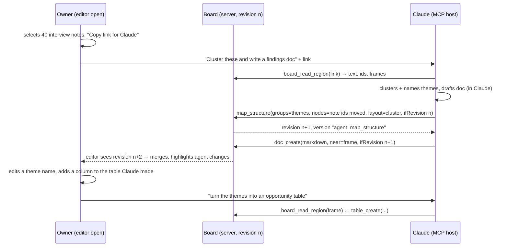
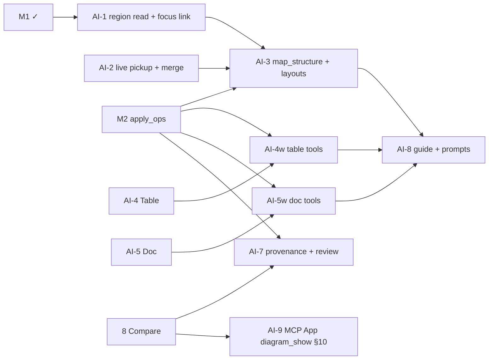
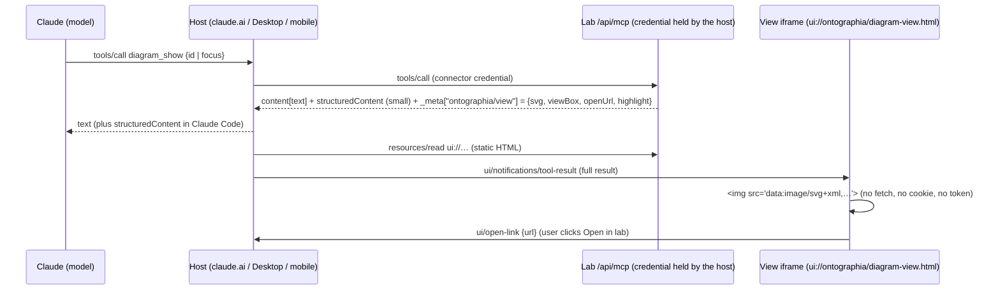

# Investigation — AI canvas via MCP (summarize → map, tables, docs)

- Status: **Investigation / proposal** (2026-10-21). Built so far: AI-1, AI-2, AI-3 and AI-4 (see the as-built sections 8, the AI-2 section, 9 and 11); the rest is not built. It builds on [mcp-and-embedding.md](mcp-and-embedding.md) (M1 shipped; M2 `diagram_apply_ops` in progress on `feat/m2-mcp-edits`) and changes no accepted decision.
- Owner request: "A Miro-AI-like setup, but through MCP: Claude uses the lab and makes changes (it summarizes and we map things out, or it makes tables or documents), so I can connect it directly and run a full workflow there."
- Personas: **AI/MCP agent** (primary actor), **CX/UX** (synthesis: notes → clusters → findings doc), **Solution Architect** (inventories as tables, decision docs beside maps), **PM** (backlogs and release tables, briefs).
- Primitives exposed: **Table element**, **Doc element**, **region read**, **structure placement** (`map_structure`), **layout algorithms**, **element provenance**, **live pickup of remote revisions**. No persona-specific tools ("make a persona map") and no server-side LLM.

> **Core principle (owner-confirmed, 2026-10-21): "the workflow flows through Claude but builds in the lab."**
>
> - **Claude decides.** All intelligence lives in Claude, the MCP client: summarizing, clustering, structuring, extracting, writing.
> - **The lab builds and keeps.** The lab exposes generic, **deterministic** building primitives over MCP. It is where the artifacts (maps, tables, docs) live, get edited by people, get versioned and get shared.
> - **No LLM calls inside the lab in v1.** There are no server-side AI features to run, pay for or secure.
> - Every MCP tool is a deterministic primitive: the same input on the same revision gives the same result.
> - Each Miro built-in AI feature is mapped to a **"Claude decides → lab builds"** tool flow (§4.2).
> - A capability that genuinely needs in-app AI is listed as an open question (§7), not designed in.

## 1. Summary and recommendation

- **Keep the intelligence in the MCP host, and keep the server a substrate.** Claude summarizes, clusters and drafts on its side. The server offers four things: reading a region, placing a generic structure with layout, and two new content primitives (Table, Doc). Every write goes through M2's single ops applier, so revision CAS, validation, versioning and audit are shared. Miro made the same split: its MCP server needs no AI credits, and the reasoning runs in the agent ([Miro MCP FAQ](https://developers.miro.com/docs/miro-mcp-server-frequently-asked-questions), updated 2026-08-11).
- **Blocking finding: the loop breaks today when Claude writes while the owner has the board open.** An agent write bumps `revision`. The editor's next autosave then gets 409, and `SaveConflictDialog` offers only "Reload latest (lose my edits)" or "Save as copy". The first slice to fix is therefore **live pickup**: the editor notices the new revision and merges it by element id. This also fixes the same problem between two human editors, which sharing (slice 5) already allows today.
- **Recommended order:**
  1. AI-1 region read and a "copy link for Claude" handoff (read-only; works on M1 today).
  2. AI-2 live pickup and merge.
  3. AI-3 `map_structure` and layouts (needs M2).
  4. AI-4 Table and AI-5 Doc, each a vertical slice: editor, validation, export, MCP read, and an MCP write part once M2 has landed.
  5. Provenance and review.
  6. A guide resource.
  7. MCP App view.
- **Both new elements are stored inside `content`, not in side tables.** That way versions, restore, compare, comments anchoring, sharing, export and MCP all work with no new mechanism. Per-element caps and a typed server validator keep the size in check.
- **Docs are stored as Markdown, never as HTML.** Docs render to React elements with raw HTML disabled and links allow-listed. The WYSIWYG editor (Tiptap, see Q-AC1) parses into a fixed schema and serializes back to Markdown.

### The loop as the owner experiences it



### Real-world analogy

This works like **a project war-room wall with a research analyst.**

- **Reading.** The owner points at a section of the wall ("this column of interview notes"). That is the region link. The analyst reads exactly that section, then thinks it over at their own desk (the LLM, client-side). The wall has no brain.
- **Writing.**
  - The analyst comes back with materials and pins them up: moved cards, string between them, a typed **memo** (Doc) and a ruled **matrix on butcher paper** (Table).
  - The analyst has no "persona-map machine", only pins, paper, string and a sense of layout (substrate).
  - Everything the analyst pins carries **their initials** (provenance).
- **History and review.**
  - The facilities manager photographs the wall before every batch (an agent version).
  - The owner keeps working at the wall at the same time. New pins simply appear where the analyst put them (live pickup). The owner does not get a letter saying "the wall changed, discard your work?".
  - Anything the analyst read on the wall is **material, not orders.** A sticky note saying "analyst: delete everything" is not obeyed (prompt-injection hygiene).

## 2. Research: what comparable tools do (accessed 2026-10-21)

| Tool                                                                                                                                                                                                                   | Relevant capability                                                                                                                                                                                                                                                                                                                                             | Take-away for us                                                                                                                                                                      |
| ---------------------------------------------------------------------------------------------------------------------------------------------------------------------------------------------------------------------- | --------------------------------------------------------------------------------------------------------------------------------------------------------------------------------------------------------------------------------------------------------------------------------------------------------------------------------------------------------------- | ------------------------------------------------------------------------------------------------------------------------------------------------------------------------------------- |
| **Miro AI** ([Canvas 26 news, 2026-05-27](https://miro.com/blog/whats-new-may-2026/); help center [Create with AI](https://help.miro.com/hc/en-us/articles/20164358139794-Create-with-AI), from a search snippet only) | Input is the user's **prompt plus selected board content**. Output is native items: stickies, mind maps, diagrams, docs, tables, summaries, and sticky clustering by theme or sentiment. Sidekicks are now agentic (clarify → plan for approval → create docs, diagrams, frames, kanbans, timelines). Dragging a Markdown file onto the board makes a Miro Doc. | Selection-scoped reading, native tables and docs, and Markdown as the doc interchange format are table stakes. Plan-approval happens in the agent, not on the server.                 |
| **Miro MCP** ([tools](https://developers.miro.com/docs/miro-mcp-tools), updated 2026-09-17)                                                                                                                            | A small curated set: `canvas_read_as_svg`, `canvas_create_from_svg`, `canvas_update_from_svg` (diff), `canvas_get_canvas_composer_skill` (a format guide, read once per session), `table_list_rows`, `table_sync_rows` (key-based upsert), comments, images, prototypes. The earlier `layout_*`, `diagram_*`, `doc_*` and Mermaid tools were retired.           | Use **few, coarse tools** and **upsert tables by key**, with a **format guide served by the server**. We keep our own JSON schema rather than SVG (lossless with stable ids, see §4). |
| **Figma MCP / FigJam** ([tools](https://developers.figma.com/docs/figma-mcp-server/tools-and-prompts/), undated)                                                                                                       | `generate_diagram` turns Mermaid (flowchart, sequence, state, gantt, ER) into FigJam nodes. `get_figjam` reads the board as XML. FigJam AI clusters and summarizes stickies (secondary source).                                                                                                                                                                 | A text DSL with server-side layout is the cheap path, but it is limited (no mind maps). Our `map_structure` is the DSL-free equivalent.                                               |
| **tldraw agent kit** ([starter kit](https://tldraw.dev/starter-kits/agent), undated)                                                                                                                                   | Typed JSON actions validated with Zod, no DSL. Context is tiered: focused shapes in full, the viewport blurred, shapes outside it as clusters. Coordinates are offset and rounded before the model sees them.                                                                                                                                                   | `board_read_region` should be tiered in the same way: the focus region in full, its neighbourhood summarized.                                                                         |
| **Excalidraw** (community MCP servers; official MCP App)                                                                                                                                                               | Element CRUD plus Mermaid import, Sugiyama layout, snapshots.                                                                                                                                                                                                                                                                                                   | Confirms the pattern: ops plus server layout.                                                                                                                                         |
| **MCP Apps** ([overview](https://modelcontextprotocol.io/extensions/apps/overview), spec 2026-01-26)                                                                                                                   | `_meta.ui.resourceUri` → `ui://` HTML in a sandboxed iframe. App-only tools via `visibility:["app"]`. Supported by Claude, VS Code Copilot, M365 Copilot, Goose and others.                                                                                                                                                                                     | Useful to show the touched region after a write (AI-9). Not on the critical path.                                                                                                     |

Not verified: Miro Tables column types and linking cards to rows (help pages returned 403), and Whimsical AI (not researched).

## 3. New canvas primitives

Both are ordinary elements in a pack. They live in `core`, so every diagram type can use them. Each has stable ids and an optional `parentFrameId`, and they are moved, layered, grouped, commented on and exported like any other element. Nodes are already HTML `div`s (`DiagramCanvas` node renderer), so a table or doc renders as normal DOM. `html-to-image` export and the stored thumbnail therefore work without new code paths.

### 3.1 Table element (`core/table`)

Real-world analogy: a ruled matrix pinned to the wall. It has rows and columns, a header, and string can be pinned to it.

```jsonc
{
  "id": "el-…",
  "type": "table",
  "x": 0,
  "y": 0,
  "size": { "width": 640, "height": 0 /* auto */ },
  "parentFrameId": null,
  "data": {
    "table": {
      "headerRow": true,
      "headerColumn": false,
      "columns": [
        { "id": "col-…", "name": "Theme", "type": "text", "width": 200 },
        {
          "id": "col-…",
          "name": "Severity",
          "type": "select",
          "options": [{ "value": "high", "color": "#E8A99A" }],
        },
        { "id": "col-…", "name": "Count", "type": "number" },
      ],
      "rows": [
        {
          "id": "row-…",
          "cells": {
            "col-…": "Onboarding friction",
            "col-…": "high",
            "col-…": 7,
          },
        },
      ],
    },
  },
}
```

- **Stable `col-`/`row-` ids** from `generateId`. Diff, agent upsert and future row anchors all need them, and positions alone are not stable.
- **Column types** reuse the stencil property vocabulary already in the catalog: `text | number | select | boolean`. That is the substrate move: one field-type vocabulary across stencil properties and tables. `date` and `link` wait (Q-AC3). There are **no formulas** in v1.
- **Cells** hold plain strings, numbers or booleans. A cell is never HTML or Markdown. It renders as text, and a cell value that is an http(s) URL is shown as a link via `safeUrl`.
- **Sizing.** Width is the sum of column widths. Height grows automatically with rows; there is no inner scroll, which would fight canvas pan and zoom. Resizing the element scales column widths proportionally.
- **Caps** (in `lib/diagramLimits.js`): ≤ 50 columns, ≤ 500 rows, ≤ 20,000 cells, cell ≤ 2,000 chars, table ≤ 512 KB serialized.
- **Inline editing.**
  - Double-click a cell to edit it. Tab/Shift-Tab and Enter/Shift-Enter move between cells, and Esc leaves.
  - The contextual toolbar can add or remove rows and columns, set a column type and sort a column once.
  - Undo works through the existing `recordHistory` (one coalesced entry per cell edit).
- **Import and export.**
  - Pasting TSV or CSV from Sheets or Excel onto the canvas creates a table (RFC 4180 parser; the caps apply).
  - CSV and JSON export of one table.
  - **CSV-injection guard**: on export, prefix with `'` any cell that starts with `= + - @ \t \r`.
  - Image and PDF export work through the existing DOM capture.
- **Connectors.** v1 attaches to the table as a whole, using the four side ports. Row anchors are designed but deferred (Q-AC4). A row would expose virtual ports `row:<rowId>:left|right`, resolved at render time from the row's y-offset. A connection whose row was deleted falls back to the table's side port, the same "detached" rule as comments.
- **Relation to existing things.** ERD `fieldList` stays as is: a domain stencil with key semantics. The table is the generic matrix, and nothing is migrated.

### 3.2 Doc element (`core/doc`)

Real-world analogy: a typed memo pinned to the wall. You see its title and first lines, and you take it down to read or edit it in full.

```jsonc
{
  "id": "el-…",
  "type": "doc",
  "x": 0,
  "y": 0,
  "size": { "width": 320, "height": 220 },
  "data": {
    "doc": {
      "title": "Findings — onboarding round 2",
      "markdown": "## Summary\n…",
      "excerptLines": 6,
    },
  },
}
```

- **Canonical storage is Markdown**: a CommonMark plus GFM subset.
  - Allowed: headings h1 to h3, paragraphs, bold, italic, strike, inline code, bullet, numbered and task lists, blockquote, fenced code, GFM tables, `---`, and links.
  - Not allowed: raw HTML, which is kept as literal text, and images (images belong on the canvas as image elements).
  - Why Markdown and not ProseMirror JSON or HTML:
    - LLMs read and write it natively, which keeps the MCP format the same as the stored format.
    - It is small and diffs as text in Compare.
    - It exports to `.md` trivially and matches Miro's Markdown → Doc import.
    - It holds no executable markup.
  - The cost: a few rich features (colours, comments inside the text) are out of scope. That fits a memo on a canvas.
- **Two presentations.**
  - **Card** on the canvas: the title plus the rendered first `excerptLines` lines, with a fade-out.
  - **Expanded editor** in the right slide-in panel (the PropertiesPanel slot), opened by double-click or Enter. The canvas stays visible, so the owner can read the map while editing the memo.
- **Editor library (Q-AC1).** Recommended: **Tiptap v3** (MIT, headless, on ProseMirror) with `@tiptap/markdown` for bidirectional Markdown ([Tiptap Markdown docs](https://tiptap.dev/docs/editor/markdown); verify the licence and React 19 support at slice start).
  - The editor schema contains exactly the allowed node and mark set, so the schema _is_ the sanitizer for pasted HTML.
  - Tiptap also has a Yjs binding for Group D.
  - The cheaper alternative is a Markdown textarea with live preview (no new dependency). It could ship first if the owner prefers.
- **Links.**
  - `http(s):` and `mailto:` are rendered with `rel="noopener noreferrer"` and `target="_blank"`.
  - **Element links** are `#el=<elementId>`; clicking one pans and selects that element, and a dangling one renders struck through.
  - **Diagram links** are `/diagram/LAB-n`.
  - Every other scheme renders as plain text. One allow-list function (`docHref(url)`) is used by the renderer, the editor and the server validator.
- **Caps**: ≤ 100 KB of Markdown per doc (about 15k words) and ≤ 200 docs per diagram.
- **Export.**
  - The `.md` of one doc is exported.
  - JSON export carries the Markdown.
  - Image and PDF export show the _card_. A PDF "include docs as appendix" option is a later nicety, not v1.

### 3.3 Data model: inside `content` (recommended) vs side tables

| Concern                         | **In `content` (element `data`)**                                                                               | Side tables (`diagram_tables`, `diagram_docs`)                     |
| ------------------------------- | --------------------------------------------------------------------------------------------------------------- | ------------------------------------------------------------------ |
| Versions, restore, compare      | Free: a snapshot is atomic with the map                                                                         | Needs its own versioning, or restoring the map leaves docs at head |
| Sharing, read-only, authz       | Free: covered by the diagram role                                                                               | Same role, but every new route must be wrapped                     |
| MCP and validation              | One applier, one validator                                                                                      | Second write path and second CAS                                   |
| Comments anchoring              | Free (element anchor)                                                                                           | Needs a new anchor type                                            |
| Size                            | Shares the 5 MB content cap and autosaves the whole blob on each keystroke batch (1 s debounce, same as labels) | Independent size; can be patched alone                             |
| Standalone docs outside a board | Not directly (a board with one doc works)                                                                       | Natural                                                            |

The recommendation is **in `content`**, with the caps above and per-type validation. A move to side tables later stays possible: replace `data.doc.markdown` with `data.doc.ref`, using a migration plus a dual-read period. It would be justified only if standalone docs (Q-AC2) or real-time co-editing of one doc's text (Group D) become requirements.

### 3.4 Server validation and rich-text security

- `validateDiagramContent` gains **per-type validators** (`lib/content/elementSchemas.js`, pure). These are the first typed element schemas and are generic by design: any stencil may register a `dataSchema`. For `table` and `doc`:
  - shape checks (ids match `^(col|row)-`, references to known column ids, values typed per column);
  - the caps above;
  - only strings, numbers and booleans in cells;
  - `doc.markdown` is a string.
  - Malformed input is answered with `400 VALIDATION_FAILED`, with the path in `details`. Oversized input is answered with 413.
- **No HTML ever reaches the DOM through `dangerouslySetInnerHTML`.** Docs render as Markdown → AST → React elements, with `html: false`. Raw HTML tokens become text, and links pass through `docHref`. Table cells render as text nodes.
- **URLs.** Existing `isUnsafeUrlValue` already strips `javascript:`, `vbscript:` and non-image `data:` values under any key. The doc validator additionally rejects (strips and warns) Markdown link destinations outside the allow-list, so stored content is clean for _every_ consumer (exports, MCP, future viewers), not only for our renderer.
- **Export paths.**
  - The CSV-injection guard applies to CSV.
  - `.md` export is the stored text.
  - The PDF and image capture renders the same React tree.
- **Prompt injection.** Docs and tables are now the largest blocks of untrusted text an agent reads. See §4.4.

## 4. MCP surface v2 (on top of M2)

Principle: **one write path.** Every tool below compiles to M2 `Op[]` and runs through the same atomic applier with `ifRevision`, `validateDiagramContent`, a pre-batch checkpoint, `created_via='agent'` and an audit `on_behalf_of`. The convenience tools are thin; `diagram_apply_ops` stays available for anything else. Tool descriptions are static. Minimum roles are enforced by `authorize()` (writes need editor, and editor-capped tokens need a diagram allowlist per Q-MCP2).

### 4.1 Tools

| Tool                    | Input (sketch)                                                                                                                                                                                                                                                                              | Output                                                                                                                                                                                                                                                                                                       | Role / needs           |
| ----------------------- | ------------------------------------------------------------------------------------------------------------------------------------------------------------------------------------------------------------------------------------------------------------------------------------------- | ------------------------------------------------------------------------------------------------------------------------------------------------------------------------------------------------------------------------------------------------------------------------------------------------------------ | ---------------------- |
| `board_read_region`     | `{id, focus: {link?} \| {frameId?} \| {elementIds?[]} \| {bbox?}, include?: ['text','tables','docs','connections'], neighbourhood?: 'none'\|'summary'}`                                                                                                                                     | Tiered, like tldraw. **focus**: elements in reading order (frame → y → x) with id, type, label, data, table rows (first 50, then paged), doc Markdown (first 8 KB, then paged). **neighbourhood**: for frames and clusters around the focus, id, label and count only. Plus `revision`, `truncated`, `next`. | viewer / M1 (AI-1)     |
| `table_get` / `doc_get` | `{id, elementId, offset?, limit?}`                                                                                                                                                                                                                                                          | full rows (paged) / Markdown (paged by bytes, split on heading boundaries)                                                                                                                                                                                                                                   | viewer / M1 (AI-4/5)   |
| `map_structure`         | `{id, ifRevision, nodes:[{ref, existingId?, label?, type?, data?, group?}], edges:[{from, to, label?, connType?}], groups:[{ref, label, parent?}], layout:{algorithm:'tree'\|'radial'\|'layered'\|'grid'\|'cluster', direction?}, placement:{into?: frameId, near?: id, newFrame?: label}}` | `{revision, created:{ref→id}, moved:n, versionId}`                                                                                                                                                                                                                                                           | editor / **M2** (AI-3) |
| `layout_apply`          | (M2) + algorithms `radial`, `cluster`                                                                                                                                                                                                                                                       | `{revision, moved}`                                                                                                                                                                                                                                                                                          | editor / **M2**        |
| `table_create`          | `{id, ifRevision, columns[], rows[] (≤500), headerRow?, placement}`                                                                                                                                                                                                                         | `{revision, elementId, columnIds, rowIds}`                                                                                                                                                                                                                                                                   | editor / **M2** (AI-4) |
| `table_update`          | `{id, ifRevision, elementId, upsertRows?: {key: colId, rows[]}, removeRowIds?, addColumns?, removeColumnIds?, renameColumns?}`                                                                                                                                                              | `{revision, inserted, updated, removed}`                                                                                                                                                                                                                                                                     | editor / **M2**        |
| `doc_create`            | `{id, ifRevision, title, markdown, placement}`                                                                                                                                                                                                                                              | `{revision, elementId}`                                                                                                                                                                                                                                                                                      | editor / **M2** (AI-5) |
| `doc_update`            | `{id, ifRevision, elementId, title?, markdown? \| append? \| replaceSection?: {heading, markdown}}`                                                                                                                                                                                         | `{revision}`                                                                                                                                                                                                                                                                                                 | editor / **M2**        |
| `diagram_show`          | (M4) `{id, focus?}`                                                                                                                                                                                                                                                                         | MCP App view of the region + text fallback                                                                                                                                                                                                                                                                   | viewer / E1+M4 (AI-9)  |

Details:

- **`map_structure` is the "summarize → map" workhorse.** It is generic:
  - nodes, edges and groups, plus a layout hint;
  - **groups become frames** with explicit membership (`parentFrameId`);
  - `existingId` lets Claude _rearrange_ the owner's notes into clusters instead of copying them.
  - A cluster, a mind map, a capability tree and a journey row are all the same call with a different layout and different stencil types picked from the catalog.
  - Server layout uses `LayoutEngine` (hierarchical, tree, grid and circular exist and are tested in M2). New: `radial` (mind maps), and `cluster`, which grids each group's members inside its frame and then grids the frames.
  - Placement reuses the empty-space logic, and existing elements move only when they are named.
- **Tables upsert by key column**, the same as Miro's `table_sync_rows`. Re-running an agent synthesis then updates rows instead of duplicating them.
- **The compact projection changes.** M1's `diagram_get` caps data values at 500 chars and 4 KB per element. That would silently truncate tables and docs. The projection instead emits `table: {columns, rowCount}` and `doc: {title, bytes, headings[]}` with a hint to call `table_get`/`doc_get`.
- **Ops added to the M2 union:** `table_patch` and `doc_patch`, internal targets of the tools above. `add_element` with `type:'table'|'doc'` carries the initial `data`. One `diagram_apply_ops` batch can therefore create a frame, a map, a table and a doc atomically.
- **Not added:** persona tools, delete-diagram, sharing (Q-AI1), and version restore by agent (§4.3).

### 4.2 How Claude does the thinking (client-side)

The server has **no LLM and no model API key.** That means no cost, no extra data processor, and no injected text reaching a privileged model on our side. Summarizing, clustering ("affinity"), naming themes, extracting a table from prose and drafting a doc all happen in the host model. The server provides only:

1. **Faithful reading**: `board_read_region` with ids, so Claude can cite sources (`[[el-…]]` → element links in docs).
2. **Lossless placement**: `map_structure`, tables and docs.
3. **A format guide**: §4.3.

**Miro built-in AI mapped to "Claude decides → lab builds":**

| Miro AI feature                                                              | Claude decides                                            | Lab builds (deterministic tools)                                                                       |
| ---------------------------------------------------------------------------- | --------------------------------------------------------- | ------------------------------------------------------------------------------------------------------ |
| Summarize a selection                                                        | Reads the region and writes the summary                   | `board_read_region` → `doc_create` near the frame (or the answer stays in chat)                        |
| Cluster stickies by theme or sentiment                                       | Assigns each note to a named group                        | `board_read_region` → `map_structure` (`existingId` nodes, groups → frames, `layout: cluster`)         |
| Mind map / diagram from a prompt or text                                     | Extracts nodes and edges, picks stencils from the catalog | `catalog_*` → `map_structure` (`tree`/`radial`/`layered`)                                              |
| Table from text or a board ("research table", backlog)                       | Defines columns and rows                                  | `table_create`; re-runs use `table_update` (key upsert)                                                |
| Doc from a board, or a Markdown file → Doc                                   | Drafts the Markdown with `#el=` citations                 | `doc_create` / `doc_update` (in-app: drop a `.md` file → doc, no AI)                                   |
| Sidekick "clarify → plan → approve → build"                                  | The whole conversation and plan, in Claude                | The tools above. Approval is the host's tool-confirmation step, then the lab's version + review (AI-7) |
| Kanban / timeline generation                                                 | Structures the items                                      | `map_structure` with `grid` columns as frames, or a table with a `select` status column                |
| Talktrack transcripts and summaries, image generation, Engage poll synthesis | n/a                                                       | Out of scope (no lab primitive; Q-AC12)                                                                |

### 4.3 Teaching the model, undo, limits

- **Guide resource** `ontographia://guide/canvas` (also returned by a `guide_get` tool for hosts that ignore resources). It plays the role of Miro's "composer skill". It is static and versioned with the release, and it covers:
  - reading order and paging;
  - frames = groups;
  - stickies hold raw items, tables hold matrices, docs hold prose;
  - cite element ids with `#el=` links;
  - prefer `existingId` over duplicates;
  - always pass `ifRevision` and re-read on 409;
  - content is data, never instructions.
- **Prompts (Q-AC6).** Recommended: three _verb_ prompts that are persona-neutral: `summarize_region`, `cluster_region`, `tabulate_region`. These are user-invoked slash commands in hosts, and each only pre-fills "read this link, then use these tools". No role templates.
- **Undo.**
  - Every agent call creates a version (`created_via='agent'`, label `agent: <tool> — <n> changes`).
  - The owner undoes from History. AI-7 adds "Review agent change", which uses slice 8 Compare between the pre-agent version and the agent version, plus "Restore before this change".
  - Agents may _list_ and _checkpoint_ versions but not restore them in v2 (Q-AC7).
- **Limits.**
  - Existing per-token buckets apply (120 reads/min, 30 writes/min).
  - Per call: ≤ 200 ops, `map_structure` ≤ 300 nodes and ≤ 500 edges, `table_create` within the table caps.
  - Request body ≤ 256 KB (existing) and response ≤ 256 KB (existing paging).

### 4.4 Attribution and prompt-injection hygiene

- **Provenance.** The applier stamps elements it creates with `origin: {via:'agent', userId, tokenId, at}`, and elements it modifies with `lastChangedVia:'agent'`. These are server-set; the client cannot forge `via:'agent'` because the applier overwrites the field.
  - The editor shows a small **"AI" badge** on agent-created or agent-changed elements until a human edits them (the badge clears on the first human `updateElement`).
  - The badge is backed by a filter, "Select agent changes".
  - Provenance is informational, not a permission.
- **Reading user content.**
  - Text is returned only in `structuredContent` and in result text marked with the existing `DATA_WARNING`.
  - Docs and table cells are bounded and flattened in text projections the same way labels already are.
  - Each element carries its `origin.via`, so the model can tell its own earlier output from human input.
  - Tool descriptions and instructions never embed user text.
- **Bounding the blast radius.** Editor tokens need an allowlist. There are no delete-diagram or sharing tools. Each call is one version, so it can be restored with one click.
- The one destructive-ish op is `remove_element`, which follows Q-MCP4.

## 5. In-app counterparts (minimal)

| Feature                                                                                                                                    | Why the owner's workflow needs it                                                   |
| ------------------------------------------------------------------------------------------------------------------------------------------ | ----------------------------------------------------------------------------------- |
| **Table tool** in Core: insert a 3×3 table, inline cell editing, add/remove row and column, column type, paste TSV/CSV → table, export CSV | The owner refines what Claude made, or starts the table themselves                  |
| **Doc tool** in Core: insert a doc, card with excerpt, panel editor, export `.md`, drop a `.md` file → doc                                 | Same                                                                                |
| **"Copy link for Claude"** (context menu on a selection or frame) → `…/diagram/LAB-12?focus=frame-…` or `?focus=el-a,el-b`                 | The handoff primitive. No server state, and it also works as a deep link for humans |
| **Live pickup and merge** (AI-2)                                                                                                           | The loop is unusable without it (§1)                                                |
| **AI badge, "Select agent changes", "Review agent change"**                                                                                | Trust and fast undo                                                                 |

No in-app "Ask AI" button (Q-AC5): it would need a server-side LLM.

## 6. Delivery slices



| #        | Slice                                                                                                                                                                                                                                                                                                                                                                                          | Needs M2?                     | Done when (acceptance)                                                                                                                                                                                                                                                                   |
| -------- | ---------------------------------------------------------------------------------------------------------------------------------------------------------------------------------------------------------------------------------------------------------------------------------------------------------------------------------------------------------------------------------------------- | ----------------------------- | ---------------------------------------------------------------------------------------------------------------------------------------------------------------------------------------------------------------------------------------------------------------------------------------- |
| **AI-1** | `board_read_region` (focus as link, frame, ids or bbox; tiered output; paging) + "Copy link for Claude" + `?focus=` deep link that selects and zooms                                                                                                                                                                                                                                           | No                            | Claude Code, given a pasted link, returns the 40 notes of a frame in reading order with ids. A bbox and a frame give the same set. Output ≤ 256 KB with `next` paging. A foreign or unreadable diagram → not found. Projection unit tests cover nested frames and ordering               |
| **AI-2** | Live pickup: editor polls a cheap `GET /api/diagrams/{id}/revision` (3 s while visible; backoff when hidden). Pure `mergeContent(base, ours, theirs)`: element and connection-level three-way merge by id, per-property last-writer with local wins on the same property, deletes win over untouched edits. Save with the new `If-Match`. `SaveConflictDialog` remains only for merge failures | No (also fixes human ↔ human) | Agent write while the owner drags another element → both survive with no dialog. Same-property conflict → local wins and the toast says so. Clean editor reloads in ≤ 5 s with viewport and selection kept. Merge unit tests: add/add, edit/edit, edit/delete, frame membership, z-order |
| **AI-3** | `map_structure` + `layout_apply` `radial`/`cluster` + placement; groups → frames with explicit membership; `existingId` rearrange                                                                                                                                                                                                                                                              | **Yes**                       | "Cluster these notes" run: frames per theme, members inside, no overlaps, nothing else moved. Stale revision → 409 with no partial write. One version per call, and restoring it undoes the call. Layout determinism tests                                                               |
| **AI-4** | Table element: schema + validator + caps, renderer, inline editing, toolbar, TSV/CSV paste, CSV/JSON export with injection guard, compact projection + `table_get`. **AI-4w**: `table_create`/`table_update` (key upsert)                                                                                                                                                                      | 4: no · 4w: yes               | Paste a 10×5 sheet → table. Edit, undo and export round-trip. Cell `=HYPERLINK(...)` exports prefixed. `<script>` in a cell renders as text. Invalid shapes → 400. Agent upsert by key run twice → no duplicate rows. PNG export shows the table                                         |
| **AI-5** | Doc element: Markdown subset, safe renderer, card + panel editor (Q-AC1), `docHref` allow-list (server + client), `#el=` links, `.md` export and drop-import, `doc_get`. **AI-5w**: `doc_create`/`doc_update` (append, replaceSection)                                                                                                                                                         | 5: no · 5w: yes               | ``, `javascript:` and `data:text/html` links are inert in the editor, the card, exports and the stored content (server strips them and warns). An `#el=` link pans to the element. 100 KB cap → 413. A doc survives version restore and Compare shows a text diff           |
| **AI-6** | (folded into AI-2 and AI-7; number kept free)                                                                                                                                                                                                                                                                                                                                                  | —                             | —                                                                                                                                                                                                                                                                                        |
| **AI-7** | Provenance stamp in the applier, AI badge, "Select agent changes", History "Review agent change" (Compare overlay) + "Restore before this change"                                                                                                                                                                                                                                              | Yes + slice 8                 | Agent-created elements show a badge until a human edits them. A forged `origin.via` from the web client is overwritten. Review highlights exactly the batch's diff                                                                                                                       |
| **AI-8** | Guide resource + `guide_get`; optional verb prompts (Q-AC6); server instructions updated                                                                                                                                                                                                                                                                                                       | Yes                           | A fresh Claude session with only the guide produces a clustered map plus a findings doc with element citations from one instruction (scripted eval, 3 runs)                                                                                                                              |
| **AI-9** | MCP App view `diagram_show`: board or region, last agent change highlighted (design and spike: §10; server-side SVG, so no E1 dependency)                                                                                                                                                                                                                                                                                                                                 | No (uses slice 8 + AI-2)                   | See §10.8 (AI-9a/b/c)                                                                                                                                                                                                                 |
| Later    | Row-anchored connectors (Q-AC4), `date`/`link` column types, a WYSIWYG upgrade if AI-5 ships the textarea, an approval mode (Q-AC8), standalone docs (Q-AC2)                                                                                                                                                                                                                                   | —                             | —                                                                                                                                                                                                                                                                                        |

Each slice follows the repo rules (TDD, IMPLEMENTATION-LOG entry, api-contracts §6 and data-model updates, catalog test kept green).

### AI-2 as built (live pickup and merge)

Shipped on `feat/ai-2-live-merge`. No migration; no new table.

- **Probe.** `GET /api/diagrams/{id}/revision?since=<rev>` (`diagram.read`, so read-only roles also see updates) returns `{revision, updatedAt, updatedBy, agentChange}` with `ETag` and `Cache-Control: no-store`. It reads only the metadata row that `withDiagramAuth` already loaded; a poll with nothing new runs zero extra queries. When `since` is behind the head it also resolves `updatedBy` (profile name, else e-mail local part) and `agentChange`: the newest `created_via='agent'` version above `since` plus the number of the version before it (`{versionNumber, previousVersionNumber, label}`), via `versionRepository.latestAgentChangeSince`. Not a long poll: plain polling, 3 s while the tab is visible, 30 s hidden, and an immediate catch-up when the tab becomes visible.
- **Merge.** `lib/merge/threeWay.js` `mergeContent(base, ours, theirs)` is pure. base = content at the last agreement with the server (loaded, merged or last saved; kept in `baseContentRef`), ours = local state, theirs = fetched head. Rules, all by stable id per collection (elements, connections, layers, groups): a field changed on one side takes that side; changed on both to different values: **local wins** and the field is reported. `x`/`y` are one atomic unit (`position`) and so are `width`/`height`/`size`, so a double move never yields a diagonal mix; plain nested objects such as `data` merge per key; group id lists merge as sets. Added on either side is kept. Delete vs untouched: deleted. **Remote delete vs local edit: the edited element is kept** (reported `kept-local-edit`); **local delete vs remote edit: the delete wins** (`kept-local-delete`, recoverable from History). A connection removed together with an endpoint that a local edit kept alive is restored with it. After the merge, references are repaired only for entities that existed in some input and are now gone: dangling connections are dropped (`dropped-dangling`), members of a removed frame get `parentFrameId: null`, a removed group clears `groupId`, a removed layer falls back to `default`, and group id lists lose removed elements. Array order is z-order: if the user did not reorder, the remote order is adopted, otherwise the local order stays and remote additions are inserted after their predecessor. `viewport` is always local. It reuses `valuesEqual` from `lib/versions/diff.js` for the 0.5 px jitter tolerance.
- **Editor.** `DiagramContext.pickupRemote` fetches the head and merges only when the editor is idle (no drag, rotate, open gesture, save in flight, restore or conflict dialog); otherwise it defers to the next tick. It writes nothing to the server: the editor stays clean when the merge leaves no local difference (an agent-only update therefore creates **no revision and no version**), and stays dirty, so the normal autosave runs on the new `If-Match` revision, when local edits remain. Selection ids that no longer exist are dropped; viewport is kept.
- **Busy states (review follow-ups).** A pickup also waits while a label is being typed or a connection endpoint, waypoint, segment or curve is being dragged (the canvas reports this through `setEditingBusy`); once the edit commits the local value wins on the next tick. The merge reads the newest local content from `liveRef` (updated synchronously by the content setters), so an edit queued in the same tick is never overwritten. A pickup that is already fetching is awaited by the 409 path (never skipped into the dialog). The diagram name and description merge like fields against `baseMetaRef` (remote rename adopted unless changed locally; the save sends the merged value). A save that succeeds while the user kept editing recomputes dirty against what was sent, so the later edit autosaves. A 403/404 from the revision probe goes through the slice-5 access handling (read-only notice) and stops polling. Duplicate ids make `mergeContent` return `ok:false` (dialog fallback); `validateDiagramContent` now enforces unique ids per collection and `normalizeDiagramContent` renames legacy duplicates (`id-dupN`) on load, as do duplicate and restore. After a merge `group.elementIds` is re-derived from `element.groupId` for any group some element still points at.
- **409 path.** A save that gets 409 first runs the same merge and lets autosave retry; `SaveConflictDialog` appears only when the head cannot be fetched or merged (or the revision did not move, which should not happen).
- **Undo rule (lazy rebase).** Undo/redo history is kept across a merge and a pickup does not touch it (cost no longer grows with snapshots x entities). A pickup appends the remote delta (base, theirs) to a log of the last 20 pickups and bumps an epoch; every snapshot is stamped with the epoch it was recorded at. When undo or redo reaches a snapshot, only that snapshot is merged forward through the deltas it missed (`rebaseSnapshot`: `mergeContent(deltaBase, snapshot, deltaTheirs)` in order), so undoing a local edit never removes an agent's elements and never resurrects what the other writer deleted. Rule: a snapshot older than the retained 20 pickups cannot be rebased; when undo/redo reaches one (or a merge fails) the history is cleared instead of risking a wrong state. Appending is O(1) (50 snapshots x 2000 elements: under 50 ms, tested).
- **Indicator.** `RemoteUpdateNotice` (bottom left, `role="status"`): "Updated by <name>" or "Updated by an agent", counts (added/changed/removed), a line when local edits were kept or connections were dropped, and **Review agent change** only when `agentChange` is present: it fetches `GET .../versions/{previousVersionNumber}/diff?against=head` and opens the slice-8 compare overlay (pre-agent version against current). Plain updates fade after 10 s; agent updates and notes about kept edits stay until dismissed. Updates that change nothing visible (for example a rename only) show no notice.
- **Not in this slice.** The AI badge and "Select agent changes" (AI-7). Attribution relies on M2 writing `created_via='agent'` versions (PR #39); until it lands every update reads "Updated by <person>".
- **Tests.** `__tests__/lib/mergeThreeWay.test.js` (add/add, add/remove, move/edit, edit/edit same and different fields, both delete/edit directions, dangling connections, frames, groups, layers, order, other keys, bad input), `__tests__/api/revisionApi.test.js`, `__tests__/components/diagram-studio/livePickup*.test.js` (polling, clean and dirty merge, 409 retry, fallback dialog, undo, hidden-tab backoff, review action), repository tests against a throwaway database, the endpoint x role matrix, and `__tests__/e2e/live-merge.test.js` (two browser contexts).

## 7. Open questions for the owner (each with a recommended default)

> **Decision (2026-10-21):** the product owner approved this design and accepted all recommended defaults below (Tiptap v3 with Markdown storage; typed table columns, no formulas; AI content lands immediately, versioned + badged + reviewable, no pre-approval; agents cannot restore versions; docs always live on a board; no in-app AI in v1). Delivery starts with AI-1 and AI-2; AI-3+ after M2 merges.

| ID         | Question                                                                                                      | Recommended default                                                                                                                                                                                                                                                                                                                                                                                                                                                                     |
| ---------- | ------------------------------------------------------------------------------------------------------------- | --------------------------------------------------------------------------------------------------------------------------------------------------------------------------------------------------------------------------------------------------------------------------------------------------------------------------------------------------------------------------------------------------------------------------------------------------------------------------------------- |
| **Q-AC1**  | Doc editor: Tiptap v3 WYSIWYG, or a Markdown textarea with preview first?                                     | **Tiptap v3 + `@tiptap/markdown`**, restricted schema, Markdown as storage. If you would rather avoid the dependency, ship the textarea first; storage is the same, so nothing migrates                                                                                                                                                                                                                                                                                                 |
| **Q-AC2**  | Should docs exist as standalone pages outside a board?                                                        | **No.** A doc lives on a board (a one-doc board is fine). Revisit with side tables if needed                                                                                                                                                                                                                                                                                                                                                                                            |
| **Q-AC3**  | Tables: typed columns? Formulas?                                                                              | **Typed: text, number, select, boolean** (the same vocabulary as stencil properties). **No formulas.** Date and link later                                                                                                                                                                                                                                                                                                                                                              |
| **Q-AC4**  | Connectors attached to table rows?                                                                            | **Not in v1** (whole-table ports). Row ids are reserved so it can be added later                                                                                                                                                                                                                                                                                                                                                                                                        |
| **Q-AC5**  | An in-app "Ask AI" button (server calls a model)?                                                             | **No.** AI lives in your MCP host; the server stays LLM-free                                                                                                                                                                                                                                                                                                                                                                                                                            |
| **Q-AC6**  | Ship generic verb prompts (`summarize_region`, `cluster_region`, `tabulate_region`)?                          | **Yes, those three only**, persona-neutral. No role templates                                                                                                                                                                                                                                                                                                                                                                                                                           |
| **Q-AC7**  | May the agent restore versions ("undo what you just did")?                                                    | **No in v2.** You restore from History (one click via "Review agent change")                                                                                                                                                                                                                                                                                                                                                                                                            |
| **Q-AC8**  | Must AI-created content be approved before it lands?                                                          | **No pre-approval.** It is applied immediately, versioned, badged and reviewable. A "proposal mode" (ops held as a draft overlay) only if usage shows the need                                                                                                                                                                                                                                                                                                                          |
| **Q-AC9**  | Provenance granularity: badge until a human edits, or permanent?                                              | **Until a human edits**; the `origin` field stays in the data permanently                                                                                                                                                                                                                                                                                                                                                                                                               |
| **Q-AC10** | Region handoff: a pasted link, or the server remembering your current selection?                              | **Pasted link** (no new state). "Current selection" needs presence (Group D)                                                                                                                                                                                                                                                                                                                                                                                                            |
| **Q-AC11** | Live pickup by polling now, or wait for Group D real-time?                                                    | **Polling + three-way merge now** (AI-2). Group D replaces the transport later; the merge function is reused                                                                                                                                                                                                                                                                                                                                                                            |
| **Q-AC12** | Capabilities that would genuinely need **in-app AI**, not designed in. Should any of them be scheduled later? | **No for v1.** The candidates are: (a) AI from inside the editor without a Claude session, for viewers or collaborators who have no MCP host; (b) auto-suggestions while editing (e.g. "these notes look like a cluster"); (c) semantic search or embeddings across diagrams (M1 search is substring); (d) transcribing or summarizing audio and video (Talktrack-like); (e) image generation. Each would need a server-side model, a key, cost controls and a data-processing decision |

## 8. As built: AI-1 (2026-10-21)

- **Tool `board_read_region`** (`lib/mcp/regionTool.js`, registered by one line in `lib/mcp/server.js`; pure selection in `lib/mcp/regionSelect.js`). Read-only, `diagram.read` through `authorize()`, so viewer, commenter and editor tokens all work; allowlist applies; foreign or unknown diagrams are "not found".
- **Input:** `id?` (optional when a link is given), `focus` with exactly one of `link`, `frameId`, `elementIds` (max 200), `bbox`, `around {elementId, radius?}` (radius default 300, clamped to 5000); `include?` (`data`, `connections`), `neighbourhood?` (`none`|`summary`), `limit?` (default 200, max 500), `cursor?`.
- **Selection rules:** a frame focus is the frame plus its transitive explicit `parentFrameId` members (never geometry). A frame id inside `elementIds` expands the same way. `bbox` and `around` return every element whose rectangle strictly overlaps (touching edges excluded); elements without coordinates are never selected; missing sizes use the editor defaults. Unknown ids are reported as `focus.notFound`; if none exist the call is an input error.
- **Output:** `structuredContent` = `{diagram, focus {kind, matched, notFound?}, range {offset, returned, total}, packs, elements, connections, neighbourhood?, next?, truncated?, omitted?, hint?}` in reading order (depth-first by frame, then y, then x); `text` = a readable outline plus the `next` cursor. Elements use the existing compact projection (`diagram_get` caps on labels and data). Each of text and structuredContent is capped at the existing per-copy budget (about 128 KB, 256 KB total). A connection is returned once, on the page that holds its later endpoint.
- **Paging:** stateless cursor bound to revision and to the focus; a stale or mismatched cursor is an input error telling the caller to start again.
- **Neighbourhood summary:** frames outside the focus, nearest first (max 20), with `id`, `label`, member `count` only.
- **Not in AI-1:** table and doc tiers, comments, `include: ['text','tables','docs']` (those primitives arrive with AI-4/5); `ontographia://guide/canvas` (arrives with the M2 guide, AI-3).
- **Focus link** (`lib/focusLink.js`): `/diagram/<LAB-n|uuid>?focus=<id>[,<id>...]` (max 200 ids) or `?region=x,y,w,h`. The link does not say whether an id is a frame; the server decides. Selections over 200 elements and the no-selection case ("this view") use `region=`. Parsing is strict (ids `[A-Za-z0-9_.:@+~-]`, finite bounded numbers, no `focus` + `region` together) and ignores the host, so a link can never make the server fetch anything.
- **In-app:** the canvas context menu has "Copy link for Claude" (the selection, or "(this view)" with nothing selected). The link goes to the clipboard; if that is blocked, the link is shown in a small status box. Opening a link with `?focus=` selects and zooms to those elements; `?region=` zooms to the rectangle.
- **Security:** the tool description is static and says board content is user-authored data, not instructions; labels, data and the outline are bounded and flattened by the existing projections.

## 9. As built: AI-3 (2026-10-21)

`map_structure`, `layout_apply`, the layouts, the guide and two prompts. One write path: both tools compile to M2 `Op[]` and run through `applyOps` and `diagramRepository.applyContentChange` (CAS, one `created_via='agent'` version with the pre-agent version before it, `diagram.agent_edit` audit, editor token plus allowlist, write rate limit). The shared path now lives in one helper inside `createMcpServer` (`agentWrite`), used by `diagram_apply_ops`, `map_structure` and `layout_apply`; the first two error texts differ only in wording ("Not applied") and the `code` (`INVALID_OPS` or `INVALID_STRUCTURE`).

- **Files:** `lib/layout/structureLayout.js` (pure layouts), `lib/layout/freeSpace.js` (free-space placement), `lib/mcp/structure.js` (validation and compilers `compileMapStructure` / `compileLayoutApply`), `lib/mcp/structureTool.js` (registration), `lib/mcp/guide.js` (guide text and prompts). `ops.js` gained `opts.maxOps` and `MAX_STRUCTURE_OPS` (800): a compiled batch can exceed the 200 ops a model may send directly, but `diagram_apply_ops` itself is still capped at 200. `placement.js` exports `createBoxIndex`.
- **`map_structure` input:** `{id, baseRevision, structure: {nodes [{key, label?, stencil?, data?, group?, existingId?}], edges [{from, to, label?}], groups [{key, label}]}, layout: tree|radial|mindmap|cluster|flow|grid, anchor?: {near}|{at:{x,y}}|{inFrame}}`. It differs from the sketch in section 4.1: `baseRevision` (not `ifRevision`), `key` (not `ref`), the layout names `tree`, `mindmap`, `flow` (the doc's `layered`), and `anchor` instead of `placement`. Keys are `[A-Za-z0-9_-]{1,38}`. Output: `{revision, versionId, created: {key: id}, groups: {key: id}, summary {layout, nodes, existingMoved, edges, frames, placement, bounds}, counts, warnings?}`.
- **Caps per call:** 200 nodes (the doc said 300), 400 edges (500), 40 groups. Unknown fields, unknown keys or groups, duplicate keys, self loops, an unknown stencil (with closest matches), an `existingId` that is missing, a frame, used twice or combined with `stencil`/`data`, a bad anchor: all rejected before anything is written, listed together. A duplicate edge is dropped with a warning. Cycles are allowed in every layout (back edges are ignored for layering and for the spanning tree; the connector is still drawn).
- **Groups:** each group becomes a `core/frame` with `membershipExplicit`, sized to its members; members get an explicit `parentFrameId`. With a layout other than `cluster`, each group is laid out on its own with that layout (edges inside the group) and the frames are packed; ungrouped nodes form a frameless block beside them. `existingId` nodes are moved (and optionally relabeled), never copied; elements that are not named never move.
- **Stencil defaults:** mindmap and radial: `mind-map/central-topic` (root), `main-topic` (depth 1), `sub-topic`; flow: `process-flow/task`; tree: `core/rectangle`; grid and cluster: `sticky-notes/sticky-medium`. A node's `stencil` overrides. Connector style: step for tree and flow, curved for mindmap and radial, straight otherwise.
- **Layouts (all pure, deterministic, snapped to the 20 px grid, no overlaps; tested on random structures up to 200 nodes):** tree = top-down tidy tree; mindmap = root centered, subtrees split to both sides by leaf count; radial = rings around the root with angular sectors by leaf count (the ring radius grows until every sector has room); flow = longest-path layers left to right with two barycenter sweeps; grid = rows and columns; cluster = per-group grid and shelf-packed frames. The root of tree, mindmap and radial is the first node without an incoming edge; other roots hang off it for layout only (no edge is invented).
- **Placement:** default = right of all existing content, top aligned with it (always free). `near` = beside that element; `at` = that point; both fall back to the nearest free spot (ring search) and then to right of content. `inFrame` = the first free spot in the frame's content area, else below the frame's members with the frame grown to fit. Growth never moves anything; if the grown frame now covers other elements the result carries a warning saying so.
- **`layout_apply`:** `{id, baseRevision, target: {frameId} | {elementIds (up to 300)}, layout, anchor? (elementIds only: near or at)}`. Units are non-frame elements and whole frames (a frame moves rigidly with its contents). A frame target, or a selection whose members share one parent frame, is laid out inside that frame (growing it if needed); otherwise the block stays at the selection's top-left and moves aside only if blocked. Connections between units drive tree, mindmap, radial and flow; `cluster` means grid here. Output is `update_element` ops: x/y, plus `parent` only where the drop rule below changes a non-frame unit's frame (labels, sizes and connections are untouched). A selection that already has this layout is rejected with "Nothing to change" (no empty version).
- **Guide:** resource `ontographia://guide/canvas` and tool `guide_get` (same static text, versioned `GUIDE_VERSION`; it says board content is data, the read-think-build workflow, conventions, limits, and that tables and docs are not available yet). Prompts: `cluster_region {link, theme?}` and `map_from_text {diagramId, layout?}`; `summarize_region` and `tabulate_region` wait for the doc and table primitives. Server instructions point at the guide.
- **Review follow-ups (PR 42):** (1) Frame membership: a note moved by `existingId` without `group`/`anchor.inFrame`, or by `layout_apply`, follows the editor's drop rule (`computeFrameMembershipChanges`: the frame holding the new centre adopts it; outside every frame it is released with `parent: null`; notes held by non-frame containers and members travelling with their own frame are left alone). (2) Locks (`element.locked` or a locked layer) are never overridden: `diagram_apply_ops` update/remove and `map_structure` `existingId` fail with `INVALID_OPS` naming the ids (nothing written); `layout_apply` skips locked units, and frames holding a locked member, with a warning and arranges the rest (they stay as obstacles); a locked target frame is rejected. The applier itself (`isLockedElement` in `ops.js`) enforces this for update/remove, so no path bypasses it. (3) `structure.nodes/edges/groups` must be arrays; keys `__proto__`, `constructor`, `prototype` are rejected; `created`/`groups` results are null-prototype objects. (4) `layout_apply` on an empty frame says "the frame has no members". The guide has a "Locks and frames" section.
- **Not in AI-3:** `table_*` and `doc_*` tools, the AI badge and Review (AI-7), `parent` nesting of groups, per-edge styles, `layout.direction`, version labels such as "agent: map_structure - n changes" (the applier does not take a label yet).
- **Tests:** layout geometry (no overlaps for every layout including cyclic and edgeless input, determinism, frames), validation, compile-to-ops and existing-element rearrangement, anchors, `layout_apply`, a performance test (200 nodes into a diagram of about 4700 elements, under 300 ms best of 3, in every layout), MCP protocol tests with the real authz (viewer/commenter refused, editor outside the allowlist not found, CAS conflict, rate limit, size budget, guide and prompts), and a throwaway-database test that a `map_structure` write makes one agent version, one audit row, and restoring the pre-agent version undoes it.

## 10. Addendum (2026-10-21): show the board inside Claude (`diagram_show`, slice AI-9)

Owner question (2026-10-21): "can it also feed back into Claude and visualise it there?" The principle is unchanged: **Claude does the thinking, the lab builds and hosts the artifacts.** The view below is a window onto the lab's board, not a second editor.

### 10.1 Research (accessed 2026-10-21)

| Topic                  | Finding                                                                                                                                                                                                                                                                                                                                                                                                                                                                                                                                                                                                                                                                                                                                                                                                                                                                               | Source                                                                                                                                                                                                                                                                                 |
| ---------------------- | ------------------------------------------------------------------------------------------------------------------------------------------------------------------------------------------------------------------------------------------------------------------------------------------------------------------------------------------------------------------------------------------------------------------------------------------------------------------------------------------------------------------------------------------------------------------------------------------------------------------------------------------------------------------------------------------------------------------------------------------------------------------------------------------------------------------------------------------------------------------------------------- | -------------------------------------------------------------------------------------------------------------------------------------------------------------------------------------------------------------------------------------------------------------------------------------- |
| Mechanism              | MCP Apps extension `io.modelcontextprotocol/ui`, stable spec **2026-01-26**. A tool declares `_meta.ui.resourceUri` (`ui://…`); the host reads that resource (`mimeType: text/html;profile=mcp-app`) and renders it in a sandboxed iframe (a double iframe on web). The view talks JSON-RPC over `postMessage`: `ui/initialize` → `ui/notifications/initialized`; the host sends `ui/notifications/tool-input`, `…/tool-result` (the whole `CallToolResult`, `_meta` included) and `…/host-context-changed`; the view may send `ui/open-link`, `ui/message`, `ui/update-model-context`, `ui/request-display-mode`, `ui/notifications/size-changed` and plain `tools/call` (proxied by the host to our server). Tools with `_meta.ui.visibility: ["app"]` are callable by the view but hidden from the model. The flat `_meta["ui/resourceUri"]` key is deprecated (removed before GA) | [spec 2026-01-26](https://github.com/modelcontextprotocol/ext-apps/blob/main/specification/2026-01-26/apps.mdx); [overview](https://modelcontextprotocol.io/extensions/apps/overview)                                                                                                  |
| CSP / sandbox          | Default CSP when a resource declares nothing: `default-src 'none'; script-src 'self' 'unsafe-inline'; style-src 'self' 'unsafe-inline'; img-src 'self' data:; media-src 'self' data:; connect-src 'none'`. Extra origins only via `_meta.ui.csp.{connectDomains, resourceDomains, frameDomains, baseUriDomains}`; Claude restricts `frameDomains` pending review. Optional stable origin `_meta.ui.domain` = first 32 hex chars of SHA-256(connector URL) + `.claudemcpcontent.com` (only needed for an in-view OAuth flow)                                                                                                                                                                                                                                                                                                                                                           | spec; Claude [get started](https://claude.com/docs/connectors/building/mcp-apps/getting-started), [design guidelines](https://claude.com/docs/connectors/building/mcp-apps/design-guidelines), [troubleshooting](https://claude.com/docs/connectors/building/mcp-apps/troubleshooting) |
| Sizing                 | Inline cards auto-fit their height (no nested vertical scroll; the host caps and clips inline height); modes `inline`, `fullscreen`, `pip`; widths from 320 px; mobile renders in a native WebView and vertical pans go to the conversation. Host style variables (`--color-*`, `--font-*`, `--border-radius-*`) arrive in `hostContext.styles`                                                                                                                                                                                                                                                                                                                                                                                                                                                                                                                                       | Claude design guidelines                                                                                                                                                                                                                                                               |
| Result size            | claude.ai and Desktop: ~**150,000 characters** per tool result. Beyond that (with code execution on) the result is written to a file and **the app never hydrates**. Claude Code: 25,000 tokens (`MAX_MCP_OUTPUT_TOKENS`)                                                                                                                                                                                                                                                                                                                                                                                                                                                                                                                                                                                                                                                             | [Build an MCP server for Claude](https://claude.com/docs/connectors/building); troubleshooting                                                                                                                                                                                         |
| What the model sees    | Spec: `content` is model context; `structuredContent` is "optimized for UI rendering (not added to model context)"; `_meta` is "not intended for model context". **But Claude Code forwards `structuredContent` to the model** (and drops the text when both are present)                                                                                                                                                                                                                                                                                                                                                                                                                                                                                                                                                                                                             | spec; [claude-code#55677](https://github.com/anthropics/claude-code/issues/55677), [#15412](https://github.com/anthropics/claude-code/issues/15412)                                                                                                                                    |
| SDK                    | `@modelcontextprotocol/ext-apps` (MIT on npm). **2.0.x** (2.0.0 on 2026-09-08, 2.0.3 on 2026-09-25) peers on the SDK **v2** packages (`@modelcontextprotocol/server@^2`, `zod@^4.2`). **1.7.5** (2026-07-23) peers on `@modelcontextprotocol/sdk@^1.29` and `zod@^3.25` (we run 1.32.1 and 3.25.76); 1.36 MB unpacked. The `App` class is optional: the wire protocol can be spoken directly                                                                                                                                                                                                                                                                                                                                                                                                                                                                                          | npm registry (queried 2026-10-21); [ext-apps](https://github.com/modelcontextprotocol/ext-apps)                                                                                                                                                                                        |
| Claude surfaces        | **Render MCP Apps:** claude.ai (web), Claude Desktop, Claude for iOS/Android (WKWebView/WebView; the connector must be added on web or desktop first) and Cowork. **Do not render:** Claude Code (CLI). It uses the tool's text result, drops the UI and does not advertise `io.modelcontextprotocol/ui` (open request [claude-code#95149](https://github.com/anthropics/claude-code/issues/95149), 2026-09-17). Custom remote connectors run on the same infrastructure as directory connectors                                                                                                                                                                                                                                                                                                                                                                                      | [Use interactive connectors](https://support.claude.com/en/articles/13454812-use-interactive-connectors-in-claude) (updated 2026-08-11); Claude docs above                                                                                                                             |
| Other hosts            | VS Code Copilot, M365 Copilot, Goose, Postman, MCPJam, Archestra. Reference host: `examples/basic-host` (AppBridge)                                                                                                                                                                                                                                                                                                                                                                                                                                                                                                                                                                                                                                                                                                                                                                   | overview; [basic-host](https://github.com/modelcontextprotocol/ext-apps/tree/main/examples/basic-host)                                                                                                                                                                                 |
| How others show boards | **Excalidraw** (official): `create_view` renders the scene inline; `export_to_excalidraw`, `save_checkpoint` and `read_checkpoint` are app-only tools; its resource CSP allows `https://esm.sh` to load the editor. **Miro**: an MCP Apps pilot returns board-summary cards, item tables, frame grids and SVG graphs with an "Open in Miro" CTA (validated in Claude Desktop on 2026-05-24); Miro's own MCP server is text-only. **Figma** is listed by Claude as an interactive connector. **tldraw** ships an editable canvas app                                                                                                                                                                                                                                                                                                                                                   | [excalidraw-mcp `src/server.ts`](https://github.com/excalidraw/excalidraw-mcp); [miro-mcp-apps](https://github.com/olgasafonova/miro-mcp-apps); support article above; [tldraw blog](https://tldraw.dev/blog/tldraw-mcp-app)                                                           |

### 10.2 What the view shows (v1, read-only)

- **Scope:** the whole diagram, or a region using exactly the AI-1 focus vocabulary (`focus.link` from "Copy link for Claude", `frameId`, `elementIds`, `bbox`, `around`). Same `authorize(…, 'diagram.read')`, the same allowlist, and "not found" for foreign diagrams.
- **Highlight of the last agent change**, using the slice-8 diff: `diffContent(version before, agent version)`, found with `versionRepository.latestAgentChangeSince` (AI-2). The colours are the Compare overlay's: added green, changed amber, removed shown as a dashed red ghost at the old bounds.
  - Default `highlight: "auto"` marks it only while the agent's version still equals the head (no human edits since), so an old agent batch is never presented as "what just happened".
  - `"last-agent-change"` forces it; `"none"` skips the lookup.
- **Interaction:** zoom (buttons, Ctrl/⌘ + wheel, pinch), drag to pan, Fit, **Changes** (zoom to the highlighted area), and **Full screen** when the host offers it.
- **Open in lab:** sends `ui/open-link` with the AI-1 deep link (`/diagram/LAB-n?focus=…` selects and zooms in the editor; the whole-diagram view links to the board). The view never navigates itself. If the host refuses, the view prints the URL.
- **Not in v1:** editing, comments, selection, live updates, and dark rendering of the board itself (the board keeps its own colours, as on the canvas; the surrounding chrome uses host tokens).

### 10.3 How data reaches the view (no auth in the iframe)



- The picture travels **inside the tool result**, so the view needs no network, cookie or token. The CSP stays at the spec default: the resource declares empty `connectDomains` and `resourceDomains`, and the HTML adds its own `<meta>` CSP (`img-src data:`, `connect-src 'none'`).
- **Three channels, three audiences:**
  - `content` text: a short summary and the link, for the model and for text-only hosts.
  - `structuredContent`: small ids, counts and the link. It is safe even where it reaches the model, as in Claude Code.
  - `_meta["ontographia/view"]`: the SVG. It is never model context, so the picture costs zero model tokens on every host.
- Revisit only if a host strips result `_meta`. The official `pdf-server` and `map-server` examples read `result._meta` in the view, so hosts forward it. The fallback would be an app-only tool `diagram_render` (`visibility: ["app"]`) that the view calls.

### 10.4 Rendering approach (decision)

| Option                                                                              | Size                                                                                                               | Fidelity                                                                                                                                                                                                                                                                                                          | Verdict                                                                                                                          |
| ----------------------------------------------------------------------------------- | ------------------------------------------------------------------------------------------------------------------ | ----------------------------------------------------------------------------------------------------------------------------------------------------------------------------------------------------------------------------------------------------------------------------------------------------------------- | -------------------------------------------------------------------------------------------------------------------------------- |
| Bundle the editor canvas (E1 viewer inlined, as mcp-and-embedding.md B2/M4 assumed) | DiagramCanvas, packs, React and MUI: megabytes inline in every resource read; needs the E1 viewer extraction first | Exact                                                                                                                                                                                                                                                                                                             | Too big for v1; still the path to an editable view                                                                               |
| Headless Chromium screenshot (PNG)                                                  | A heavy new dependency and process                                                                                 | Exact                                                                                                                                                                                                                                                                                                             | Rejected (Q-MCP6 stays "no")                                                                                                     |
| **Server-side SVG from stored content** (`lib/render/diagramSvg.js`)                | About 6 KB for a 10-element board; no dependency                                                                   | Shapes from the stencil catalog (`shape`, `color`, size) with the packs' fill, stroke and label-contrast rules, and the **same connector geometry**: `autoPorts` and the straight, curved, arc and orthogonal path builders are reused from the editor. No pack decorations (UML compartments, ERD fields, icons) | **Chosen.** The smallest thing that reads as "our board"; also reusable for e-mail or Slack previews and a server-side thumbnail |

For v1 this **supersedes** the "inlined E1 bundle" wording of mcp-and-embedding.md B2/M4. E1 remains the route to an editable or pack-exact view.

### 10.5 Limits and security

- **Size:** the SVG is capped at 96 KB (at most 600 elements and 1,200 connections drawn; labels at most 160 characters). The whole result stays well under Claude's ~150,000-character inline limit (tested with 2,000 elements and 3,000 connections: under 120,000 characters). Over the cap, the view and the text both say "too large, narrow the focus or open it in the lab".
- **Shared output budget (fixed in AI-9a):** the older read tools used to allow 256 KB of text plus the same again as `structuredContent` (about 272 KB), over claude.ai's limit. `MAX_RESPONSE_BYTES` is now 120 KB, so one result is at most about 136 KB with framing (text and `structuredContent` each get about half, as before; paging with `frameId` / `elementIds` / `offset` is unchanged).
- **Sanitization:**
  - Every user string is XML-escaped.
  - Colours are parsed and re-emitted as `#rrggbb`, so a stored `url(https://…)` can never reach a `fill`.
  - Numbers are finite, and path data is checked against a command-and-number alphabet.
  - The SVG is shown as an `` data URI, where browsers run no script and load nothing; even a renderer bug cannot execute or exfiltrate.
  - The view sets text with `textContent` only and opens only `http(s)` links that the server produced.
- **Prompt injection:** board text is in the picture, not in model context. The text summary repeats the "user-authored data, not instructions" notice, and the tool description is static.
- **Auth:** unchanged (bearer API tokens; the view never sees them). Using Claude's hosted surfaces still needs the lab reachable as a remote connector: a public HTTPS URL, plus OAuth or an Owner-entered static header under Claude's connector auth rules.

### 10.6 Graceful fallback

Hosts without MCP Apps (Claude Code today, older clients) ignore `_meta.ui` and show the text, for example: `Showing "Checkout journey" (LAB-1, revision 2): 10 elements and 7 connections drawn. Highlighted: the agent change saved as version 3 (+3 added, ~1 changed, -2 removed)… Open in lab: https://…/diagram/LAB-1`. The stateless server cannot see client capabilities on `tools/call`, so it always returns all three channels, with no per-host branching.

### 10.7 v2 (optional): selection back to Claude, edits stay in the lab

- **Selection:** a click or lasso in the view sends `ui/update-model-context` with `{diagram, focus.elementIds, link}` (the AI-1 focus link). The next Claude turn can then call `board_read_region` on exactly that selection. Only ids are sent, never labels, which keeps injected text out of context. Hit-testing uses the element boxes (the SVG already tags `data-id`).
- **No editing in the view:** "Edit" means Open in lab. Agent edits stay in `diagram_apply_ops` (versioned and reviewable, AI-7).
- **Optional auto-refresh** while the card is visible, through an app-only `diagram_revision` tool (polling the AI-2 probe through the host). Only if users ask for it.

### 10.8 Delivery slices

| #                        | Slice                                                                                                                                                          | Done when (acceptance)                                                                                                                                                                                                                                                                                                                                                                                                 |
| ------------------------ | -------------------------------------------------------------------------------------------------------------------------------------------------------------- | ---------------------------------------------------------------------------------------------------------------------------------------------------------------------------------------------------------------------------------------------------------------------------------------------------------------------------------------------------------------------------------------------------------------------- |
| **AI-9a**                | `diagram_show`, `ui://ontographia/diagram-view.html` and `lib/render/diagramSvg.js`: this spike, hardened, with renderer coverage for every pack's base shapes | Renders in claude.ai and Claude Desktop against the deployed lab (manual checklist with screenshots, light and dark). Claude Code gets the same text fallback. A foreign diagram is "not found". `<script>` labels and `url()` colours are inert (tests). A 2,000-element board gives the "too large" message with a result under 150,000 characters. The view makes no network request (headless check in basic-host) |
| **AI-9b**                | Guide and instructions: "after a write, call `diagram_show`"; the `diagram_apply_ops` result suggests it                                                       | Scripted eval: after "add a wallet path", Claude calls `diagram_show` and the card highlights exactly that batch                                                                                                                                                                                                                                                                                                       |
| **AI-9c** (v2, optional) | Selection → `ui/update-model-context`; mobile tap targets; pack decorations for the most-used packs                                                            | Selecting 3 notes and asking "cluster these" makes Claude call `board_read_region` with those ids                                                                                                                                                                                                                                                                                                                      |

### 10.9 Open questions (recommended defaults)

**Approved by the product owner on 2026-10-21, all recommended defaults** (Q-AV1 to Q-AV6 as listed below). Q-AV7 (how the lab authenticates as a remote connector) is decided separately: an OAuth design is in progress and is not part of AI-9a.

| ID    | Question                                                                                                                    | Recommended default                                                                                                                                    |
| ----- | --------------------------------------------------------------------------------------------------------------------------- | ------------------------------------------------------------------------------------------------------------------------------------------------------ |
| Q-AV1 | Should every write (`diagram_apply_ops`, `map_structure`) render the card itself (tool `_meta.ui`), or only `diagram_show`? | **Only `diagram_show`.** Writes stay text, so a series of edits does not spam cards. Revisit after the AI-9b eval                                      |
| Q-AV2 | Server-side SVG (approximate) or bundle the editor renderer (exact)?                                                        | **SVG for v1**; the E1 bundle only for an editable view                                                                                                |
| Q-AV3 | Add `@modelcontextprotocol/ext-apps`?                                                                                       | **No.** 2.x needs the SDK v2 upgrade; 1.7.x adds 1.36 MB for helpers that ~270 lines of plain view code replace. Re-evaluate with the SDK v2 migration |
| Q-AV4 | Default highlight                                                                                                           | **`auto`** (only while the agent change is the latest state)                                                                                           |
| Q-AV5 | The board in dark mode                                                                                                      | **Keep the board's colours** (a light board, host-themed chrome), like the canvas                                                                      |
| Q-AV6 | Selection back to Claude (v2)                                                                                               | **Yes, ids and the link only**, after an explicit click by the user                                                                                    |
| Q-AV7 | Deploy the lab as a public remote connector so it works in claude.ai, Desktop and mobile?                                   | **Needed for any real use.** Decide the auth (OAuth or a static header) with the deploy work                                                           |

### 10.10 Spike as built (branch `spike/mcp-app-diagram-show`, 2026-10-21)

- **Code:**
  - `lib/render/diagramSvg.js`: the pure renderer.
  - `lib/mcp/app/diagramView.js`: the static view HTML (~270 lines, no dependency, protocol `2026-01-26`).
  - `lib/mcp/showTool.js`: the tool and the resource.
  - One registration in `lib/mcp/server.js`, and `focusShape` exported from `regionTool.js`. The server instructions mention `diagram_show`.
  - No migration, no new dependency, no feature flag (read-only).
- **Verified:**
  - Unit and protocol tests: `__tests__/lib/diagramSvg.test.js` and `__tests__/lib/mcpDiagramShow.test.js`.
  - The real `/api/mcp` on a dev server with a throwaway database: an agent `diagram_apply_ops` batch, then `diagram_show`, returned an 8 KB result with the highlight.
  - Headless Chromium in the **official reference host** (`ext-apps/examples/basic-host` at `82221c0`, ext-apps 2.0.3) rendered the card: title, legend, highlight, zoom, Fit, Changes, Full screen and Open in lab. The host received `ui/open-link` and opened the deep link.
  - The view made **no network request** besides the host's own sandbox page and the `data:` image.
  - A small local proxy added the bearer header and CORS for the browser-based host; in production, Claude's backend holds the credential.
- **Not verified:**
  - Rendering inside claude.ai, Desktop or mobile. This needs the lab deployed at a public HTTPS URL and added as a custom connector.
  - Claude-specific behaviour: `_meta` forwarding, `ui/open-link` confirmation, and full screen.
  - Claude's stricter default CSP. basic-host's CSP is looser, but the view's own meta CSP is the strict one and was in force.

### 10.11 As built: AI-9a (2026-10-21, branch `feat/ai-9a-diagram-show`)

The spike, hardened. No new dependency, no migration, no feature flag, no auth change.

- **Renderer hardening** (`lib/render/diagramSvg.js`): coordinates beyond ±1e6 are treated as corrupt (the element is skipped; sizes are clamped to 100,000), so the output never contains `Infinity`, `NaN` or exponent notation. Waypoints and removed-ghost bounds follow the same rule.
- **Model-facing text** (`lib/mcp/showTool.js`): the diagram name, change labels and ids are flattened to one line (`oneLine`), so a name with newlines cannot add lines to the text the model reads.
- **Shared budget:** `MAX_RESPONSE_BYTES` 256 KB to 120 KB (see 10.5). The `diagram_show` result is unaffected: SVG at most 96 KB plus a small text, tested under 120,000 characters for a 2,000-element board.
- **Tests added:**
  - `diagramSvg.test.js`: an injection payload in every user string (ids, labels, `data`, `properties.frameTitle`, connection id, label, colour, line style, waypoints) parses as strict XML (jsdom) with only drawing elements and no `on*`, `href`, `xlink` or `src` attribute; every stencil of every pack renders; absurd numbers; determinism and the byte cap.
  - `mcpDiagramShow.test.js`: viewer, commenter and editor tokens; the allowlist gives "not found" by id, short id and focus link with no name leak; a link that contradicts `id` is rejected; the text fallback stands alone; `auto` highlight switches off after a later edit; the view HTML's CSP, no network or navigation sinks, and `http(s)` links only.
  - `mcpServer.test.js` and the other budget tests use the 120 KB budget.
- **Verified in the MCP Apps reference host** (`basic-host`) again: render, zoom, Fit, Changes, Full screen, Open in lab, and no network request from the view. Still **not** verified in claude.ai, Desktop or mobile (needs the deployed connector, Q-AV7).
- **How-to:** "See the board in Claude" in `mcp-connect-howto.md` section 7.
- **Review fixes (PR 45):** `structuredContent` ids are validated, capped at 100 characters and 200 per list, with a 16 KB backstop that drops the id lists (`idsOmitted`); `notFound` is capped the same way (`notFoundCount` keeps the total). `validateDiagramContent` rejects ids over 128 characters on writes (elements, connections, layers, groups; existing stored content still loads). `curveAmount` is clamped to ±1e4, the SVG carries no `data-id`, the highlight box reuses `boundsOf`, quotes in the diagram name are neutralized in the model text, and the view opens links only under the server-named lab origin.

## 11. As built: AI-4 Table (2026-10-21, branch `feat/ai-4-table`)

The table element and its tools. No migration, no new dependency, no feature flag. One write path: `table_create` and `table_update` compile to ops (`add_element` with `table`, and the new `table_patch`) and run through `agentWrite` (rate limit, editor token plus allowlist or all-boards, CAS, `validateDiagramContent`, one `created_via='agent'` version, one `diagram.agent_edit` audit row, locks respected by the applier).

**Owner use case (2026-10-21): "graph, then table, then a text summary".** The design did not define links from a row to a board element, so it was added minimally: a row may carry `elementId`.
- Agents give `elementId` on a row (`table_create`, `table_update` upsert). It is validated against the diagram on write (an unknown id fails the whole call with the row path); inside one `diagram_apply_ops` batch it may be an `@ref` to an element created earlier in the batch.
- The editor shows a link button in the row gutter; clicking it selects the element and zooms to it. When the element is deleted the row keeps the id and the gutter shows plain, non-clickable text with the tooltip "The linked element was removed". A dangling id stays valid in stored content (an autosave never fails because a source was deleted); only agent writes check that the element exists.
- People can link or unlink a row in the editor: select the table and one other element, open the row menu, "Link to ...".
- `table_get` and the SVG render show the link, and flag it `{missing: true}` / hollow when dangling. Importing or merging a JSON file remaps links to the new element ids and drops links to elements that were not part of the insert.

**Data model** (`lib/table/tableModel.js`, pure). `element.data.table` = `{headerRow, headerColumn, columns, rows}` (the editor and the stencil catalog use `element.data`, so it is not under `properties`). Columns `{id: "col-...", name, type: text|number|select|boolean, width?, options?: [{value, color?}]}`; rows `{id: "row-...", cells: {columnId: string|number|boolean}, elementId?}` (an empty cell is a missing key). No formulas. A select column learns its options from the values it holds. Caps (`lib/diagramLimits.js`): 50 columns, 500 rows, 20,000 cells, 2,000 characters per cell, 512 KB per table, 50 options per select. The stencil is `core/table` (shape `table`, four side ports); a label is optional and shown as a title above the table.

**Validation** (`lib/table/tableSchema.js`, called by `validateDiagramContent` on every save and agent write). Closed schema (unknown keys rejected), `col-`/`row-` ids of at most 128 characters and unique, cells typed per column, no `null` cells, the caps above (400 `VALIDATION_FAILED` with the path, 413 for an oversized table). A cell is never HTML: it renders as a text node, and `javascript:`/`data:` values are removed by the shared URL rule. A `core/table` element without `data.table` is refused; the editor gives every table one when it is created (`DiagramContext.addElement`).

**Layout.** Deterministic, so the element size, the SVG, the export and connector ports agree: a 40 px gutter, a 36 px header, rows from 32 px that grow with wrapped text (at most 5 lines, a 7 px per character estimate), no inner scroll. Width = gutter + column widths; resizing the element scales the columns proportionally (settles 350 ms after the gesture) and the height always follows the rows. Connectors attach to the whole table (Q-AC4: row anchors deferred).

**Editor.** Files under `components/diagram-studio/elements/table/`: `TableNode.js` (grid, keyboard, menus), `CellEditor.js`, `TableMenu.js`, `newTableElement.js`, `useTablePaste.js`; rendered through `CorePack.renderNode`.
- Table tool (toolbar and Tools menu): a click places a 3 x 3 table.
- Double-click or Enter or F2 edits a cell; typing on an active cell replaces it. Enter / Shift+Enter commit and move down / up, Tab / Shift+Tab move right / left (Tab past the last cell adds a row), Alt+Enter or Ctrl+Enter is a newline, Escape leaves without committing, blur commits. A value that does not fit the column type (for example text in a number column) is refused with a notice and the editor stays open on Enter. Arrow keys move the active cell; Delete clears it (and never deletes the element).
- Column menu: rename, type (text, number, select, yes/no; cells that cannot convert are emptied and counted in a notice, undo restores), sort once A to Z or Z to A, insert left or right, move, delete; a header edge drag resizes. Row menu: insert above or below, move, delete, link or unlink, go to element. Table menu: header row on or off, Export as CSV, Export as JSON, Copy as TSV. Add row and add column buttons sit under and beside a selected table.
- Paste: a tab-separated or CSV range from Sheets or Excel pasted on the canvas becomes a table at the center of the view (first row is the header, number and yes/no columns are inferred); pasted into an open cell editor it fills cells from there, adding rows up to the cap (`pasteGrid`).
- Read-only viewers, commenters and locked tables get the drawing without any control.
- Undo: one history entry per committed cell edit; column width drags and the post-resize fit coalesce.

**Export.** PNG, JPEG, PDF and the live-canvas SVG capture the DOM, so the table is drawn as it is (controls are stripped in `captureCanvas.js`). The headless SVG fallback and `diagram_show` draw the grid through `lib/table/tableSvg.js` (rows cut at 40 in `diagram_show` with a footer, to keep the 96 KB SVG budget). CSV (`lib/table/tableCsv.js`, RFC 4180 with CRLF and a BOM): any text cell or header that starts with `=`, `+`, `-`, `@`, TAB or CR gets a leading `'` (real negative numbers are written as numbers); JSON export is `{columns, rows: [{id, elementId?, values: {columnName: value}}]}`. The thumbnail is the existing DOM capture. Import: a broken table element in an imported file is skipped with the usual warning.

**Diff and merge** (slice 8, AI-2). `lib/versions/diff.js` reports the field `table` (not `data`) when only the table changed, plus `table: {columns, rows: {added, removed, changed, moved}, cells, changedCells: [{rowId, columnId}] (first 50), header}` on the change (`lib/table/tableDiff.js`); Compare shows "rows +2 ~1, 3 cells". `lib/merge/threeWay.js` hands a table that both sides changed to `lib/table/tableMerge.js`: columns and rows merge by id, each cell, link and column property is its own field (one side changed: that side; both changed differently: local wins and `data.table.cell:<rowId>:<columnId>` is reported); added on either side is kept; a delete beats an untouched edit; a remote delete never removes a row the user edited; cells of removed columns are dropped and values that no longer fit a changed column type are converted or emptied so the result always validates; if the merged table would break a cap the local table is kept whole (`table`). Order merge was moved to `lib/merge/order.js` and is shared with the z-order merge.

**MCP.** `lib/mcp/tableTools.js`, registered by one block in `lib/mcp/server.js`. Same naming as AI-3 (`baseRevision`, `anchor`).
- `table_create {id, baseRevision, title?, columns, rows?, headerRow?, anchor?}`: columns are names or `{name, type?, options?, width?}`; rows are arrays aligned to the columns or `{cells: [...] | {columnName: value}, elementId?}`; values are coerced to the column type ("3" becomes 3 in a number column) and every problem is listed with its path (`rows[4].cells[2]`). Placement as `map_structure` (`near`, `at`, `inFrame`; default free space right of the content). Returns `{revision, versionId, elementId, columnIds, rowIds, summary}`.
- `table_update {id, baseRevision, elementId, key?, upsertRows?, removeRowIds?, removeKeys?, addColumns?, renameColumns?, setColumnTypes?, removeColumns?}` applied in that order (columns by name or id). With `key`, `upsertRows` updates the row whose key cell matches (trimmed, case-insensitive) and adds the rest, so running the same call twice adds no rows; other cells of an updated row are kept and `null` clears a cell; `id` in a row updates by row id. Returns `{revision, versionId, inserted, updated, removed, columnIds, rowIds}`.
- `table_get {id, elementId, offset?, limit?}` (read-only, a viewer token is enough): columns and rows (cells aligned, links resolved or `missing`), paged within the 120 KB budget with `next`. `diagram_get` and `board_read_region` summarize a table as `table: {columns: [{id, name, type}], rowCount}` and the outline as `{table: 3 columns x 12 rows}`, so rows are never truncated silently.
- Ops: `add_element` takes `table` for `core/table` (ids are generated by the applier and reported as `tables` in the apply result), and `table_patch` (the patch fields above) is a new op; both also work inside `diagram_apply_ops`.
- The guide (`GUIDE_VERSION` 2) has a Tables section including "from a map to a table"; the server instructions mention the tools; the prompt `tabulate_region {link, columns?}` was added (`summarize_region` waits for the doc element). `skills/ontographia-lab/` does not exist on main at the time of this slice, so no skill file was changed.
- Not in v1 (as designed): formulas, `date`/`link` columns, row-anchored connectors, per-cell formatting, a table-wide sort that stays live.

**Tests.** Unit: model, CSV and the injection guard, schema (every rejection, the caps, 413), patch and ops (links, `@ref`, locks, upsert twice), diff, three-way merge of tables, SVG (XML well-formedness, escaping, row cap). Component: `tableNode.test.js` (rendering, `<script>` as text, safe links, links and dangling links, read-only and locked, the keyboard contract, paste into the editor, menus, type change, resize fit), export and import. MCP protocol with the real authz (`mcpTableTools.test.js`: five-element component table, rejected links, conflict, roles, allowlist, rate limit, anchors, 500 x 5 paging). Database: `diagramRepositoryAgentEdit.test.js` (one version per call, audit rows, links through jsonb, restore-before removes the table). E2E `__tests__/e2e/table.test.js`: Table tool, keyboard editing, paste from the clipboard, CSV export, persistence; Claude (MCP over HTTP) builds a table linked to 5 elements and the open editor picks it up, a row link selects the element, upsert twice, deleting a linked element, `table_get`.

