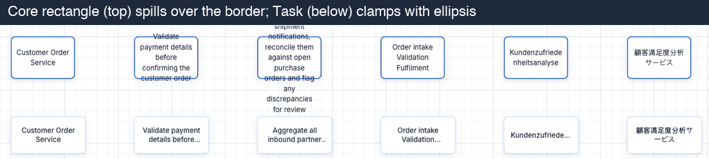
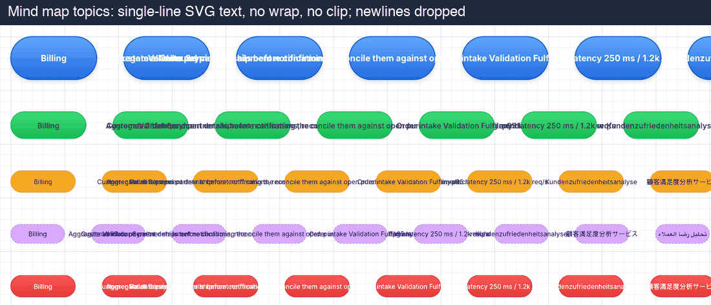
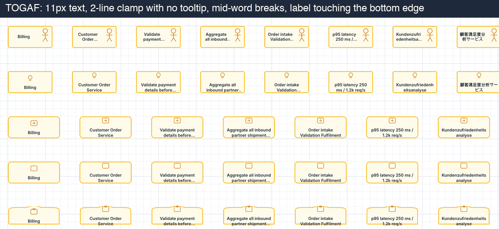
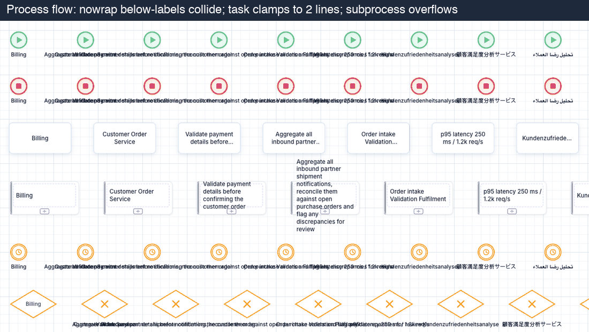
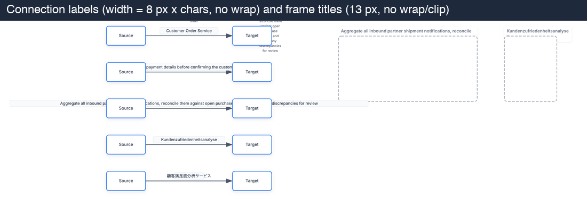
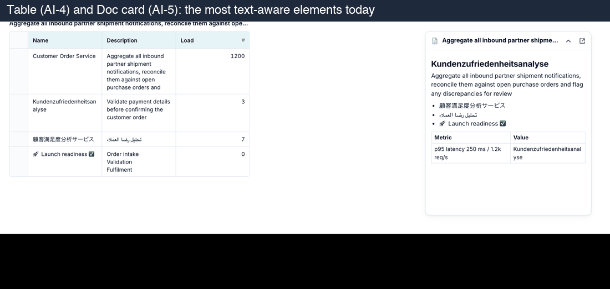
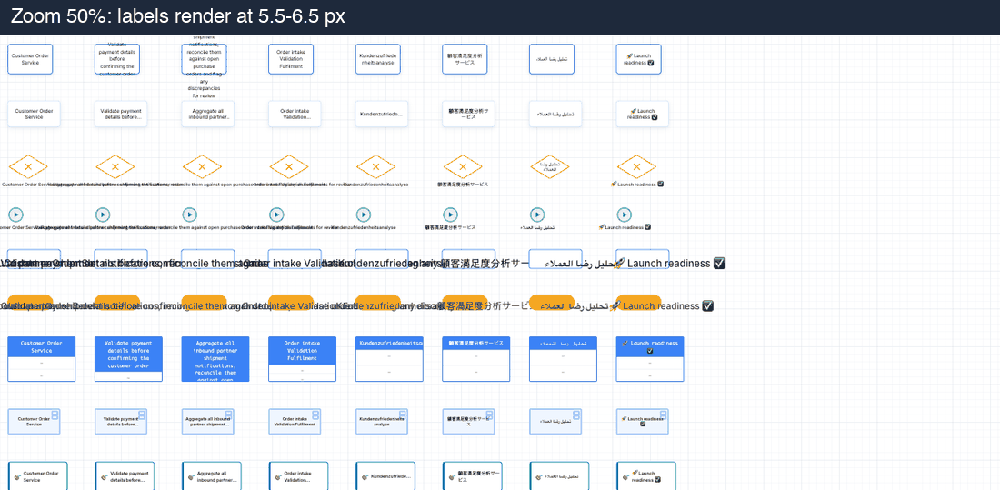
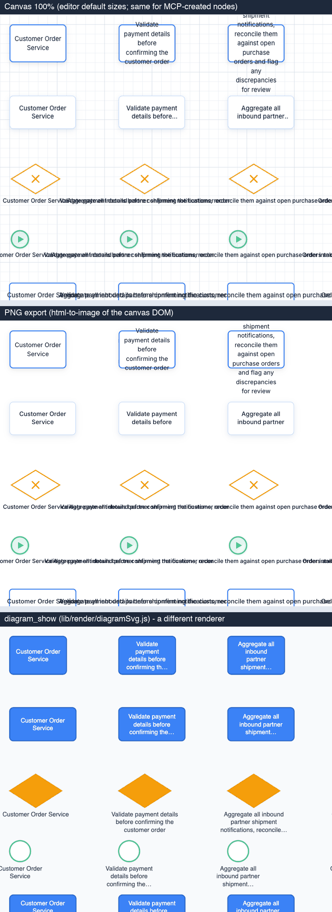
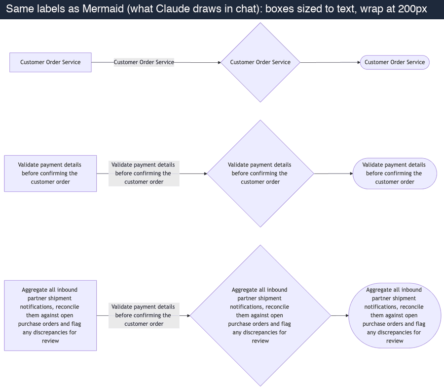

# Text rendering audit: labels on the canvas, in exports and in diagram_show

- Date: 2026-10-22. Base: `origin/main` at `6e665cf` (P1 presentations merged; P2 presets/themes on `feat/p2-presets-themes`, not merged).
- Trigger (owner, 2026-10-22): "Claude shows graphs way better directly, while the tool has text cut-offs, small text not aligned to the boxes, not autosized etc. That is a tool issue at its core, not a Claude or MCP issue."
- Verdict: **confirmed, and it is structural.** No part of the system knows how big a label is. Every stencil places its text at a fixed size inside a box that was sized before the text existed, and each of the 11 packs handles the overflow in its own way. Claude's own diagrams look better for one reason: a layout engine measures the text first and then draws the box around it.
- Design follow-up: [ADR-0008 text layout and autosizing](../adr/0008-text-layout-and-autosizing.md).

## 1. Method

**Environment.** A dev server on port 3285 (`next dev --webpack`) with a throwaway PostgreSQL database and the QA admin account. Headless Chrome (puppeteer, already a dev dependency) at 1379 × 985, the owner's browser size.

**Gallery.** One board per pack. Each board holds every stencil in the catalog (`packs/catalog/*.js`): 187 stencils. `core/table` and `core/doc` are tested separately because they carry data, not labels. Each stencil appears once per label variant, which gives **1,870 nodes per creation path**. The 10 variants:

| Key   | Label                                                                                                                                           |
| ----- | ----------------------------------------------------------------------------------------------------------------------------------------------- |
| w1    | `Billing`                                                                                                                                       |
| w3    | `Customer Order Service`                                                                                                                        |
| c60   | `Validate payment details before confirming the customer order` (61 chars)                                                                      |
| c140  | `Aggregate all inbound partner shipment notifications, reconcile them against open purchase orders and flag any discrepancies for review` (135) |
| ml    | `Order intake⏎Validation⏎Fulfilment` (explicit newlines)                                                                                        |
| num   | `p95 latency 250 ms / 1.2k req/s`                                                                                                               |
| de    | `Kundenzufriedenheitsanalyse` (a long German compound)                                                                                          |
| ja    | `顧客満足度分析サービス`                                                                                                                        |
| ar    | `تحليل رضا العملاء` (RTL)                                                                                                                       |
| emoji | `🚀 Launch readiness ✅`                                                                                                                        |

**Creation paths.**

- (a) **Editor default size.** This is `stencil.defaultSize`, the size the editor uses on drop and on click-to-place (`DiagramCanvas.js:3151`, `:3835-3850`).
- (b) **MCP `map_structure`** (layout `grid`, no sizes; this is what Claude sends).
- (c) **MCP `diagram_apply_ops`** `add_element` without `w`/`h`.

**Measurement.** A script runs in the page for every node. It walks the text nodes that belong to the label and calls `Range.getClientRects()` on each grapheme. It also finds the clip box (every ancestor whose overflow is not `visible`). From these it records:

- characters hidden by a clip;
- characters drawn outside the node box;
- the number of rendered lines;
- words broken across lines;
- the computed font size in screen px at 100% and at 50%;
- line-clamp or ellipsis, and whether a tooltip holds the full label;
- the gap between the text and each edge of the node.

Captures:

- canvas screenshots at 100% and 50%;
- one showcase board (11 representative stencils × 8 variants, plus connection labels, frame titles, a table and a doc card created through MCP), exported through the real Export dialog to **PNG** and **PDF**, and rendered by **`diagram_show`** (the SVG in `_meta`, drawn as an `` the way the MCP app shows it);
- the same labels as **Mermaid**, the format Claude draws in chat.

**Defect codes** (one cell can carry several):

| Code   | Meaning                                                                                                             |
| ------ | ------------------------------------------------------------------------------------------------------------------- |
| **OV** | text is drawn outside the shape and over the border or neighbours                                                   |
| **CL** | characters are hidden by a clip (overflow hidden or line clamp)                                                     |
| **EL** | clipped or ellipsized with **no tooltip or indicator**: the full text cannot be seen                                |
| **NW** | no wrap: a single line that overflows or is cut                                                                     |
| **BL** | the external label (below or above the shape) is wider than the shape and unbounded, so it collides with neighbours |
| **ML** | explicit newlines are dropped                                                                                       |
| **MW** | a word is broken mid-word without a hyphen (e.g. `Kundenzufriede` / `nheitsanalyse`)                                |
| **SM** | font below 11 px at 100% zoom                                                                                       |
| **PD** | text closer than 3 px to the edge                                                                                   |
| **TR** | text truncated in code before rendering                                                                             |

**Limits of the method.**

- The script judges geometry, not taste. Vertical-alignment problems are listed from the screenshots (section 3.6), not from the codes.
- Header-style stencils (UML class, ERD entity) put the label at the top on purpose. The PD and OV codes only apply to them when the text actually touches or crosses an edge.

## 2. Headline numbers

- **Creation path makes no difference.** The editor default size, `map_structure` and `diagram_apply_ops` produced **byte-identical sizes and identical defect matrices** (0 of 1,870 nodes differed). The server uses the stencil default (`lib/mcp/ops.js:35`, `:263-267`; `lib/mcp/structure.js:240-243`), and `map_structure` cannot accept a size. Claude's diagrams look bad here for exactly the same reason a person's do.
- **57% of all cells (1,059 / 1,870) have at least one defect**, and 54% have a defect other than dropped newlines. Every one of the 187 stencils fails at least one variant.
- By variant (stencils that fail):

  | Variant                            | Stencils failing (of 187) |
  | ---------------------------------- | ------------------------- |
  | `Billing`                          | 18                        |
  | `Customer Order Service` (3 words) | 88                        |
  | 60 chars                           | 145                       |
  | 140 chars                          | 172                       |
  | multiline                          | 168                       |
  | numbers                            | 100                       |
  | German compound                    | 167                       |
  | Japanese                           | 83                        |
  | Arabic                             | 32                        |
  | emoji                              | 86                        |

- **Type scale.** At 100% the labels use **10 different font sizes** (9, 10, 11, 12, 12.5, 13, 14, 16, 18, 20 px) and **19 different line heights**. The family is Inter on 1,710 nodes, "Patrick Hand" on 80 (never loaded, so it falls back to Comic Sans or cursive) and Consolas on 80. 70 labels are below 11 px.
- **At 50% zoom 1,849 of 1,870 labels render below 7 px** (median 6 px). There is no level of detail.

| Pack           | Stencils | Cells     | Cells with ≥1 defect | Cells with a defect other than ML | Most frequent                          |
| -------------- | -------- | --------- | -------------------- | --------------------------------- | -------------------------------------- |
| core           | 7        | 70        | 32 (46%)             | 30                                | OV 22, PD 7, MW 7, NW 4                |
| process-flow   | 14       | 140       | 102 (73%)            | 100                               | BL 62, NW 60, OV 23, SM 20             |
| sticky-notes   | 15       | 150       | 53 (35%)             | 41                                | BL 18, NW 17, ML 14, OV 10             |
| cld            | 10       | 100       | 80 (80%)             | 79                                | NW 51, OV 48, SM 30, TR 20             |
| uml-class      | 28       | 280       | 161 (58%)            | 154                               | NW 97, BL 93, OV 33, ML 20             |
| mind-map       | 13       | 130       | 100 (77%)            | 99                                | OV 97, NW 85, ML 13, PD 2              |
| product-design | 24       | 240       | 79 (33%)             | 59                                | CL 25, EL 25, ML 23, NW 14             |
| erd            | 7        | 70        | 23 (33%)             | 21                                | OV 10, CL 9, EL 9, NW 6                |
| togaf          | 37       | 370       | 272 (74%)            | 269                               | CL 119, EL 119, PD 115, OV 47          |
| itil           | 20       | 200       | 102 (51%)            | 97                                | OV 44, PD 37, NW 18, ML 12             |
| capability-map | 12       | 120       | 55 (46%)             | 52                                | CL 48, EL 48, NW 21, ML 11             |
| **all**        | **187**  | **1,870** | **1,059 (57%)**      | **1,001 (54%)**                   | NW 402, OV 348, CL 228, EL 228, BL 191 |

## 3. Top defects

Counts are cells (stencil × variant) out of 1,870, with the number of distinct stencils affected in brackets.

1. **No wrap (NW), 402 cells (98 stencils).**
   - CLD, MindMap, UML actor/use-case and ITIL stakeholder draw one SVG `<text>` line with no wrap (e.g. `MindMapPack.js:277-290`, `CLDPack.js:261-270`).
   - Below-labels use `white-space: nowrap` (`NodeLabels.js:18`).
   - Capability chevrons and pool/lane headers also use `nowrap`.
2. **Text overflows the shape (OV), 348 cells (93 stencils).**
   - The default renderer, used by Core and by every stencil whose `renderNode` returns `null`, has no overflow handling at all (`styles/diagram-studio.css:686-698`, `:740-749`).
   - The text is centred, so it spills over the top and bottom borders.
   - A 140-char label in a 120 × 80 rectangle needs 11 lines: 66 px above the box and 65 px below it.

   
   

3. **Silent clipping (CL + EL), 228 cells (69 stencils), none with a tooltip.**
   - TOGAF (`-webkit-line-clamp: 2`, or 1 for containers; `TOGAFPack.js:861-877`), Capability Map (2), Product Design (2-3), ProcessFlow task (2), UML class header and ERD entity header (`overflow: hidden`).
   - Nothing lets the user see the rest of the text: no `title`, no indicator, no "fit" action.
   - The only label with a tooltip in the whole product is the truncated CLD loop marker (`CLDPack.js:465`).
4. **Unbounded external labels collide (BL), 191 cells (21 stencils).**
   - BPMN events and gateways, UML initial/final/decision nodes and sticky markers put a `nowrap` label below a 30-60 px shape.
   - Neighbouring labels overprint each other (see the process-flow screenshot).
   - The exclusive gateway moves the label below the diamond with a 0.55 em heuristic (`ProcessFlowPack.js:486-496`). The label is still `nowrap` there.
5. **Newlines dropped (ML), 154 stencils.**
   - Only the default renderer (`white-space: pre-wrap`) and a few HTML cards keep `\n`.
   - SVG text and `normal` white-space collapse `Order intake⏎Validation⏎Fulfilment` into one line.
   - The inline editors are single-line `<input type="text">` (`DiagramCanvas.js:698-721`, `:880-905`), so a user cannot type a newline at all. Claude can, through MCP, and its newlines are then thrown away.
6. **Padding and vertical placement (PD), 185 cells (56 stencils).**
   - TOGAF puts an icon above the text and sets the label at 11 px with 4 px padding. Two-line labels end up 1-2 px from the bottom border, and on the 50 px-tall service stencils they cross the rounded bottom edge.
   - ITIL `svc-*` labels touch the edges for the same reason.
   - DataStore (`top: 55%`) and DataObject (`bottom: 4`) are pinned to positions, not centred (`ProcessFlowPack.js:689`, `:730`).

   

7. **Mid-word breaks (MW), 73 cells (69 stencils).**
   - `overflow-wrap: break-word` or `anywhere` breaks `Kundenzufriedenheitsanalyse` wherever it runs out of room, with no hyphen: `Kundenzufriede|nheitsanalyse`.
   - The German compound fails in **167 of 187 stencils** (MW, CL, OV or NW).
   - Default widths of 120-140 px cannot hold a 185 px word at 13 px. Nothing grows the box to the longest word.
8. **Small text (SM): 9-10 px in 7 stencils; 11 px in 520 cells.**
   - Hard-coded sizes: DataObject 9 px, DataStore 10 px, CLD table-function 10 px, UML combined-fragment 10 px, ITIL stakeholder 10 px; TOGAF 11 px everywhere.
   - The toolbar's font-size control is read by only 5 renderers. It does nothing for CLD, MindMap, UML, ERD, TOGAF, ITIL, Capability, ProductDesign and Sticky.
9. **Text truncated in code (TR), CLD loops (20 cells).** The loop label is cut to fit a 50 px circle at 9 px, with a `<title>` tooltip. This is the one place that measures text at all, using a glyph-width estimate (`CLDPack.js:10-58`).
10. **Divergence between canvas, export and `diagram_show`** (section 4) and between canvas measurement heuristics (section 5).

### 3.1 Connection labels, frame titles, tables, doc cards, sticky notes

**Connection labels** (`connections/labels/ConnectionLabel.js:104-145`).

- One SVG line at 12 px, with no wrap and no maximum width.
- The background width is `max(48, chars × 8)`. Measured: 176 px for 137 px of text, and 1,080 px for 777 px. For Japanese it is **88 px for 134 px of text**: the text runs out of its own background.
- Long labels run under the source and target nodes.
- The baseline is a `y + 4` guess.

**Frame titles** (`CorePack.js:35-57`).

- Fixed 13 px and not wrapped. They are clipped in the PNG export and run past a narrow frame on the canvas.
- A 1920 × 1080 slide frame gets the same 13 px title.

**Table (AI-4).**

- The most text-aware element. Row heights come from a model of 7 px per char at 12 px (`lib/table/tableModel.js:27`, `:383-395`), which is shared by the canvas, the SVG and the ports.
- Cells clamp at 5 lines with an ellipsis and no tooltip. The title is ellipsized with no tooltip. `overflow-wrap: anywhere` breaks words mid-word (`Kundenzufriedenheitsan|alyse`).

**Doc card (AI-5).** The title is ellipsized **with** a tooltip. The body scrolls with a fade. This is the best-behaved text element.

**Sticky notes.**

- Font size `min(14, max(11, width/12))` in "Patrick Hand", which is never loaded (`StickyNotesPack.js:209-216`).
- No clamp. A 140-char label overflows a 150 px note.

### 3.2 Zoom

The whole canvas is scaled by one CSS transform (`DiagramCanvas.js:5273`). There is no minimum size and no level of detail, so at 50% zoom labels are 5.5-6.5 px.

## 4. Canvas vs PNG/PDF export vs `diagram_show`

**PNG and PDF export** (`export/captureCanvas.js` + `html-to-image`; the PDF is the same raster placed in jsPDF).

- Export clones the live DOM, so it inherits every canvas defect: overflow, collisions, `nowrap`.
- **It is not identical to the canvas either.**
  - Line breaks change. The 140-char rectangle wraps `purchase / orders and flag` on the canvas but `purchase orders / and flag any` in the export.
  - `-webkit-line-clamp` loses its ellipsis. The task shows `details before…` on the canvas and `details before` in the export.
  - The cause is that the clone is laid out again by the browser inside `foreignObject`, with embedded fonts. Nothing pins the line breaks, so any font-metric drift moves them.

**`diagram_show`** (`lib/render/diagramSvg.js`) is a separate renderer.

- **Text.**
  - It wraps with an estimate of 0.56 em per char (`:98-125`) and ellipsizes, so its long labels look _tidier_ than the canvas.
  - It never matches the canvas: different line breaks, different truncation, a system font instead of Inter.
- **Shapes and colours.**
  - It draws only 6 generic shapes, filled with the stencil colour. The canvas draws white cards with coloured borders.
  - UML class compartments, ERD fields, TOGAF icons and BPMN symbols are not drawn (header comment `:5-9`).
- **Layout.**
  - Two long frame titles overprint each other.
  - Connection labels are cut at 60 chars.

**The legacy data-driven SVG exporter** (`ExportManager.js:424-427`, used for version thumbnails and compare) draws every label as one 13 px `sans-serif` line. That makes it a third variant.

So the same board has **three different text layouts**: the canvas DOM, its export clone, and the server SVG. They are produced by four unrelated pieces of text arithmetic:

- CSS layout;
- 0.56 em per char (`diagramSvg`);
- 7 px per char (tables);
- 8 px per char (connection labels).

P2 adds a fifth: 0.52 em per char in `lib/present/textLayout.js` on the P2 branch.

## 5. How accurate is each kind of text arithmetic?

Measured in Chrome with Inter 500 at 13 px (`canvas.measureText` and DOM span width agree to within 0.1 px):

| Label                       | Real width | Per-glyph advance table (no kerning) | 0.56 em per char | 7 px per char (table model) | 8 px per char (connection label) |
| --------------------------- | ---------- | ------------------------------------ | ---------------- | --------------------------- | -------------------------------- |
| Billing                     | 38 px      | 0.0%                                 | +36%             | +42%                        | +49%                             |
| Customer Order Service      | 150        | +0.1%                                | +7%              | +11%                        | +17%                             |
| 61-char sentence            | 389        | +0.4%                                | +14%             | +19%                        | +25%                             |
| Kundenzufriedenheitsanalyse | 185        | +0.2%                                | +6%              | +11%                        | +17%                             |
| 顧客満足度分析サービス      | 145        | −1.0%                                | **−45%**         | −42%                        | −39%                             |
| تحليل رضا العملاء           | 97         | +19.8% (shaping)                     | +28%             | +33%                        | +40%                             |
| 🚀 Launch readiness ✅      | 149        | −3.9%                                | +3%              | +7%                         | +13%                             |
| WWWWWWWWWW / iiiiiiiiii     | 133 / 33   | −2.1% / 0%                           | −45% / +122%     |                             |                                  |

What this shows:

- A **per-glyph advance table** taken from the actual font is within 1% for Latin and CJK and within 4% for emoji.
- It **over**-estimates Arabic, because Arabic letters join (shaping) and the table counts them as separate glyphs. Over-estimating is the safe direction: the box comes out slightly too big, never too small.
- Character-count heuristics are off by −45% to +130%.
- Throughput: measuring 30,000 words with `measureText` took 27 ms.

## 6. Why Claude's own diagrams look better

Rendered from the same labels with Mermaid 11:

1. **The box is sized from the text, never the other way round.** "Customer Order Service" gets a 230 × 54 box and the 135-char label a 260 × 198 box. Diamonds grow (224 → 398 px) to keep the text inside the inscribed square.
2. **One wrap width and one type scale.** Mermaid wraps at about 200 px and uses 16 px everywhere, with the same padding everywhere. Short labels stay on one line and long labels wrap into a readable column.
3. **Edge labels wrap too** and get a background that fits them.
4. **Newlines are kept**, and CJK, Arabic and emoji render at their real widths. Nothing is clipped, so nothing needs an ellipsis.
5. **The layout engine knows the node sizes** (dagre/ELK), so nothing overlaps.

Graphviz, ELK and D2 all follow the same rule: _measure, then size, then lay out_.

The lab does the reverse:

1. pick a box (the stencil default);
2. lay out the boxes (`structureLayout.js` uses `{w, h}` with no label input);
3. leave each renderer to cope with the text.

The fix is to adopt the measure-first rule for the whole product (ADR-0008), not to tune individual stencils.

## 7. Root causes (file:line)

| #   | Root cause                                                                                                                                                                                                                                                                                                                                                                                                                           | Evidence                                                                                                             |
| --- | ------------------------------------------------------------------------------------------------------------------------------------------------------------------------------------------------------------------------------------------------------------------------------------------------------------------------------------------------------------------------------------------------------------------------------------ | -------------------------------------------------------------------------------------------------------------------- |
| R1  | **Nothing measures text to size or lay out a node.** The only measurement is a grow-only height pass after an inline label edit, using a hidden div whose metrics match no renderer (padding 8, line height 1.4, `system-ui`).                                                                                                                                                                                                       | `DiagramCanvas.js:345-375`, `:596-636`                                                                               |
| R2  | **Sizes come from the stencil, never the label**, in the editor (`DiagramCanvas.js:3151`, `:3835-3850`; `PackRegistry.js:80-93`; fallbacks `{120,60}` vs `{120,80}`) and on the server (`lib/mcp/ops.js:35`, `:263-267`; `lib/mcp/structure.js:240-243`; `lib/mcp/placement.js:19-29`). `map_structure` nodes cannot carry a size (`structure.js:179`). Layout engines receive `{w,h}` only (`lib/layout/structureLayout.js:13-19`). | 0 / 1,870 size differences between the paths                                                                         |
| R3  | **About 60 renderNode implementations each lay out text their own way**, using three techniques (single-line SVG `<text>`; HTML with line clamp; HTML with no overflow handling). There is no shared text component. `NodeLabels.js` (`nowrap` below-labels) and `SvgNodeFrame.js` (sizing only) are the only shared helpers.                                                                                                        | pack files, section 3                                                                                                |
| R4  | **Font size, line height, padding and alignment are hard-coded per stencil** (9-20 px, 19 line heights). There are no type-scale or line-height tokens (`styles/diagram-studio-tokens.css:60-73` has spacing and weights only). `element.fontSize`, `textAlign` and `verticalAlign` are read by 5 renderers.                                                                                                                         | `StyleConstants.js:165-220`                                                                                          |
| R5  | **No overflow policy.** Each renderer either spills, clips silently, clamps without a tooltip, or truncates. There is no "fit" mode, no indicator, and no way to see the full text except opening the editor.                                                                                                                                                                                                                        | section 3                                                                                                            |
| R6  | **No line-breaking rules.** `overflow-wrap: break-word/anywhere` (mid-word, no hyphen); `nowrap`; SVG text that cannot wrap; `\n` dropped; single-line editors.                                                                                                                                                                                                                                                                      | `NodeLabels.js:18`; `.ds-node-label`                                                                                 |
| R7  | **Exports re-layout instead of re-drawing.** html-to-image reflows a DOM clone (line breaks shift; clamp ellipsis lost). `diagram_show` and the legacy SVG exporter have their own wrap estimates and generic shapes.                                                                                                                                                                                                                | `export/captureCanvas.js`, `exportRenderer.js:62-110`, `lib/render/diagramSvg.js:98-125`, `ExportManager.js:379-433` |
| R8  | **Fonts are not deterministic.** Google Fonts CDN (`pages/_document.js:25-31`); "Patrick Hand" is never loaded; `system-ui` is used in the measurement; `diagram_show` falls back to system fonts. P2 self-hosts the OFL fonts (Latin subsets) under `public/fonts`, which is the precondition for shared metrics.                                                                                                                   |                                                                                                                      |
| R9  | **No zoom policy for text.** The canvas is one CSS scale with no minimum size and no level of detail.                                                                                                                                                                                                                                                                                                                                | `DiagramCanvas.js:5270-5278`                                                                                         |

## 8. Full defect matrix (creation path (a); paths (b) and (c) are identical)

Text = render technique (`svg` = SVG `<text>`, `html`; `clampN` = line clamp, `nowrap`/`pre-wrap` = white-space). `·` = no defect.

| Pack | Stencil | Default size | Text | Font px (100%) | w1 | w3 | c60 | c140 | ml | num | de | ja | ar | emoji |
|---|---|---|---|---|---|---|---|---|---|---|---|---|---|---|
| core | frame | 600×400 | html | 13 | · | · | · | · | ML | · | · | · | · | · |
| core | section | 400×300 | html | 11 | · | · | · | · | ML | · | · | · | · | · |
| core | text-block | 200×40 | html,pre-wrap | 13 | · | · | OV | OV | OV | PD | MW PD | · | · | · |
| core | rectangle | 120×80 | html,pre-wrap | 13 | · | · | OV | OV | · | · | MW | · | · | · |
| core | circle | 80×80 | html,pre-wrap | 13 | · | · | OV MW | OV MW | OV MW | PD | MW PD | · | · | PD |
| core | diamond | 80×80 | html | 13 | · | · | OV | OV | PD | OV | OV NW | · | · | PD |
| core | divider | 200×2 | html,pre-wrap | 13 | OV | OV NW | OV | OV | OV | OV | OV MW | OV | OV NW | OV NW |
| process-flow | start-event | 44×44 | html,nowrap | 12 | · | BL NW | BL NW | BL NW | BL NW ML | BL NW | BL NW | BL | BL NW | BL NW |
| process-flow | end-event | 44×44 | html,nowrap | 12 | · | BL NW | BL NW | BL NW | BL NW ML | BL NW | BL NW | BL | BL NW | BL NW |
| process-flow | task | 140×70 | html,clamp2 | 13 | · | · | CL EL | CL EL | CL EL ML | · | CL EL NW | · | · | · |
| process-flow | subprocess | 160×80 | html | 13 | · | · | PD | OV | ML | · | OV NW | · | · | · |
| process-flow | intermediate-event | 44×44 | html,nowrap | 12 | · | BL NW | BL NW | BL NW | BL NW ML | BL NW | BL NW | BL | BL NW | BL NW |
| process-flow | exclusive-gateway | 110×70 | html | 12 | · | BL NW | BL NW | BL NW | BL NW ML | BL NW | BL NW | BL | · | BL NW |
| process-flow | parallel-gateway | 60×60 | html,nowrap | 12 | · | BL NW | BL NW | BL NW | BL NW ML | BL NW | BL NW | BL | BL NW | BL NW |
| process-flow | inclusive-gateway | 60×60 | html,nowrap | 12 | · | BL NW | BL NW | BL NW | BL NW ML | BL NW | BL NW | BL | BL NW | BL NW |
| process-flow | merge | 60×60 | html,nowrap | 12 | · | BL NW | BL NW | BL NW | BL NW ML | BL NW | BL NW | BL | BL NW | BL NW |
| process-flow | pool | 600×300 | html,nowrap | 12 | · | · | OV | OV | · | · | · | · | · | · |
| process-flow | lane | 500×150 | html,nowrap | 12 | · | · | OV | OV | OV | OV | OV | · | · | · |
| process-flow | data-object | 50×65 | html | 9 | SM | SM | OV SM | OV SM | SM | SM PD | OV SM NW | SM PD | SM | SM PD |
| process-flow | data-store | 70×60 | html | 10 | SM | OV SM | OV SM | OV SM | OV SM | OV SM | OV SM NW | OV SM | SM | OV SM |
| process-flow | annotation | 150×60 | html | 12 | · | · | OV | OV | ML | · | OV NW | PD | · | · |
| sticky-notes | sticky-small | 100×100 | html | 11 | · | · | · | OV | · | · | MW | · | · | · |
| sticky-notes | sticky-medium | 150×150 | html | 12.5 | · | · | · | OV | ML | · | MW | · | · | · |
| sticky-notes | sticky-large | 200×200 | html | 14 | · | · | · | · | ML | · | MW | · | · | · |
| sticky-notes | sticky-blue | 150×150 | html | 12.5 | · | · | · | OV | ML | · | MW | · | · | · |
| sticky-notes | sticky-green | 150×150 | html | 12.5 | · | · | · | OV | ML | · | MW | · | · | · |
| sticky-notes | sticky-pink | 150×150 | html | 12.5 | · | · | · | OV | ML | · | MW | · | · | · |
| sticky-notes | sticky-orange | 150×150 | html | 12.5 | · | · | · | OV | ML | · | MW | · | · | · |
| sticky-notes | sticky-purple | 150×150 | html | 12.5 | · | · | · | OV | ML | · | MW | · | · | · |
| sticky-notes | group-box | 300×250 | html | 13 | · | · | · | PD | ML | · | · | · | · | · |
| sticky-notes | section | 500×400 | html | 13 | · | · | · | · | ML | · | · | · | · | · |
| sticky-notes | text-block | 200×60 | html | 14 | · | · | PD | OV | ML | · | PD | · | · | · |
| sticky-notes | circle-marker | 40×40 | html,nowrap | 12 | · | BL NW | BL NW | BL NW | BL NW ML | BL NW | BL NW | BL | BL NW | BL NW |
| sticky-notes | arrow-marker | 60×30 | html,nowrap | 12 | · | BL NW | BL NW | BL NW | BL NW ML | BL NW | BL NW | BL | BL NW | BL NW |
| sticky-notes | image-placeholder | 200×150 | html | 11 | · | · | PD | PD | ML | · | · | · | · | · |
| sticky-notes | link-card | 180×80 | html | 12 | · | · | · | OV | ML | · | OV NW | · | · | · |
| cld | variable | 140×50 | svg,nowrap | 13 | · | OV NW | OV NW | OV NW | OV NW ML | OV NW | OV NW | OV | · | OV NW |
| cld | stock | 100×60 | svg,nowrap | 12 | · | OV NW | OV NW | OV NW | OV NW ML | OV NW | OV NW | OV | · | OV NW |
| cld | flow | 80×40 | svg,nowrap | 11 | · | OV NW | OV NW | OV NW | OV NW ML | OV NW | OV NW | OV | OV NW | OV NW |
| cld | cloud | 60×40 | svg,nowrap | 12 | · | BL NW | BL NW | BL NW | BL NW ML | BL NW | BL NW | BL | BL NW | BL NW |
| cld | reinforcing-loop | 50×50 | svg,nowrap | 9 | TR SM | TR SM | TR SM | TR SM | TR SM ML | TR SM | TR SM | TR SM | TR SM | TR SM |
| cld | balancing-loop | 50×50 | svg,nowrap | 9 | TR SM | TR SM | TR SM | TR SM | TR SM ML | TR SM | TR SM | TR SM | TR SM | TR SM |
| cld | constant | 50×50 | svg,nowrap | 11 | · | OV NW | OV NW | OV NW | OV NW ML | OV NW | OV NW | OV | OV NW | OV NW |
| cld | table-function | 80×50 | svg,nowrap | 10 | SM | OV SM NW | OV SM NW | OV SM NW | OV SM NW ML | OV SM NW | OV SM NW | OV SM | SM PD | OV SM NW |
| cld | system-boundary | 400×300 | svg,nowrap | 12 | · | · | · | OV NW | ML | · | · | · | · | · |
| cld | annotation | 150×60 | svg,nowrap | 11 | · | · | OV NW | OV NW | OV NW ML | OV NW | OV NW | · | · | · |
| uml-class | class | 180×120 | html | 13 | · | · | · | CL EL | · | · | CL EL OV NW | · | · | · |
| uml-class | abstract-class | 180×120 | html | 13 | · | · | · | CL EL | · | · | CL EL OV NW | · | · | · |
| uml-class | interface | 160×100 | html | 13 | · | · | PD | CL EL | · | · | CL EL NW | · | · | · |
| uml-class | enum | 140×100 | html | 13 | · | · | CL EL | CL EL | · | · | CL EL NW | · | · | · |
| uml-class | package | 250×200 | html | 12 | · | · | · | · | ML | · | · | · | · | · |
| uml-class | data-type | 120×60 | html,pre-wrap | 13 | · | · | OV | OV | PD | · | MW | · | · | · |
| uml-class | actor | 60×100 | svg,nowrap | 11 | PD | OV NW | OV NW | OV NW | OV NW ML | OV NW | OV NW | OV | OV NW | OV NW |
| uml-class | use-case | 140×70 | svg,nowrap | 12 | · | PD | OV NW | OV NW | OV NW ML | OV NW | OV NW | · | · | PD |
| uml-class | system-boundary | 400×300 | html | 13 | · | · | · | · | ML | · | · | · | · | · |
| uml-class | initial-node | 30×30 | html,nowrap | 12 | BL | BL NW | BL NW | BL NW | BL NW ML | BL NW | BL NW | BL | BL NW | BL NW |
| uml-class | final-node | 30×30 | html,nowrap | 12 | BL | BL NW | BL NW | BL NW | BL NW ML | BL NW | BL NW | BL | BL NW | BL NW |
| uml-class | flow-final | 30×30 | html,nowrap | 12 | BL | BL NW | BL NW | BL NW | BL NW ML | BL NW | BL NW | BL | BL NW | BL NW |
| uml-class | action | 140×50 | html | 12 | · | · | OV | OV | ML | · | OV NW | · | · | · |
| uml-class | decision | 50×50 | html,nowrap | 12 | · | BL NW | BL NW | BL NW | BL NW ML | BL NW | BL NW | BL | BL NW | BL NW |
| uml-class | fork-join | 150×8 | html,nowrap | 12 | · | · | BL NW | BL NW | BL NW ML | BL NW | BL NW | · | · | · |
| uml-class | swimlane | 200×400 | html | 12 | · | · | · | OV | ML | · | · | · | · | · |
| uml-class | object-node | 100×50 | html,pre-wrap | 13 | · | OV | OV | OV MW | OV | OV | OV MW | · | · | · |
| uml-class | initial-state | 30×30 | html,nowrap | 12 | BL | BL NW | BL NW | BL NW | BL NW ML | BL NW | BL NW | BL | BL NW | BL NW |
| uml-class | final-state | 30×30 | html,nowrap | 12 | BL | BL NW | BL NW | BL NW | BL NW ML | BL NW | BL NW | BL | BL NW | BL NW |
| uml-class | state | 140×80 | html | 12 | · | · | PD | CL EL | ML | · | CL EL NW | · | · | · |
| uml-class | composite-state | 300×200 | html | 12 | · | · | · | · | ML | · | · | · | · | · |
| uml-class | choice | 40×40 | html,nowrap | 12 | · | BL NW | BL NW | BL NW | BL NW ML | BL NW | BL NW | BL | BL NW | BL NW |
| uml-class | history | 30×30 | html,nowrap | 12 | BL | BL NW | BL NW | BL NW | BL NW ML | BL NW | BL NW | BL | BL NW | BL NW |
| uml-class | lifeline | 100×300 | html | 12 | · | · | · | · | · | · | OV NW | · | · | · |
| uml-class | activation | 16×60 | html,nowrap | 12 | BL | BL NW | BL NW | BL NW | BL NW ML | BL NW | BL NW | BL | BL NW | BL NW |
| uml-class | combined-fragment | 300×150 | html | 10 | SM | SM | SM | SM | SM ML | SM | SM | SM | SM | SM |
| uml-class | note | 150×80 | html | 11 | · | · | · | OV | ML | · | MW | · | · | · |
| uml-class | constraint | 140×50 | html,pre-wrap | 13 | · | · | OV | OV | OV | · | MW | · | · | · |
| mind-map | central-topic | 160×80 | svg,nowrap | 16 | · | OV NW | OV NW | OV NW | OV NW ML | OV NW | OV NW | OV | · | OV NW |
| mind-map | main-topic | 140×50 | svg,nowrap | 14 | · | OV NW | OV NW | OV NW | OV NW ML | OV NW | OV NW | OV | · | OV NW |
| mind-map | sub-topic | 120×40 | svg,nowrap | 12 | · | OV NW | OV NW | OV NW | OV NW ML | OV NW | OV NW | OV | · | OV NW |
| mind-map | floating-topic | 100×35 | svg,nowrap | 12 | · | OV NW | OV NW | OV NW | OV NW ML | OV NW | OV NW | OV | · | OV NW |
| mind-map | topic-red | 120×40 | svg,nowrap | 12 | · | OV NW | OV NW | OV NW | OV NW ML | OV NW | OV NW | OV | · | OV NW |
| mind-map | topic-blue | 120×40 | svg,nowrap | 12 | · | OV NW | OV NW | OV NW | OV NW ML | OV NW | OV NW | OV | · | OV NW |
| mind-map | topic-green | 120×40 | svg,nowrap | 12 | · | OV NW | OV NW | OV NW | OV NW ML | OV NW | OV NW | OV | · | OV NW |
| mind-map | topic-purple | 120×40 | svg,nowrap | 12 | · | OV NW | OV NW | OV NW | OV NW ML | OV NW | OV NW | OV | · | OV NW |
| mind-map | callout | 140×60 | svg,nowrap | 11 | · | PD | OV NW | OV NW | OV NW ML | OV NW | OV NW | · | · | PD |
| mind-map | image | 100×80 | svg,nowrap | 12 | · | OV NW | OV NW | OV NW | OV NW ML | OV NW | OV NW | OV | · | OV NW |
| mind-map | link | 120×40 | svg,nowrap | 12 | · | OV NW | OV NW | OV NW | OV NW ML | OV NW | OV NW | OV | · | OV NW |
| mind-map | boundary | 250×200 | svg,nowrap | 11 | · | · | OV NW | OV NW | ML | · | · | · | · | · |
| mind-map | summary | 30×100 | svg,nowrap | 11 | OV | OV NW | OV NW | OV NW | OV NW ML | OV NW | OV NW | OV | OV NW | OV NW |
| product-design | insight-card | 160×100 | html,clamp3 | 12 | · | · | CL EL | CL EL | ML | · | MW | · | · | · |
| product-design | action-card | 160×100 | html,clamp3 | 12 | · | · | CL EL | CL EL | ML | · | MW | · | · | · |
| product-design | pain-point | 160×100 | html,clamp3 | 12 | · | · | CL EL | CL EL | ML | · | MW | · | · | · |
| product-design | opportunity-card | 160×100 | html,clamp3 | 12 | · | · | CL EL | CL EL | ML | · | MW | · | · | · |
| product-design | quote-card | 160×100 | html,clamp3 | 12 | · | · | CL EL | CL EL | ML | · | MW | · | · | · |
| product-design | outcome-node | 220×80 | html,clamp2 | 12 | · | · | CL EL | CL EL | ML | · | CL EL NW | · | · | · |
| product-design | opportunity-node | 180×70 | html,clamp2 | 12 | · | · | CL EL | CL EL | ML | · | CL EL NW | · | · | · |
| product-design | solution-node | 160×60 | html,clamp2 | 12 | · | · | CL EL | CL EL | CL EL ML | · | CL EL NW | · | · | · |
| product-design | experiment-node | 150×55 | html,clamp2 | 12 | · | · | CL EL | CL EL | CL EL ML | · | CL EL NW | · | · | · |
| product-design | quadrant-zone | 400×300 | html | 11 | · | · | · | · | ML | · | · | · | · | · |
| product-design | lane-zone | 800×100 | html | 11 | · | · | · | PD | ML | · | · | · | · | · |
| product-design | phase-container | 200×500 | html | 11 | · | · | · | · | ML | · | OV NW | · | · | · |
| product-design | column-zone | 220×500 | html | 11 | · | · | · | PD | ML | · | · | · | · | · |
| product-design | section-zone | 350×180 | html | 11 | · | · | · | · | ML | · | · | · | · | · |
| product-design | persona-header | 720×120 | html | 18 | · | · | · | · | ML | · | · | · | · | · |
| product-design | touchpoint | 140×60 | html | 11 | · | · | OV | OV | · | · | CL EL NW | · | · | · |
| product-design | emotion-point | 40×40 | html,nowrap | 12 | · | BL NW | BL NW | BL NW | BL NW ML | BL NW | BL NW | BL | BL NW | BL NW |
| product-design | scored-item | 180×50 | html | 12 | · | · | PD | OV | ML | · | MW | · | · | · |
| product-design | yellow-card | 140×100 | html | 12 | · | · | · | OV | ML | · | MW | · | · | · |
| product-design | blue-card | 140×100 | html | 12 | · | · | · | OV | ML | · | MW | · | · | · |
| product-design | green-card | 140×100 | html | 12 | · | · | · | OV | ML | · | MW | · | · | · |
| product-design | pink-card | 140×100 | html | 12 | · | · | · | OV | ML | · | MW | · | · | · |
| product-design | orange-card | 140×100 | html | 12 | · | · | · | OV | ML | · | MW | · | · | · |
| product-design | purple-card | 140×100 | html | 12 | · | · | · | OV | ML | · | MW | · | · | · |
| erd | entity | 200×160 | html | 13 | · | · | · | CL EL | ML | · | CL EL OV NW | · | · | · |
| erd | weak-entity | 200×140 | html | 13 | · | · | · | CL EL | ML | · | CL EL OV NW | · | · | · |
| erd | view | 180×100 | html | 13 | · | · | · | CL EL | · | · | CL EL NW | · | · | · |
| erd | junction | 160×100 | html | 13 | · | · | CL EL | CL EL | · | · | CL EL OV NW | · | · | · |
| erd | attribute | 100×50 | html | 11 | · | · | OV | OV | PD | · | OV NW | · | · | · |
| erd | relationship-chen | 100×80 | html | 13 | · | · | OV | OV | PD | PD | OV NW | · | · | · |
| erd | erd-note | 150×80 | html,pre-wrap | 13 | · | · | PD | OV | · | · | MW | · | · | · |
| togaf | business-actor | 120×60 | html,clamp2 | 11 | · | CL EL | CL EL | CL EL | CL EL ML | CL EL | CL EL MW | · | · | · |
| togaf | business-role | 120×60 | html,clamp2 | 11 | · | PD | CL EL | CL EL | CL EL ML | PD | MW PD | PD | · | PD |
| togaf | business-process | 140×60 | html,clamp2 | 11 | · | PD | CL EL | CL EL | ML PD | PD | MW PD | PD | · | PD |
| togaf | business-function | 140×60 | html,clamp2 | 11 | · | PD | CL EL | CL EL | ML PD | PD | MW PD | PD | · | PD |
| togaf | business-service | 140×50 | html,clamp2 | 11 | · | OV | CL EL OV | CL EL OV | OV ML | OV | OV MW | OV | · | OV |
| togaf | business-object | 120×60 | html,clamp2 | 11 | · | PD | CL EL | CL EL | CL EL ML | PD | MW PD | PD | · | PD |
| togaf | product | 140×80 | html,clamp1 | 12 | · | CL EL NW | CL EL NW | CL EL NW | CL EL NW ML | CL EL NW | CL EL NW | CL EL | · | CL EL NW |
| togaf | contract | 120×60 | html,clamp2 | 11 | · | PD | CL EL | CL EL | CL EL ML | PD | MW PD | PD | · | PD |
| togaf | application-component | 140×70 | html,clamp2 | 11 | · | · | CL EL | CL EL | ML | · | MW | · | · | · |
| togaf | application-service | 140×50 | html,clamp2 | 11 | · | OV | CL EL OV | CL EL OV | OV ML | OV | OV MW | OV | · | OV |
| togaf | application-interface | 100×50 | html,clamp2 | 11 | · | OV | CL EL OV | CL EL OV | CL EL OV ML | CL EL OV | OV MW | OV | · | OV |
| togaf | application-function | 140×60 | html,clamp2 | 11 | · | PD | CL EL | CL EL | ML PD | PD | MW PD | PD | · | PD |
| togaf | data-object | 120×60 | html,clamp2 | 11 | · | PD | CL EL | CL EL | CL EL ML | PD | MW PD | PD | · | PD |
| togaf | node | 140×70 | html,clamp1 | 12 | · | CL EL NW | CL EL NW | CL EL NW | CL EL NW ML | CL EL NW | CL EL NW | CL EL | · | CL EL NW |
| togaf | device | 120×60 | html,clamp2 | 11 | · | PD | CL EL | CL EL | CL EL ML | PD | MW PD | PD | · | PD |
| togaf | system-software | 140×60 | html,clamp2 | 11 | · | · | CL EL | CL EL | ML | · | MW | · | · | · |
| togaf | technology-service | 140×50 | html,clamp2 | 11 | · | OV | CL EL OV | CL EL OV | OV ML | OV | OV MW | OV | · | OV |
| togaf | artifact | 100×60 | html,clamp2 | 11 | · | PD | CL EL | CL EL | CL EL ML | CL EL | MW PD | PD | · | PD |
| togaf | communication-network | 160×40 | html,clamp2 | 11 | OV | OV NW | CL EL OV | CL EL OV | OV ML | OV | OV MW | OV | OV NW | OV NW |
| togaf | stakeholder | 120×60 | html,clamp2 | 11 | · | CL EL | CL EL | CL EL | CL EL ML | CL EL | CL EL MW | · | · | · |
| togaf | driver | 120×60 | html,clamp2 | 11 | · | PD | CL EL | CL EL | CL EL ML | PD | MW PD | PD | · | PD |
| togaf | assessment | 120×60 | html,clamp2 | 11 | · | PD | CL EL | CL EL | CL EL ML | PD | MW PD | PD | · | PD |
| togaf | goal | 120×60 | html,clamp2 | 11 | · | PD | CL EL | CL EL | CL EL ML | PD | MW PD | PD | · | PD |
| togaf | outcome | 120×60 | html,clamp2 | 11 | · | PD | CL EL | CL EL | CL EL ML | PD | MW PD | PD | · | PD |
| togaf | principle | 120×60 | html,clamp2 | 11 | · | PD | CL EL | CL EL | CL EL ML | PD | MW PD | PD | · | PD |
| togaf | requirement | 120×60 | html,clamp2 | 11 | · | PD | CL EL | CL EL | CL EL ML | PD | MW PD | PD | · | PD |
| togaf | constraint | 120×60 | html,clamp2 | 11 | · | PD | CL EL | CL EL | CL EL ML | PD | MW PD | PD | · | PD |
| togaf | resource | 120×60 | html,clamp2 | 11 | · | PD | CL EL | CL EL | CL EL ML | PD | MW PD | PD | · | PD |
| togaf | capability | 140×60 | html,clamp2 | 11 | · | PD | CL EL | CL EL | ML PD | PD | MW PD | PD | · | PD |
| togaf | value-stream | 160×50 | html,clamp2 | 11 | · | · | CL EL OV | CL EL OV | OV ML | OV | OV MW | · | · | · |
| togaf | course-of-action | 140×60 | html,clamp2 | 11 | · | PD | CL EL | CL EL | ML PD | PD | MW PD | PD | · | PD |
| togaf | work-package | 140×60 | html,clamp2 | 11 | · | PD | CL EL | CL EL | ML PD | PD | MW PD | PD | · | PD |
| togaf | deliverable | 120×60 | html,clamp2 | 11 | · | PD | CL EL | CL EL | CL EL ML | PD | MW PD | PD | · | PD |
| togaf | plateau | 200×100 | html,clamp1 | 12 | · | · | CL EL NW | CL EL NW | CL EL NW ML | CL EL NW | CL EL NW | · | · | · |
| togaf | gap | 120×60 | html,clamp2 | 11 | · | PD | CL EL | CL EL | CL EL ML | PD | MW PD | PD | · | PD |
| togaf | grouping | 250×180 | html,clamp1 | 12 | · | · | CL EL NW | CL EL NW | ML | · | · | · | · | · |
| togaf | location | 200×150 | html,clamp1 | 12 | · | · | CL EL NW | CL EL NW | CL EL NW ML | CL EL NW | CL EL NW | · | · | · |
| itil | svc-engage | 140×70 | html | 12 | · | PD | OV | OV | ML PD | PD | OV NW | PD | · | PD |
| itil | svc-plan | 140×70 | html | 12 | · | PD | OV | OV | ML PD | PD | OV NW | PD | · | PD |
| itil | svc-design | 140×70 | html | 12 | · | PD | OV | OV | ML PD | PD | OV NW | PD | · | PD |
| itil | svc-obtain | 140×70 | html | 12 | · | PD | OV | OV | ML PD | PD | OV NW | PD | · | PD |
| itil | svc-deliver | 140×70 | html | 12/20 | · | PD | OV | OV | ML PD | PD | OV NW | PD | · | PD |
| itil | svc-improve | 140×70 | html | 12 | · | PD | OV | OV | ML PD | PD | OV NW | PD | · | PD |
| itil | service | 160×80 | html | 13 | · | · | CL EL | CL EL | ML | · | CL EL OV NW | · | · | · |
| itil | practice | 160×80 | html,pre-wrap | 13 | · | · | PD | OV | · | · | MW | · | · | · |
| itil | process | 160×80 | html,pre-wrap | 13 | · | · | PD | OV | · | · | MW | · | · | · |
| itil | incident | 140×70 | html | 12 | · | · | CL EL | CL EL | ML | · | CL EL OV NW | · | · | · |
| itil | problem | 140×70 | html | 12 | · | · | CL EL | CL EL | ML | · | CL EL OV NW | · | · | · |
| itil | known-error | 140×70 | html | 12 | · | · | CL EL | CL EL | ML | · | CL EL OV NW | · | · | · |
| itil | change-request | 140×70 | html,pre-wrap | 13 | · | · | OV | OV | · | · | MW | · | · | · |
| itil | release | 140×70 | html,pre-wrap | 13 | · | · | OV | OV | · | · | MW | · | · | · |
| itil | ci | 140×70 | html | 11 | · | · | OV | OV | ML | · | OV NW | · | · | · |
| itil | cmdb | 200×150 | html,pre-wrap | 13 | · | · | · | · | · | · | MW | · | · | · |
| itil | stakeholder | 80×100 | svg,nowrap | 10 | SM PD | OV SM NW | OV SM NW | OV SM NW | OV SM NW ML | OV SM NW | OV SM NW | OV SM | SM PD | OV SM NW |
| itil | team | 160×80 | html,pre-wrap | 13 | · | · | PD | OV | · | · | MW | · | · | · |
| itil | sla | 120×60 | html,pre-wrap | 13 | · | · | OV | OV | PD | · | MW | · | · | · |
| itil | kpi | 120×60 | html,pre-wrap | 13 | · | · | OV | OV | PD | · | MW | · | · | · |
| capability-map | cap-capability | 160×80 | html,clamp2 | 12 | · | · | CL EL | CL EL | CL EL ML | · | CL EL NW | · | · | · |
| capability-map | cap-capability-group | 280×200 | html | 12 | · | · | · | · | ML | · | · | · | · | · |
| capability-map | cap-value-stream | 180×60 | html,nowrap | 12 | · | CL EL NW | CL EL NW | CL EL NW | CL EL NW ML | CL EL NW | CL EL NW | · | · | · |
| capability-map | cap-value-stage | 140×50 | html,nowrap | 12 | · | CL EL NW | CL EL NW | CL EL NW | CL EL NW ML | CL EL NW | CL EL NW | CL EL | · | CL EL NW |
| capability-map | cap-assessment | 140×70 | html,clamp2 | 12 | · | · | CL EL | CL EL | CL EL ML | CL EL | CL EL NW | · | · | · |
| capability-map | cap-gap | 140×70 | html,clamp2 | 12 | · | · | CL EL | CL EL | CL EL ML | CL EL | CL EL NW | · | · | · |
| capability-map | cap-operating-model | 200×120 | html | 12 | · | · | · | OV | ML | · | OV NW | · | · | · |
| capability-map | cap-resource | 120×60 | html,clamp2 | 12 | · | CL EL | CL EL | CL EL | CL EL ML | CL EL | CL EL NW | CL EL | · | CL EL |
| capability-map | cap-accountability | 120×60 | html,clamp2 | 12 | · | CL EL | CL EL | CL EL | CL EL ML | CL EL | CL EL NW | CL EL | · | CL EL |
| capability-map | cap-initiative | 160×70 | html,clamp2 | 12/14 | · | · | CL EL | CL EL | CL EL ML | · | CL EL NW | · | · | · |
| capability-map | cap-swimlane | 300×400 | html | 12 | · | · | · | · | ML | · | · | · | · | · |
| capability-map | cap-annotation | 160×100 | html,pre-wrap | 11 | · | · | · | OV | · | · | OV NW | · | · | · |

## 9. Reproduction

The harness ran from a scratch directory and is not committed. ADR-0008 T3 turns it into a test.

- The gallery script builds one board per pack through the REST API (path a), `map_structure` (path b) and `diagram_apply_ops` (path c).
- The in-page measurer is about 150 lines: per-grapheme `Range.getClientRects()`, the clip box and the edge gaps.
- The showcase script captures the Export dialog's PNG and PDF blobs, `diagram_show` `_meta.svg` and Mermaid.
